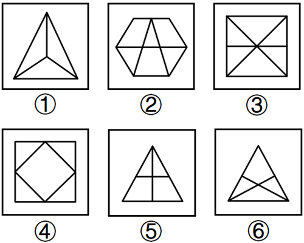

# 数量规律-线与面的数量做差运算（直线数-面数量）

考点：[[20-考点/判断推理/图形推理/数量规律-线与面的数量做差运算（直线数-面数量）|图形推理 / 数量规律-线与面的数量做差运算（直线数-面数量）]]

**问法模型**：‘把六个图形分成两类，使每一类都有各自规律’→ 分组分类题，元素组成不同且属性无规律时，逐项数数量，单一数量无规律则对数量做运算找分组

## 推理链
1. 第1步：六个图形元素组成不同，无对称、封闭、曲直等明显属性规律；题干图形封闭区域明显且全部由直线构成，考虑数量规律
2. 第2步：优先数面，①~⑥面数量依次为3、6、6、5、4、4，单独看无分组规律
3. 第3步：继续数直线，①~⑥直线数依次为6、9、7、8、5、5，单独看同样无分组规律
4. 第4步：对两个数量做减法运算：直线数-面数量，①=6-3=3，②=9-6=3，④=8-5=3；③=7-6=1，⑤=5-4=1，⑥=5-4=1
5. 第5步：图①②④差值均为3为一组，图③⑤⑥差值均为1为一组，与选项A（①②④，③⑤⑥）吻合

**最快解法**：⚡ 数量做差法：先快速数面（3、6、6、5、4、4）发现无规律，立即补数直线（6、9、7、8、5、5），两列纵向相减，差值为3的①②④一组、差值为1的③⑤⑥一组，秒选A

## 易错点
- ⚠ 只数面或只数线，发现单独无规律后转找属性规律而放弃数量运算，错失做差这一核心思路
- ⚠ 数直线时漏数内部交叉线段（如③对角线与中横线易漏、①内部到顶点的3条线段易漏）导致差值算错
- ⚠ 做差方向混乱或误用线+面求和，找不到恒定的分组差值

## 母题抽象
> 🧩 当分组分类题出现‘元素组成不同+封闭区域明显+全直线构成，且面数量、线数量单独看均无规律’的特征时，用‘两个数量做差（或求和）’的方法，验证差值是否恰好把图形分成恒定数值的两类

**同类特征**：六个图形分两类、封闭区域（面）明显、全部由直线构成、面数量单独无规律、直线数量单独无规律、线数-面数差值恒定

## 相关题
- [[10-真题/判断推理/图形推理/2172364 图形推理-数量规律（面数量与外框边数的差值恒定）|2172364]]（江苏 2018，相关度2）
- [[10-真题/判断推理/图形推理/12100999 数量规律-面数量（封闭区域数）|12100999]]（江苏 2025，相关度1）
- [[10-真题/判断推理/图形推理/13504389 图形推理-笔画数（奇点数定一笔画-多笔画）|13504389]]（云南 2025，相关度1）
- [[10-真题/判断推理/图形推理/16070127 数量规律-面数量+面的分级对称性（最大面-中间面-最小面的轴对称遍历）|16070127]]（河南 2026，相关度1）
- [[10-真题/判断推理/图形推理/16593026 图形推理-对称性（轴对称判定，阴影斜线计入图形的干扰）|16593026]]（河北 2024，相关度1）

---

### 题干

把下面的六个图形分成两类，使每一类图形都有各自的规律和特性，分类正确的一项是：

### 选项
- A. ①②④，③⑤⑥　✅
- B. ①②③，④⑤⑥
- C. ①③④，②⑤⑥
- D. ①③⑥，②④⑤

### 官方解析
本题为分组分类题目。元素组成不同，且无明显属性规律，考虑数量规律。题干图形封闭区域明显，优先考虑数面，面数量依次为3、6、6、5、4、4，单独看无规律；继续观察发现，题干图形均由直线构成，考虑数直线，直线数量依次为6、9、7、8、5、5，单独看无规律，考虑二者做运算。图①②④中，直线数-面数量=3，图③⑤⑥中，直线数-面数量=1。即图①②④为一组，图③⑤⑥为一组。
故正确答案为A。

### 给定材料
（无）
