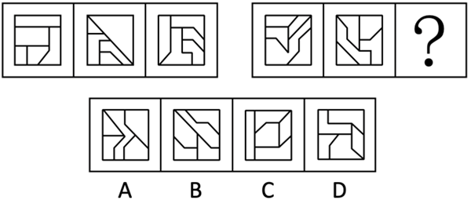
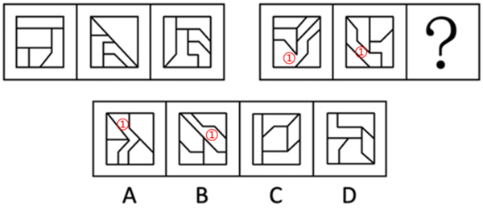

# 数量规律-图形间关系（面相贴-被完全隔开，内部线条部分数）

考点：[[20-考点/判断推理/图形推理/数量规律-图形间关系（面相贴-被完全隔开，内部线条部分数）|图形推理 / 数量规律-图形间关系（面相贴/被完全隔开，内部线条部分数）]]

**问法模型**：两组式（3+3）图形填问号 → 面数量无规律时转向'图形间关系'：比较面的相贴与被隔开情况、内部线条的连通部分数

## 推理链
1. 第1步：题干为两组式图形，元素组成不同且无明显属性规律（对称、曲直等均不成立），先走数量规律路线
2. 第2步：题干图形分割明显，优先数面数量，但两组面数量无对应规律（官方解析：'考虑面数量，但没规律'）
3. 第3步：换角度看图形间关系——第一组三幅图中各面彼此相邻（'面彼此挨在一起'），不存在被完全分隔的区域；第二组前两幅图中均有一个面（面①）将其中1个面与另外3个面完全隔开
4. 第4步：用解析二交叉验证——只看内部线条（不含外框），第一组内部线条连成一部分，第二组内部线条分为两部分，且其中一部分可一笔画
5. 第5步：逐项对照选项，A、C、D的内部线条仍连通为一部分，无'隔开'结构；B项内部线条分成两部分（其中一部分一笔画），且存在将1个面与另外3个面完全隔开的区域
6. 第6步：问号处与第二组规律一致，只有B项符合，故选B

**最快解法**：⚡ 内部线条连通性排除法：数面无规律后，只观察'框内线条连成几部分'——第一组三图均连为一部分，第二组前两图均分为两部分，直接在选项中找内部线条分两部分的图形，秒选B

## 易错点
- ⚠ 只停留在数面数量，发现无规律就卡住，未切换到'图形间关系/内部线条'这一细分考点
- ⚠ 混淆'面的个数'与'面之间是否被隔开'，忽略某一区域是否将其他面完全分隔成1+3结构
- ⚠ 判断线条部分数时误把外框一起计入，导致连通部分数判断错误

## 母题抽象
> 🧩 当两组式图形分割明显但面数量无规律时，转看图形间关系：比较'面彼此相贴'还是'被某面完全隔开'（等价于内部线条连成一部分还是多部分），问号处补齐第二组特征即可锁定答案

**同类特征**：两组式（3+3）图形、元素组成不同、无属性规律、图形分割明显、面数量无规律、面彼此挨在一起 vs 被1个面完全隔开、内部线条一部分/两部分、其中一部分可一笔画

## 相关题
- [[10-真题/判断推理/图形推理/12561867 数量规律-相同元素的位置关系（对角相对-边邻相邻）分组分类|12561867]]（浙江 2024，相关度1）
- [[10-真题/判断推理/图形推理/14993424 数量规律-元素个数（黑-灰矩形数量等差递增）|14993424]]（选调 2024，相关度1）
- [[10-真题/判断推理/图形推理/16069776 数量规律-面数量（总面数恒定+全直线面数量递减二级规律）|16069776]]（广西 2026，相关度1）
- [[10-真题/判断推理/图形推理/1789602 数量规律-波峰波谷个数差+位置规律（最高波峰与竖轴左右关系）|1789602]]（江苏 2016，相关度1）
- [[10-真题/判断推理/图形推理/18643877 数量规律-切点数（线圆接触关系：相切-相交-相离）|18643877]]（四川 2026，相关度1）

---

### 题干

从所给的四个选项中，选择最合适的一个填入问号处，使之呈现一定的规律性：

### 选项
- A. A
- B. B　✅
- C. C
- D. D

### 官方解析

解析一：元素组成不同，且无明显属性规律，考虑数量规律。观察发现，题干图形分割明显，考虑面数量，但没规律；继续观察发现，题干图形均由多个面拼接而成，考虑图形间关系。第一组图中，面彼此挨在一起，第二组图形中，面①将其中1个面和另外3个面完全隔开，只有B项符合。

解析二：元素组成不同，且无明显属性规律，考虑数量规律。观察发现，题干图形分割明显，考虑面数量，但没规律；继续观察发现，只考虑内部线条的情况下，第一组图的内部线条为一部分，第二组图的内部线条为两部分，且有一部分线条是一笔画，只有B项符合。

故正确答案为B。

### 给定材料
（无）
