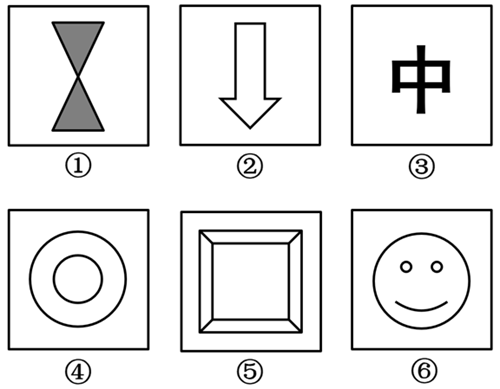

# 属性规律-对称性（轴对称与中心对称组合分组）

考点：[[20-考点/判断推理/图形推理/属性规律-对称性（轴对称与中心对称组合分组）|图形推理 / 属性规律-对称性（轴对称与中心对称组合分组）]]

**问法模型**：六个图形分两类使每类有共同特征 → 元素组成不同时优先用属性规律（对称性）进行分组分类

## 推理链
1. 第1步：六个图形元素组成各不相同（沙漏、箭头、汉字'中'、同心圆、回字方框、笑脸），优先考虑属性规律
2. 第2步：图形均较为规整，按对称性逐一判定——先看是否轴对称（沿某直线对折重合），再看是否中心对称（旋转180°与原图重合）
3. 第3步：①双三角沙漏形沿竖轴、横轴对折均重合，旋转180°后与原图重合；④同心圆、⑤回字形方框同理，旋转180°均与原图重合
4. 第4步：②向下箭头仅沿竖轴对折重合，旋转180°后箭头朝上不重合；③'中'仅沿竖轴对折重合，旋转180°后与原图不重合；⑥笑脸仅沿竖轴对折重合，旋转180°后眼睛、嘴部位置关系改变
5. 第5步：归纳分组——①④⑤为既轴对称又中心对称图形，②③⑥为仅轴对称图形，与选项C（①④⑤，②③⑥）吻合

**最快解法**：⚡ 对称性两步口诀：'对折找轴、旋转验中心'——把①④⑤分别旋转180°，均与原图完全重合（既轴又中心对称）；把②③⑥旋转180°，箭头朝向、笔画、五官位置均改变（仅轴对称），快速锁定C

## 易错点
- ⚠ 把⑤回字形误判为仅中心对称而漏看其轴对称性，导致两组错分
- ⚠ 对③'中'字形凭书写直觉误判其为中心对称，应以题干图形实际笔画结构为准（旋转180°后与原图不重合）
- ⚠ 把⑥笑脸的两只眼睛误看作对称轴倾斜依据，忽略其仅沿竖直轴对称、旋转180°后五官位置关系改变

## 母题抽象
> 🧩 当分组分类题的图形元素组成不同且整体规整时，用属性规律中的对称性分组：沿直线对折重合为轴对称，旋转180°重合为中心对称，按'仅轴对称/既轴又中心对称'两类验证选项

**同类特征**：分组分类问法、元素组成不同、图形规整、对称特征明显、两类各三个图形、轴对称与中心对称组合辨析

## 相关题
- [[10-真题/判断推理/图形推理/10297262 数量规律-面的形状种类（封闭面种类数分组）|10297262]]（浙江 2025，相关度2）
- [[10-真题/判断推理/图形推理/11367775 属性规律-对称性（对称轴数量等差递减）|11367775]]（江苏 2025，相关度2）
- [[10-真题/判断推理/图形推理/12536392 数量规律-黑色区域面积（宫格面积折算）|12536392]]（四川 2024，相关度2）
- [[10-真题/判断推理/图形推理/12882156 图形推理-对称性（仅轴对称 vs 既轴对称又中心对称）|12882156]]（黑龙江 2025，相关度2）
- [[10-真题/判断推理/图形推理/17097256 数量规律-交点数（交点数相同再比交点分布位置）|17097256]]（山西 2024，相关度2）

---

### 题干

把下面的六个图形分为两类，使每一类图形都有各自的共同特征或规律，分类正确的一项是：

### 选项
- A. ①②③，④⑤⑥
- B. ①③④，②⑤⑥
- C. ①④⑤，②③⑥　✅
- D. ①②⑥，③④⑤

### 官方解析
本题为分组分类题目。元素组成不同，优先考虑属性规律。观察发现，题干图形均较为规整，考虑对称性。图①④⑤均为既轴对称又中心对称的图形，图②③⑥均为仅轴对称图形，即图①④⑤为一组，图②③⑥为一组。
故正确答案为C。

### 给定材料
（无）
