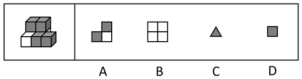

# 截面图-正方体组合体截切（选非题）

考点：[[20-考点/判断推理/图形推理/截面图-正方体组合体截切（选非题）|图形推理 / 截面图-正方体组合体截切（选非题）]]

**问法模型**：“从任一方向剖开，哪一项不可能是该立体图形的截面”→ 选非题：对每个选项构造一个截切平面验证可截性，唯一无法构造的即为答案

## 推理链
1. 第1步：提取结构信息——共7个正方体（3白+4灰），图中可见前排“白、灰、灰”3块与上层2个灰块，按颜色总数推知被遮挡处为后排2个白色块，上层2个灰块正压在后排白块之上，形成台阶式堆叠
2. 第2步：明确截面规则——任一平面与单个凸的正方体只能交出一个连通区域，故截面图中每个同色小区块必然对应一个被截到的该色正方体，要出现n个同色区块至少需要n个该色正方体
3. 第3步：验证B项——B为2×2共4个全白正方形，需4个白色正方体呈2×2相邻排列并被平行于表面的平面同时截过，而题干仅有3个白色正方体，故B不可能截出
4. 第4步：验证A项——用垂直于前表面的平面纵截中列一排（前排灰块+后排白块+其正上方的灰块），截面即2灰1白的L形，A可截出
5. 第5步：验证C项——用平面截任一灰色正方体的一个角（截线穿过共顶点的三条棱），得灰色三角形，C可截出
6. 第6步：验证D项——平行于表面只截最外侧某一个灰色正方体（如最右前的灰块），得单个灰色正方形，D可截出
7. 第7步：A、C、D均可截出，只有B不可截出，本题为选非题，故正确答案为B

**最快解法**：⚡ 数色否定法：B项含4个白色区块，而立体图只有3个白色正方体，每个正方体被截至多贡献1个连通区块，4＞3，直接锁定B为不可能截面，无需逐一构造其余截法

## 易错点
- ⚠ 漏看“不可能”三字，把选非题当选择题去选可截出的图形
- ⚠ 误以为B可由现有3个白块截出，忽略“每个正方体至多贡献一个截面区块”且2×2结构必须有4个白块
- ⚠ 忽略台阶式结构沿列方向纵截可得L形（A项），误以为A也截不出而纠结

## 母题抽象
> 🧩 当题干为“若干有色正方体粘接体+问不可能的截面”时，先数各颜色正方体数量，凡选项中同色区块数超过该颜色块数者即不可能截出；其余选项用“平行面截单块、纵截台阶列、截角得三角形”三类基本截法验证

**同类特征**：多个正方体粘接成组合体、两种颜色（3白+4灰）、台阶式两层堆叠、有被遮挡块、选非题（选不可能截面）、选项图形带颜色分区、考查空间截切能力

## 相关题
（暂无）

---

### 题干

左图为3个白色正方体和4个灰色正方体粘接而成的多面体，将其从任一方向剖开，下面哪一项不可能是该立体图形的截面？

### 选项
- A. A
- B. B　✅
- C. C
- D. D

### 官方解析

本题考查截面图，如下图所示，A、C、D三项均可截出，只有B项无法截出。

本题为选非题，故正确答案为B。

### 给定材料
（无）
