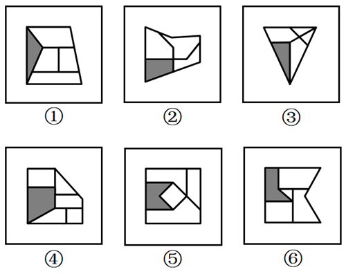

# 数量规律-灰色多边形边数与白色面数量的差值运算分组

考点：[[20-考点/判断推理/图形推理/数量规律-灰色多边形边数与白色面数量的差值运算分组|图形推理 / 数量规律-灰色多边形边数与白色面数量的差值运算分组]]

**问法模型**：六个图形分为两类、每类各有共同规律 → 分组分类题，元素组成不同先看属性、属性无规律转数量，单一数量无规律时对多个数量特征做加减运算找分组

## 推理链
1. 第1步：六幅图元素组成不同，无对称、封闭等明显属性规律，且每幅图都含一个灰色多边形和被线条分割出的多个白色面，转向数量规律
2. 第2步：先数灰色多边形的边数，①②③④⑤⑥依次为3、4、3、4、5、5，呈3/4/5混杂，单独无法分成两组
3. 第3步：再数白色面的数量，依次为4、3、4、5、4、4，单独看同样无分组规律
4. 第4步：两个数量单独均无效，考虑对'灰色多边形边数'与'白色面数量'做差运算
5. 第5步：计算白色面数−灰色边数：图①为4−3=+1，图③为4−3=+1，图④为5−4=+1；图②为3−4=−1，图⑤为4−5=−1，图⑥为4−5=−1
6. 第6步：差值为+1的①③④一组，差值为−1的②⑤⑥一组，与选项B完全吻合

**最快解法**：⚡ 数量差运算法：先数灰色多边形边数（3、4、3、4、5、5），再数白色面数（4、3、4、5、4、4），两者单独无规律立刻做差——差为+1的①③④一组、差为−1的②⑤⑥一组，直接选B

## 易错点
- ⚠ 只数出灰色边数或白色面数等单一数量，发现无法分组就放弃，想不到在两个数量特征之间做加减运算
- ⚠ 数白色面时误把灰色多边形占据的区域计入白色面，或漏数被线条分割出的狭小白色区域，导致面数统计偏差
- ⚠ 数灰色多边形边数时漏数与外框重合或被分割线切分的边（如⑥的L形灰色块易被误数成4条边）

## 母题抽象
> 🧩 当题干出现'灰色/阴影图形+内部被线条分割出多个面'且灰色边数、白色面数等单一数量各自无规律时，用'数量间做差运算'方法，验证两组图形的数量差值是否呈现+1/−1等相反常数从而完成分组

**同类特征**：每幅图均含一个灰色多边形、内部被线条分割出多个白色面、元素组成不同且无明显属性规律、单一数量（边数、面数）单独无分组规律、分组分类问法（六图分两类）

## 相关题
- [[10-真题/判断推理/图形推理/14403697 图形推理-数量规律（外框边数与内部元素个数作差恒定分组）|14403697]]（山东 2025，相关度1）
- [[10-真题/判断推理/图形推理/16070177 数量规律-部分数（黑白块分堆-同色连通区域数）|16070177]]（重庆 2026，相关度1）
- [[10-真题/判断推理/图形推理/2262565 数量规律-笔画数（奇点数与一笔画-多笔画）|2262565]]（选调 2016，相关度1）
- [[10-真题/判断推理/图形推理/2423328 图形推理-数量规律（内部线条与外框角端点相接个数）|2423328]]（甘肃 2019，相关度1）
- [[10-真题/判断推理/图形推理/2448487 数量规律-曲直交点数与曲线数的倍数运算关系|2448487]]（国考 2020，相关度1）

---

### 题干

把下面的六个图形分为两类，使每一类图形都有各自的共同特征或规律，分类正确的一项是：

### 选项
- A. ①②③，④⑤⑥
- B. ①③④，②⑤⑥　✅
- C. ①②⑥，③④⑤
- D. ①④⑤，②③⑥

### 官方解析
本题为分组分类题目。元素组成不同，且无明显属性规律，考虑数量规律。观察发现，题干每幅图形均出现灰色多边形，考虑数灰色多边形的边数量。题干图形的灰色多边形的边数量依次为3、4、3、4、5、5，单独数边数无法分为两组。继续观察发现，题干每幅图形中白色面较多，考虑白色面的数量。题干图形中白色面的数量依次为4、3、4、5、4、4，单独看白色面的数量无规律，考虑灰色图形的边数与白色面的数量之间做运算。图①③④的白色面的数量比灰色多边形的边数多1，图②⑤⑥的白色面的数量比灰色多边形的边数少1，即图①③④为一组，图②⑤⑥为一组。
故正确答案为B。

### 给定材料
（无）
