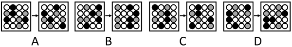

# 位置规律-平移（S形轨迹及方向）

考点：[[20-考点/判断推理/图形推理/位置规律-平移（S形轨迹及方向）|图形推理 / 位置规律-平移（S形轨迹及方向）]]

**问法模型**：问'哪一组与另外三组呈现不同的变化规律'→三同一异模型：先归纳多数组的共同位置规律，再锁定违背该规律的例外组

## 推理链
1. 第1步：四组均为'图1→图2'结构，每组内元素组成相同（黑球、灰球、白球填满方格），优先考虑位置规律而非数量或样式规律
2. 第2步：将方格按S形（蛇形）顺序串成一条固定轨迹，分别标记图1与图2中黑色、灰色小球在轨迹上的位置
3. 第3步：A项中黑球与灰球均沿同一方向的S轨迹平移1格得到图2，变化方式明确
4. 第4步：C、D项同法验证，黑球与灰球同样沿与A相同的S轨迹方向平移1格，规律一致
5. 第5步：B项黑球与灰球虽也平移1格，但所沿S轨迹的方向与A、C、D相反
6. 第6步：三同一异，B组呈现不同变化规律，与官方答案B一致

**最快解法**：⚡ 轨迹描点法：把方格中心按S形（蛇形）顺序连线成固定路径，只盯黑球和灰球两点在路径上的走向——A、C、D均沿同向走1格，B沿反向走1格，直接选B

## 易错点
- ⚠ 只跟踪黑球而忽略灰球，本题黑、灰两球须沿同一S轨迹同步平移才能锁定完整规律
- ⚠ S轨迹走向判断错误（蛇形路径逐行交替行进），把反向平移误判为同向而错选其他项
- ⚠ 习惯按横行/竖列直线平移找规律，走不通后误转数量规律等其他考点，绕远耗时

## 母题抽象
> 🧩 当各组图形元素组成完全相同、仅小球或色块位置变动，且问'哪一组规律不同'时，先按S形等固定轨迹描点比较平移步数与方向，步数相同则比方向，方向相反者即为答案

**同类特征**：元素组成相同、黑/灰/白小球填格、图1→图2箭头相连、求不同规律的一组、平移1格、S形轨迹方向

## 相关题
- [[10-真题/判断推理/图形推理/2172768 位置规律（旋转-翻转）|2172768]]（海南 2021，相关度1）
- [[10-真题/判断推理/图形推理/10204458 位置规律-平移（特征交点沿内圈循环平移）|10204458]]（甘肃 2024，相关度1）
- [[10-真题/判断推理/图形推理/10204614 图形推理-位置规律（旋转+翻转交替循环）|10204614]]（黑龙江 2024，相关度1）
- [[10-真题/判断推理/图形推理/10297399 位置规律—平移（多黑块分组循环平移）|10297399]]（四川 2025，相关度1）
- [[10-真题/判断推理/图形推理/11226892 位置规律-九宫格小元素沿固定循环链移动|11226892]]（上海 2025，相关度1）

---

### 题干

以下四组图形中，哪一组与另外三组呈现不同的变化规律？

### 选项
- A. A
- B. B　✅
- C. C
- D. D

### 官方解析

元素组成相同，优先考虑位置规律。观察发现，A、C、D三项中图1的黑色和灰色小球均以相同的S轨迹（如下图所示）平移1格得到图2，B项中图1的黑色和灰色小球以与其他三项相反的S轨迹（如下图所示）平移1格得到图2，故B项呈现出不同的变化规律。

故正确答案为B。

### 给定材料
（无）
