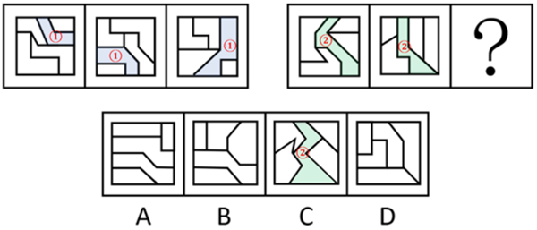

# 图形间关系（面的分隔与相交）＋内部线条部分数-笔画数

考点：[[20-考点/判断推理/图形推理/图形间关系（面的分隔与相交）＋内部线条部分数-笔画数|图形推理 / 图形间关系（面的分隔与相交）＋内部线条部分数/笔画数]]

**问法模型**：两组图类比型问法'选最合适的一个填入问号处'→ 面数量无规律时，转向图形间关系（某面把其余面分隔成几部分、同侧面是否相交）并用内部线条部分数/笔画数双重验证

## 推理链
1. 第1步：两组图形元素组成不同，无对称、曲直等明显属性规律；题干图形均为正方形被内部线条分割、分割明显且由多个面拼接而成，优先考虑数量规律
2. 第2步：先数面数量，第一组三个图形的面数量无一致的递变规律，单纯数面行不通
3. 第3步：细化观察图形间关系：第一组图中，面①将其中1个面与另外3个面完全分隔开，且同侧的3个面彼此相交
4. 第4步：推第二组应满足的规律：存在面②将与之相交的4个面两两分隔开，且同侧的2个面相交
5. 第5步：换角度验证——只看内部线条：第一组内部线条为两部分，两部分的笔画数分别为1和3
6. 第6步：第二组内部线条也应为两部分，且两部分的笔画数分别为2和2
7. 第7步：逐项对照：A、B、D的内部线条部分数/笔画数或面的分隔相交关系不符；C项内部线条为两部分且笔画数分别为2和2，同时满足面②分隔4个面、同侧面相交的关系，故选C

**最快解法**：⚡ 内部线条笔画数法：只看内部线条，第一组为两部分、笔画数1和3，第二组应为两部分、笔画数2和2；快速检验四个选项的内部线条，仅C项是两部分且各为2笔画（连通、无多余奇点），其余选项部分数或笔画数不符，直接锁定C

## 易错点
- ⚠ 只数面总数发现无规律后陷入僵局，没想到从'数量规律'细化转向'图形间关系'（面的分隔与相交）这一考点
- ⚠ 笔画数判断失误：把内部两段线条误当作整体一笔画，或忽略每部分需独立满足一笔画条件（连通且奇点数为0或2）
- ⚠ 只验证'分隔成几部分'就急于选答案，漏掉'同侧的面彼此相交'这一附加条件，易被结构相似但相交关系不符的干扰项迷惑

## 母题抽象
> 🧩 当题干出现'正方形被内部线条分割成多个面、面数量无规律'的特征时，用'图形间关系+内部线条笔画数'双通道验证：看某个面/线条把其余面分隔成几部分、同侧面是否相交，再看内部线条的部分数与各部分笔画数是否成组一致

**同类特征**：元素组成不同、分割明显、多面拼接、面数量无规律、图形间关系：面分隔+同侧相交、内部线条分两部分、笔画数1和3→2和2

## 相关题
- [[10-真题/判断推理/图形推理/13504389 图形推理-笔画数（奇点数定一笔画-多笔画）|13504389]]（云南 2025，相关度2）
- [[10-真题/判断推理/图形推理/2029962 数量规律-数直角（角数量）|2029962]]（四川 2016，相关度2）
- [[10-真题/判断推理/图形推理/10204454 数量规律-部分数（黑白球连通区域数做和）|10204454]]（甘肃 2024，相关度1）
- [[10-真题/判断推理/图形推理/10204604 数量规律-线数量（汉字横线数）|10204604]]（辽宁 2024，相关度1）
- [[10-真题/判断推理/图形推理/10297050 数量规律-特殊计数（线条穿过小白球的数量）|10297050]]（天津 2025，相关度1）

---

### 题干

从所给的四个选项中，选择最合适的一个填入问号处，使之呈现一定的规律性：

### 选项
- A. A
- B. B
- C. C　✅
- D. D

### 官方解析

解析一：元素组成不同，且无明显属性规律，考虑数量规律。观察发现，题干图形分割明显，考虑面数量，但没规律；继续观察发现，题干图形均由多个面拼接而成，考虑图形间关系。第一组图中，面①将其中1个面与另外3个面完全分隔开，且同侧的3个面相交；第二组图形中，面②将与之相交的4个面两两分隔开，且同侧的2个面相交，只有C项符合。

解析二：元素组成不同，且无明显属性规律，考虑数量规律。观察发现，题干图形分割明显，考虑面数量，但没规律；继续观察发现，只考虑内部线条的情况下，第一组图内部的线条为两部分，且两部分的笔画数分别为1和3；第二组图内部的线条为两部分，且两部分的笔画数分别为2和2，只有C项符合。

故正确答案为C。

### 给定材料
（无）
