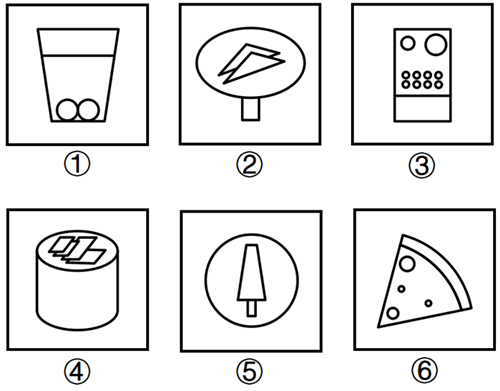

# 样式规律-相同元素遍历之位置关系（圆位于主体图形内部-外部）

考点：[[20-考点/判断推理/图形推理/样式规律-相同元素遍历之位置关系（圆位于主体图形内部-外部）|图形推理 / 样式规律-相同元素遍历之位置关系（圆位于主体图形内部/外部）]]

**问法模型**：六个图形分为两类→先找六图共同重复元素（圆），再比较该元素与主体图形的内外位置关系进行二分

## 推理链
1. 第1步：六图元素组成相似，且均含有相同元素'圆/椭圆'（①杯底两球、②椭圆、③面板上两圆、④柱顶椭圆、⑤外圈圆、⑥披萨上三圆），优先考虑样式规律中的遍历
2. 第2步：遍历无法直接分组，需细化相同元素'圆'与各图主体图形的相对位置（在内还是在外）
3. 第3步：图①圆球在杯子内部、图③圆形在机身矩形内部、图⑥小圆在扇形披萨内部，即①③⑥中圆均位于图形内部
4. 第4步：图②椭圆在外包住纸飞机、图④椭圆（柱顶面）位于装饰物外侧下方、图⑤外圈大圆包住内部小树，即②④⑤中圆均位于图形外部
5. 第5步：按'圆在内/圆在外'分为①③⑥一组、②④⑤一组，对照选项只有C符合

**最快解法**：⚡ 相同元素定位法＋内外位置口诀：先圈出六图共同元素'圆'，再快速看圆被主体包住还是包住主体——①③⑥圆被包在里面，②④⑤圆在外面包住/托住其他图形，秒选C

## 易错点
- ⚠ 只确认'都有圆'就停留在遍历层面，未进一步细化圆与主体的内外位置关系
- ⚠ 把图②的椭圆误当作整体轮廓而非'圆'元素，导致无法归类
- ⚠ 忽略图④中椭圆（圆柱顶面）与上方装饰物的位置关系，误判④中圆在内部

## 母题抽象
> 🧩 当分组分类题中六图含同一重复元素且数量、对称等规律失效时，观察该重复元素与主体图形的相对位置（内部/外部）进行二分

**同类特征**：六图分组分类、相同元素'圆'重复出现、元素组成相似、圆与主体图形的内外位置、样式规律-遍历

## 相关题
- [[10-真题/判断推理/图形推理/2295533 样式规律-元素遍历（图形分层拆解后按行遍历补缺）|2295533]]（上海 2019，相关度2）
- [[10-真题/判断推理/图形推理/5833602 样式规律-遍历（共性元素：四边形）|5833602]]（选调 2020，相关度2）
- [[10-真题/判断推理/图形推理/10204610 样式规律-加减同异（去同存异），九宫格列规律|10204610]]（辽宁 2024，相关度1）
- [[10-真题/判断推理/图形推理/10297349 样式规律-黑白运算|10297349]]（浙江 2025，相关度1）
- [[10-真题/判断推理/图形推理/10297407 样式规律-黑白运算（定义叠加）|10297407]]（四川 2025，相关度1）

---

### 题干

把下面的六个图形分为两类，使每一类图形都有各自的共同特征或规律，分类正确的一项是：

### 选项
- A. ①②④，③⑤⑥
- B. ①②⑥，③④⑤
- C. ①③⑥，②④⑤　✅
- D. ①④⑥，②③⑤

### 官方解析
本题为分组分类题目。元素组成相似，且相同元素“圆”重复出现，优先考虑样式规律中的遍历。观察发现，图①③⑥中的圆均位于图形内部，图②④⑤中的圆均位于图形外部，即图①③⑥为一组，图②④⑤为一组。
故正确答案为C。

### 给定材料
（无）
