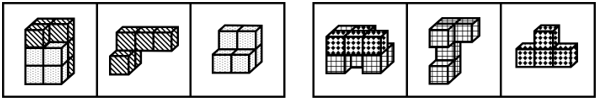

# 立体拼合（小立方体分块拼合还原）

考点：[[20-考点/判断推理/图形推理/立体拼合（小立方体分块拼合还原）|图形推理 / 立体拼合（小立方体分块拼合还原）]]

**问法模型**：两组图对照且第一组满足'图一=图二+图三拼合' → 第二组问号处为与图二凹凸互补、拼合成图一的缺失拼块

## 推理链
1. 第1步：观察第一组图：图一是由小立方体堆叠成的完整立体，图二为L形拼块、图三为小型拼块，均由同规格小立方体构成
2. 第2步：归纳规律——第一组的图一恰好由图二与图三两块在空间中无重叠、无空缺地拼合而成（立体拼合规律）
3. 第3步：将规律迁移到第二组：图一为完整立体，图二为一个弯曲（S/Z形）拼块，问号处应是与图二互补的另一拼块
4. 第4步：解题用'数量守恒+形状互补'：问号处小立方体数量=图一总块数-图二块数，且形状须与图二的缺口凹凸互补（允许旋转/翻转）
5. 第5步：逐项验证：A、C、D的块形与图二拼合后无法还原成图一的轮廓（或块数、形状不互补）
6. 第6步：B项与图二拼合后恰好完整还原第二组图一，符合规律，故选B

**最快解法**：⚡ 立体拼合互补法：先数图一与图二的立方体块数，差值锁定问号处块数；再看图二凸出的'舌头'对应问号处须凹进的'槽'，凹凸互补快速排除，仅B能与图二严丝合缝拼成图一

## 易错点
- ⚠ 只看平面轮廓相似，忽略拼块须在三维空间无重叠、无空缺地咬合
- ⚠ 未考虑拼块放入前可旋转（甚至翻转），只在原图方向上比对而误排正确项
- ⚠ 忽略小立方体数量守恒，凭主观感觉选块数不符的选项

## 母题抽象
> 🧩 当两组图出现'复杂立体=两个简单拼块拼合'的特征时，用'块数守恒+凹凸互补'法，验证问号拼块与已知拼块能否经旋转后无重叠地拼成目标立体

**同类特征**：两组图对照式问法、小立方体堆叠立体、立体拼合、图一为整体、图二图三为分块、问号处求缺失拼块

## 相关题
- [[10-真题/判断推理/图形推理/2776149 图形推理-立体拼合（小方块计数守恒+分层形状咬合）|2776149]]（浙江 2021，相关度1）
- [[10-真题/判断推理/图形推理/10204640 立体拼合（多面体组合：数量守恒+凹凸互补+旋转）|10204640]]（河南 2024，相关度1）
- [[10-真题/判断推理/图形推理/12019797 立体拼合-由两视图及全等小块反推小立体（数小立方体+旋转试装）|12019797]]（浙江 2026，相关度1）
- [[10-真题/判断推理/图形推理/12536475 图形推理-立体拼合（正方体堆叠多面体组合）|12536475]]（四川 2024，相关度1）
- [[10-真题/判断推理/图形推理/12881949 立体拼合-多块拼合正方体（凹凸互补+旋转）|12881949]]（广东 2025，相关度1）

---

### 题干

从所给的四个选项中，选择最合适的一个填入问号处，使之呈现一定的规律性：

### 选项
- A. A
- B. B　✅
- C. C
- D. D

### 官方解析

本题考查立体拼合。第一组图的图一由图二和图三拼合而成，第二组图的图一也应由图二与“？”处图形拼合而成，对应B项。 

故正确答案为B。

### 给定材料
（无）
