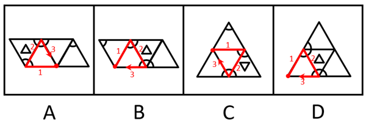

# 空间重构-三棱锥展开图折叠（画边法-公共边关系）

考点：[[20-考点/判断推理/图形推理/空间重构-三棱锥展开图折叠（画边法-公共边关系）|图形推理 / 空间重构-三棱锥展开图折叠（画边法/公共边关系）]]

**问法模型**："还原后有一个与其他三个不一样"的选异问法 → 以统一基准顶点顺时针画边，比较各展开图折叠后图案的相邻关系，找出不一致项

## 推理链
1. 第1步：四个选项均为三棱锥展开图（4个三角形面），面上图案为小三角形（△/▽）和画在棱边上的弧形（扇形），需还原后比较图案相对位置
2. 第2步：按官方统一基准——以'只有两个扇形的面上的空白顶点'为起点，顺时针画边编号（边1为起点后第一条边），保证四个展开图可比
3. 第3步：折叠定位各选项中'图案一样的两个面'：A项为右边两个面，B项为最左与最右两个面，C项为最上与左下两个面，D项为最上与右下两个面
4. 第4步：逐一检验边1折叠后与相同图案面中小扇形的关系
5. 第5步：A项边1不挨着其中任意一个面中的小扇形；B项边1不挨着小扇形；C项边1不挨着小扇形——三项折叠后图案相对位置一致
6. 第6步：D项边1与最上边面中的小扇形有公共点（相挨），与前三项的'不挨'关系矛盾
7. 第7步：前三项一致、D项不同，故与其他三个不一样的是D

**最快解法**：⚡ 画边法：在每项'只有两个扇形的面'上，从空白顶点起顺时针画边；先找出各图'图案相同的两面'，再只看边1是否与这两个面的小扇形相挨——A/B/C均不相挨、D相挨，直接锁定D

## 易错点
- ⚠ 本题是'找不同'选异题，误按常规折纸盒'选正确'思路反向操作
- ⚠ 弧形（扇形）画在棱边上，折叠后其是否与相邻面图案共点/相挨易看错；不统一起点（空白顶点）会导致画边编号混乱、各项不可比
- ⚠ 面内小三角形有△与▽方向之分，忽略图案方向的翻转变化会误判'图案一样的面'的位置

## 母题抽象
> 🧩 当题干出现'多个同类展开图折叠后找一个不同'的特征时，用统一基准（特定面的空白顶点为起点顺时针画边）法，验证各选项关键图案（如小扇形）与公共边的相邻关系是否一致，不一致者即为答案

**同类特征**：三棱锥展开图还原、四选一找不同（选非）、棱边上有扇形/弧形图案、面内有带方向的小三角形图案、存在'图案一样的面'、画边法（空白顶点起点顺时针）

## 相关题
（暂无）

---

### 题干

将下列三棱锥的展开图还原成三棱锥后，有一个与其他三个不一样，请把它找出来。

### 选项
- A. A
- B. B
- C. C
- D. D　✅

### 官方解析

本题考查空间重构。在选项展开图中，以只有两个扇形的面上的空白顶点作为起始点，进行顺时针画边，如下图所示，逐一分析选项。

A项：选项中右边两个面为图案一样的面，边1不挨着其中任意一个面中的小扇形。

B项：选项中最左边和最右边两个面为图案一样的面，边1不挨着其中任意一个面中的小扇形。

C项：选项中最上边和左下边为图案一样的面，边1不挨着其中任意一个面中的小扇形。

D项：选项中最上边和右下边为图案一样的面，边1与最上边面中的小扇形有公共点。

本题为选非题，故正确答案为D。

### 给定材料
（无）
