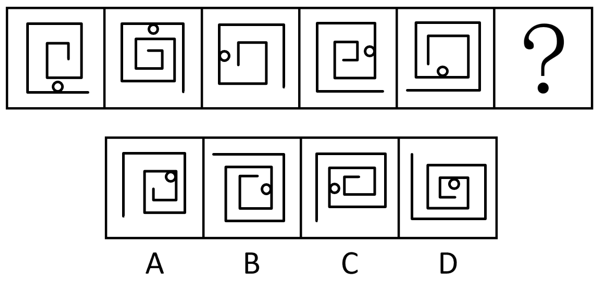

# 功能元素-小白圆标记线条的序号规律

考点：[[20-考点/判断推理/图形推理/功能元素-小白圆标记线条的序号规律|图形推理 / 功能元素-小白圆标记线条的序号规律]]

**问法模型**：每幅图元素组成基本相同且均含1个小白圆 → 采用功能元素标记法，数小白圆标记的是由外向内第几条线

## 推理链
1. 第1步：题干五幅图均由嵌套的回字形/螺旋折线加1个小白圆组成，元素组成基本相同，优先考虑位置或功能元素规律
2. 第2步：小白圆均贴附在某一条线上，判定其为功能元素，作用是标记线条；规定从每幅图最外面的那条线算第1条线，由外向内编号
3. 第3步：逐图核对标记对象：图1小白圆贴着最外层线（第1条），图2贴着第2条，图3贴着第3条，图4贴着第4条，图5贴着第5条，呈1→5依次内推的规律
4. 第4步：按此规律，？处图形的小白圆应只标记第6条线（最内层线）
5. 第5步：逐项对照：A项小白圆标记的不是第6条线，C、D项标记的线条序号也不符；B项小白圆恰好贴在第6条（最内层）线上
6. 第6步：只有B项符合'标记第6条线'的规律，故选B

**最快解法**：⚡ 功能元素标记法+线条序号口诀：从最外线起数'第1条'，快速读出五图小白圆依次标记第1、2、3、4、5条线，直接锁定标记第6条（最内层）线的B项

## 易错点
- ⚠ 数线条的起点定错：若从最内层线开始编号，1→5的递进规律会被破坏，导致误选
- ⚠ 忽略'小白圆只标记1条线'的功能定位，转而观察小白圆在左上/右下等方位找位置规律，误入歧途
- ⚠ 受各选项线条数量、螺旋圈数差异干扰，用线条数或封闭区域数排除而偏离标记对象这一核心

## 母题抽象
> 🧩 当题干图形元素组成基本相同且每幅图都含同一个小元素（小白圆/小三角等）时，用功能元素标记法：先确定小元素标记的对象（线/角/交点/区域），再观察被标记对象按固定顺序（如由外向内）的序号递变规律，在选项中验证该序号

**同类特征**：元素组成基本相同、每图含且仅含1个小白圆、嵌套回字形/螺旋折线结构、小白圆贴附于某条线、标记线条序号逐图递增、问号处延续递推规律

## 相关题
- [[10-真题/判断推理/图形推理/11226890 位置规律（端点沿外框顺时针移动+交点沿内部路径逆时针移动的双轨迹平移）|11226890]]（上海 2025，相关度1）
- [[10-真题/判断推理/图形推理/11226914 图形推理-位置规律（交点沿轨迹移动：定点+动点分轨追踪）|11226914]]（上海 2025，相关度1）
- [[10-真题/判断推理/图形推理/13432277 位置规律（旋转）+数量规律（端点加线递增）复合考点|13432277]]（深圳市考 2025，相关度1）
- [[10-真题/判断推理/图形推理/15419024 位置规律-相邻比较（黑白三角形拼接图中相邻两图相同黑块数恒定）|15419024]]（湖北 2025，相关度1）
- [[10-真题/判断推理/图形推理/16593143 位置规律（多元素分组追踪：平移+旋转）|16593143]]（甘肃 2024，相关度1）

---

### 题干

请从四个选项中选出最恰当的一项填入问号处，使题干图形呈现一定的规律性。

### 选项
- A. A
- B. B　✅
- C. C
- D. D

### 官方解析
元素组成基本相同，题干每幅图形都是由直线和小白圆组成，考虑功能元素的标记作用。观察发现，小白圆只标记1条线，且若把每幅图的最外面那条线当作第1条线，那么小白圆依次标记在第1条线、第2条线、第3条线、第4条线、第5条线上，故？处图形中的小白圆应只标记在第6条线上，只有B项符合。
故正确答案为B。

### 给定材料
（无）
