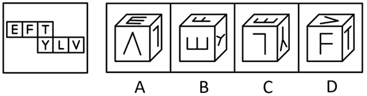
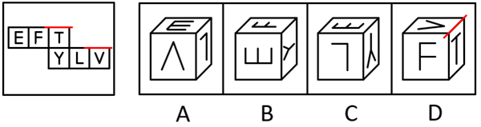

# 空间重构-六面体折叠（特征面字母朝向定位）

考点：[[20-考点/判断推理/图形推理/空间重构-六面体折叠（特征面字母朝向定位）|图形推理 / 空间重构-六面体折叠（特征面字母朝向定位）]]

**问法模型**：问'右边哪一项能由展开图折叠而成' → 空间重构：以字母开口/尖角等方向性细节为锚点，核对相邻面指向逐一排除

## 推理链
1. 第1步：展开图为3+3阶梯型，上排为E、F、T三面，下排为Y、L、V三面，每个面除字母种类外还带方向性信息（E的开口、Y的小开口、V的尖角）
2. 第2步：折叠后相邻面关系不变、字母在面上随折叠整体旋转，故用'某字母的开口/尖角对着哪个面'作为核对标准逐项验证
3. 第3步：A项由E、L、V构成，题干中E面字母的开口对着F面，而选项中E的开口对着L面，指向不符，排除
4. 第4步：B项由E、F、Y构成，题干中Y面字母的小开口对着T面，而选项中Y的小开口对着E面，指向不符，排除
5. 第5步：C项由E、Y、L构成，三个相邻面的组合及字母朝向均与展开图折叠后一致，保留
6. 第6步：D项由F、T、V构成，题干中V面字母的开口对着T面，而选项中V的尖角对着T面，指向不符，排除
7. 第7步：四个选项中仅C项与展开图完全一致，故正确答案为C

**最快解法**：⚡ 特征面锚定法（开口朝向核对）：先认出每个选项的三个字母面，再核对字母开口/尖角指向的相邻面——记住题干三条锚点'E开口对F、Y小开口对T、V开口对T'，与选项指向冲突即秒排，剩下即为答案C

## 易错点
- ⚠ 只核对三个字母的种类组合、忽略字母在面上旋转后的开口/尖角指向，误选面组合相同但朝向错误的选项（如A、B、D的字母组合均真实相邻）
- ⚠ 3+3阶梯型展开图的相邻/相对关系判定出错，把隔一面或相对的面误判为相邻面
- ⚠ 细节特征混淆：Y的'小开口'（两臂分叉处）与V的'尖角'未分清，导致朝向核对出错

## 母题抽象
> 🧩 当六面体展开图各面带有方向性图案（字母开口、箭头、缺口、尖角）时，以图案指向的相邻面为锚点，逐项核对'谁对着谁'，指向不一致的选项一律排除，剩余即为可折叠项

**同类特征**：六面体外表面展开图、3+3阶梯型（上排EFT、下排YLV）、字母面自带开口/尖角方向信息、'哪一项能由它折叠而成'问法、相邻面组合与朝向双重核对、空间重构

## 相关题
- [[10-真题/判断推理/图形推理/11367779 空间重构-六面体折叠（相对面排除＋公共边特征验证）|11367779]]（江苏 2025，相关度2）
- [[10-真题/判断推理/图形推理/16069767 空间重构-组合体表面展开图（公共边法·黑白颜色匹配）|16069767]]（河南 2026，相关度1）
- [[10-真题/判断推理/图形推理/1791642 空间重构-四面体折叠（相邻面公共边法）|1791642]]（江苏 2016，相关度1）
- [[10-真题/判断推理/图形推理/1791644 图形推理-空间重构（四面体折叠-公共边特征线）|1791644]]（江苏 2016，相关度1）
- [[10-真题/判断推理/图形推理/2042114 空间重构-四面体折叠（画箭头法-相邻面相对位置）|2042114]]（江苏 2017，相关度1）

---

### 题干

左边给定的是六面体的外表面展开图，右边哪一项能由它折叠而成？

### 选项
- A. A
- B. B
- C. C　✅
- D. D

### 官方解析

本题考查空间重构，逐一分析选项。

A项：选项由E面、L面与V面构成，题干展开图中E面字母的开口对着F面，而选项中E面字母的开口对着L面，选项与题干展开图不一致，排除；

B项：选项由E面、F面与Y面构成，题干展开图中Y面字母的小开口对着T面，而选项中Y面字母的小开口对着E面，选项与题干展开图不一致，排除；

C项：选项由E面、Y面与L面构成，选项与题干展开图一致，当选；

D项：选项由F面、T面与V面构成，题干展开图中V面字母的开口对着T面，而选项中V面字母的尖角对着T面，选项与题干展开图不一致，排除。

故正确答案为C。

### 给定材料
（无）
