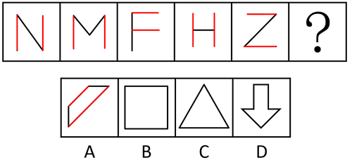

# 数量规律-线的位置关系（平行线组数）

考点：[[20-考点/判断推理/图形推理/数量规律-线的位置关系（平行线组数）|图形推理 / 数量规律-线的位置关系（平行线组数）]]

**问法模型**：图形序列填问号求延续规律→元素组成不同且属性规律无解时转向数量规律；整体数线无规律时，进一步细分观察'平行线组数'这一局部线规律

## 推理链
1. 第1步：题干五图N、M、F、H、Z均为纯直线构成，元素组成不同，对称、开闭、曲直等属性规律在选项中无唯一对应。
2. 第2步：先整体数直线：N、F、H、Z各3条、M为4条，直线数不成常数或等差规律，排除整体线数规律。
3. 第3步：细化到线的位置关系：N、M各含一组平行竖线，F、Z各含一组平行横线，H含一组平行竖线，即每幅图都仅有1组平行线。
4. 第4步：将'每图仅有1组平行线'确立为恒定规律，延伸到问号处。
5. 第5步：逐项清点平行线组数：A项上、下两条长斜边平行且其余边不构成第二组，恰为1组；B项正方形横、竖共2组；C项三角形0组；D项箭头按官方口径不符合'仅有1组'而被排除。
6. 第6步：只有A项与题干'仅有1组平行线'的规律完全一致，故选A。

**最快解法**：⚡ 规律定位法（数平行线组数）：纯直线字母形图形整体数线无规律→立刻转为数'平行线组数'；题干每图恰1组平行线→先排B（2组）、C（0组），再对比A、D锁定恰有1组的A。

## 易错点
- ⚠ 只会整体数直线总数，数不出规律就放弃，漏掉'平行线组数'这一线的位置关系细分考点（本题真正命题点）。
- ⚠ 忽略'仅有1组'的精确限定：B、D其实都含平行线，凭'有平行线'的粗略印象容易误选。
- ⚠ 平行线组数清点错误：正方形是2组而非1组、三角形是0组，必须逐项精确数'组'而不是数'是否有'。

## 母题抽象
> 🧩 当题干为元素组成不同的纯直线简单图形（尤其字母形）、整体线数与属性规律均无解时，改数'平行线组数'这一局部规律，验证各图组数是否恒定（如均为1组），再选组数完全相同的选项。

**同类特征**：元素组成不同、纯直线构成的字母形/简单线条图、整体直线数无规律、每图恰有1组平行线、属性规律（对称/开闭/曲直）无答案、五图连续排列求问号延续规律

## 相关题
- [[10-真题/判断推理/图形推理/10204454 数量规律-部分数（黑白球连通区域数做和）|10204454]]（甘肃 2024，相关度1）
- [[10-真题/判断推理/图形推理/10204604 数量规律-线数量（汉字横线数）|10204604]]（辽宁 2024，相关度1）
- [[10-真题/判断推理/图形推理/10297050 数量规律-特殊计数（线条穿过小白球的数量）|10297050]]（天津 2025，相关度1）
- [[10-真题/判断推理/图形推理/10297127 图形间关系-相交图形中不相交边数量（黑白图形相交）|10297127]]（天津 2025，相关度1）
- [[10-真题/判断推理/图形推理/10297148 数量规律-线的细化（端点连线穿过线条数；备选：平行线组数）|10297148]]（天津 2025，相关度1）

---

### 题干

请从四个选项中选出最恰当的一项填入问号处，使题干图形呈现一定的规律性。

### 选项
- A. A　✅
- B. B
- C. C
- D. D

### 官方解析

元素组成不同，且属性规律没有答案，考虑数量规律。题干图形均由直线构成，考虑直线数，但整体数直线没有规律，继续观察发现，题干每幅图都仅有1组平行线，则？处图形也应仅有1组平行线，只有A项符合。

故正确答案为A。

### 给定材料
（无）

> [!warning] 疑点（官方解析可能有误，待人工复核）
> 从所给图片看，D项箭头的左、右两条竖直边相互平行，两条斜边相交并不平行，严格按'仅有1组平行线'的标准，D项似乎同样满足该规律，与解析'只有A项符合'的排除表述存在张力；可能解析对D另有隐含排除依据或依赖原图画法细节。此疑点仅作提示，不改变官方答案A的既定结论。

<!-- CODEX-ANSWER-REVIEW:BEGIN -->
### 本次独立复核

**复核状态：** `confirmed`（独立复算确认答案）

**计分答案：** A（可计分）

**复核解析：**

题干字母N、M、F、H、Z都只有一个线条方向上存在平行线组：N/M/H是竖向组，F是横向组，Z是斜向组。选项A仅有两条互相平行的斜边，恰为一个方向组。B矩形同时有横向和纵向平行组；C三角形无平行边。D箭头不止一组：竖杆两边平行；横向还有箭杆顶边与箭头肩部水平边平行（肩部虽分列左右，但与顶边分别构成不同平行线对）。因此只有A符合“恰有一组平行线”的规律，答案A。

**相关信息：**

图形推理—数量规律/线的位置关系；平行线“组数”需按不同方向和互不重合的直线对计，不能仅看是否至少存在一对平行边。

**题源依据：** [固定版本原题](https://github.com/Mentat-Uran/kaogongzhentizhengliu/blob/84ab93d4b64b61d897bece8a1c0a5bab06b4feb2/10-%E7%9C%9F%E9%A2%98/%E5%88%A4%E6%96%AD%E6%8E%A8%E7%90%86/%E5%9B%BE%E5%BD%A2%E6%8E%A8%E7%90%86/16095263%20%E6%95%B0%E9%87%8F%E8%A7%84%E5%BE%8B-%E7%BA%BF%E7%9A%84%E4%BD%8D%E7%BD%AE%E5%85%B3%E7%B3%BB%EF%BC%88%E5%B9%B3%E8%A1%8C%E7%BA%BF%E7%BB%84%E6%95%B0%EF%BC%89.md)；固定内容 commit `84ab93d4b64b61d897bece8a1c0a5bab06b4feb2`，Markdown blob `e54834535736687578f4bfaddfa4704ce474eb45`。
<!-- CODEX-ANSWER-REVIEW:END -->
