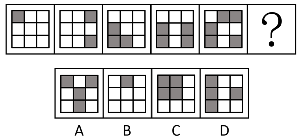
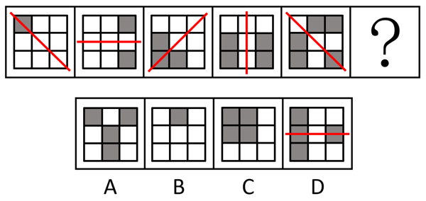

# 属性规律-对称性（轴对称+对称轴方向旋转）

考点：[[20-考点/判断推理/图形推理/属性规律-对称性（轴对称+对称轴方向旋转）|图形推理 / 属性规律-对称性（轴对称+对称轴方向旋转）]]

**问法模型**：问号处填入使题干图形呈现规律性 → 元素组成不同优先看属性规律，定位对称轴及其旋转规律

## 推理链
1. 第1步：题干五图均为3×3方格中涂黑若干格，元素组成不同且整体规整，优先考虑属性规律中的对称性
2. 第2步：逐一确定对称轴——图1仅左上格涂黑，对称轴为'\'对角线；图2右上、右下两格涂黑，上下翻折重合，对称轴为水平中线
3. 第3步：图3涂黑(2,1)(2,2)(3,2)，关于'/'对角线对称；图4涂黑(2,1)(2,3)，关于竖直中线对称；图5涂黑(1,2)(1,3)(2,1)(3,1)，关于'\'对角线对称
4. 第4步：归纳规律——五图均为轴对称图形，且对称轴依次逆时针旋转45°：'\'→水平→'/'→竖直→'\'
5. 第5步：外推问号处：对称轴继续逆时针转45°，应回到水平方向
6. 第6步：逐项对照——A、B仅竖直对称轴，C为'\'对角线对称轴，均排除；D涂黑(1,1)(2,1)(2,3)(3,1)，上下翻折完全重合，为水平对称轴，当选

**最快解法**：⚡ 对称轴标向法：快速描出五图对称轴方向，发现按'\→水平→/→竖直→\'逆时针每次转45°，问号处必须为水平对称轴；A、B竖直、C沿对角线，直接排除锁定D

## 易错点
- ⚠ 只验证'都是轴对称图形'这第一层属性，不继续追踪对称轴方向，因A/B/C同为轴对称而误选
- ⚠ 被涂黑格数1、2、3、2、4的数量变化干扰，去数黑格数量而忽略位置属性规律
- ⚠ 图4黑格(2,1)(2,3)同时满足水平与竖直对称，若错取水平轴会与旋转序列矛盾，须按'\→水→/→竖→\'的连续旋转确定其为竖直轴

## 母题抽象
> 🧩 当题干出现规整的涂色方格/黑白图案且元素组成不同时，先验证轴对称属性，再追踪对称轴方向的等角旋转（常考每次45°逆时针），用问号处所需的对称轴方向排除选项

**同类特征**：3×3方格涂黑、元素组成不同、整体规整、均为轴对称图形、对称轴逆时针每次旋转45°、问号处需水平对称轴

## 相关题
- [[10-真题/判断推理/图形推理/2031008 属性规律（轴对称+对称轴旋转）与数量规律（直线数）综合考查|2031008]]（北京 2017，相关度2）
- [[10-真题/判断推理/图形推理/2045700 属性规律（轴对称、曲直性）+数量规律（面数量等差递增）综合|2045700]]（广州市考 2017，相关度2）
- [[10-真题/判断推理/图形推理/2049850 属性规律-对称性（对称轴与图形线条的 重合-不重合）|2049850]]（山东 2017，相关度2）
- [[10-真题/判断推理/图形推理/2136980 属性规律-轴对称（对称轴数量+对称轴与图形中线条重合的二级辨析）|2136980]]（北京 2018，相关度2）
- [[10-真题/判断推理/图形推理/2188222 属性规律-对称性（轴对称及对称轴方向为竖直）|2188222]]（江西 2018，相关度2）

---

### 题干

请从四个选项中选出最恰当的一项填入问号处，使题干图形呈现一定的规律性。

### 选项
- A. A
- B. B
- C. C
- D. D　✅

### 官方解析

元素组成不同，优先考虑属性规律。题干图形整体比较规整，优先考虑对称性。观察发现，题干图形均为轴对称图形，且对称轴依次逆时针旋转。故？处图形也应为轴对称图形，且对称轴为水平方向，只有D项符合。

故正确答案为D。

### 给定材料
（无）
