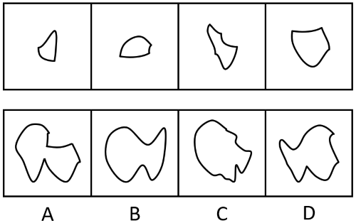
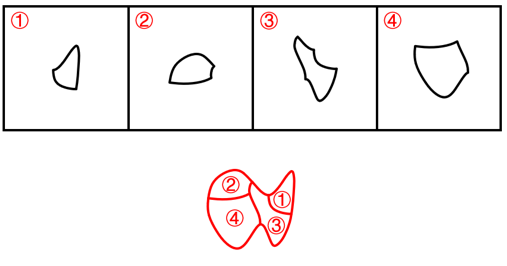

# 图形推理-平面拼合（曲线消去-仅平移拼合）

考点：[[20-考点/判断推理/图形推理/图形推理-平面拼合（曲线消去-仅平移拼合）|图形推理 / 图形推理-平面拼合（曲线消去/仅平移拼合）]]

**问法模型**：四个碎片只能平移拼合成一个整体 → 用'曲线消去法'：凹凸相对、等长同曲率的边贴合后从轮廓中消去，剩余外轮廓与选项逐一比对

## 推理链
1. 第1步：从题干提取前提——四个碎片'只能通过上、下、左、右平移'拼合，即碎片方向不变，拼接边必须等长、等弯曲程度且凹凸相对
2. 第2步：套用平面拼合规则（即官方解析'消去弯曲程度一致且等长的曲线后进行拼合'）：两碎片贴合的边成为内部边被消去，最终外轮廓只由未贴合的边构成
3. 第3步：在碎片间找配对边——上排图1右侧长弧、图2上侧圆弧、图3左侧凹口、图4的宽弧等曲线两两凹凸互补、等长同曲率，可一一贴合
4. 第4步：以最大的碎片为基底，将其余碎片按凹凸互补关系平移嵌入，所有配对曲线成对消去
5. 第5步：归纳消去后剩余的外轮廓特征：顶部为一段连贯的大圆弧，底部形成两个向下的圆弧状凸起，整体呈'上圆下双峰'形
6. 第6步：逐项对照选项——A右上出现直线状缺口方角、C右缘带锯齿碎边（碎片中无对应直线边）、D为上双峰下波浪（凸起方向颠倒），只有B与消去后的轮廓完全一致

**最快解法**：⚡ 曲线消去法（拼合消线）：先取题干中最特殊的凹弧/凸弧在四个碎片间两两配对贴合并消去，再把剩余外轮廓与选项比对，锁定'顶部大圆弧+底部双圆峰'的B

## 易错点
- ⚠ 误认为碎片可以旋转或翻转，题干限定'只能平移'，方向一经改变拼合即失效
- ⚠ 忘记消去贴合的内部曲线，把四个碎片的所有边都计入外轮廓，导致形状对不上
- ⚠ 只看整体大小和面积近似，忽略局部凹凸细节差异（如A的直角缺口、C的锯齿边、D的双峰朝向），误选C或D

## 母题抽象
> 🧩 当题干出现'若干碎片仅通过平移拼合成一个图形'的特征时，用等长同曲率曲线两两消去法：先以最特殊的凹凸边配对贴合，再让剩余外轮廓与选项逐项比对

**同类特征**：平面拼合、只能平移（不可旋转翻转）、碎片凹凸互补、等长等曲率曲线消去、外轮廓比对、四选一找拼合结果

## 相关题
- [[10-真题/判断推理/图形推理/2172310 平面拼合（平移拼合-平行且等长相消）|2172310]]（江苏 2018，相关度2）
- [[10-真题/判断推理/图形推理/2172553 平面拼合-平行且等长相消法（仅平移拼图）|2172553]]（江苏 2018，相关度2）
- [[10-真题/判断推理/图形推理/2367984 平面拼合（平行且等长相消法）|2367984]]（江苏 2019，相关度2）
- [[10-真题/判断推理/图形推理/2742197 图形推理-平面拼合（平行且等长相消）|2742197]]（江苏 2021，相关度2）
- [[10-真题/判断推理/图形推理/3019154 平面拼合（不旋转平移拼合-边线匹配）|3019154]]（广东 2021，相关度1）

---

### 题干

下边四个图形中，只有一个是由上边的四个图形拼合（只能通过上、下、左、右平移）而成的，请把它找出来。

### 选项
- A. A
- B. B　✅
- C. C
- D. D

### 官方解析

本题考查平面拼合，消去弯曲程度一致且等长的曲线后进行拼合，即可得到轮廓图，即为B项。具体拼合方式如下图所示：

故正确答案为B。

### 给定材料
（无）
