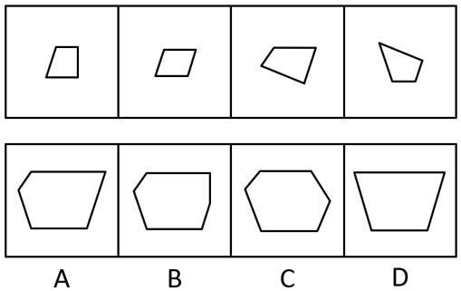
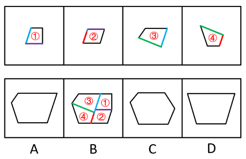

# 图形推理-平面拼合（平移拼合·平行且等长相消）

考点：[[20-考点/判断推理/图形推理/图形推理-平面拼合（平移拼合·平行且等长相消）|图形推理 / 图形推理-平面拼合（平移拼合·平行且等长相消）]]

**问法模型**：四个小图形仅通过平移拼合成一个整体 → 采用'平行且等长相消法'：相邻公共边必平行且等长，相消后剩余线段构成外轮廓，与选项比对

## 推理链
1. 第1步：逐一记录题干四个小图形（直角梯形、平行四边形、不规则四边形、类三角四边形）每条边的方向与长度特征
2. 第2步：依据拼合规则'只能上、下、左、右平移'，图形不可旋转，故各边斜率在拼合前后保持不变
3. 第3步：应用'平行且等长相消'：两个小图形拼合时贴合的公共边必须平行且等长，拼合后内部公共边消失，只保留外轮廓
4. 第4步：将四个小图形中平行且等长的边两两配对相消（如梯形斜边与平行四边形对应斜边、各水平短边相互抵消）
5. 第5步：统计未相消的剩余线段：上部长水平边、左侧斜边、右侧短竖边、下部水平边等，按原方向拼成外轮廓
6. 第6步：逐项对照：D为规则梯形缺左侧转折、C为左右对称六边形、A右侧斜边方向与剩余竖边不符，均与相消结果矛盾
7. 第7步：B项轮廓的各边方向与长度恰好等于四图形全部未相消线段之和，故选B

**最快解法**：⚡ 平行等长相消法：把四个小图形中'平行且等长'的边两两标记相消（即拼合公共边），剩下的边按原方向拼合即得外轮廓，直接匹配B

## 易错点
- ⚠ 忽略'只能平移'限制，若脑中擅自旋转小图形会得出A或C的对称轮廓
- ⚠ 相消时只验证平行而漏验等长（或反之），错消不该消的边导致轮廓边数出错
- ⚠ 误将拼合后的内部公共边保留在轮廓中，误判外轮廓形状

## 母题抽象
> 🧩 当题干出现'多个小图形仅平移拼合成一个大图形'的特征时，用'平行且等长相消法'，验证剩余线段能否与选项轮廓逐边吻合

**同类特征**：平面拼合、只能上、下、左、右平移、四个小图形、只有一个拼合结果、平行且等长相消

## 相关题
- [[10-真题/判断推理/图形推理/16095258 图形推理-平面拼合（平行且等长相消）|16095258]]（江苏 2024，相关度4）
- [[10-真题/判断推理/图形推理/2367808 图形推理-平面拼合（平移拼合·平行且等长相消）|2367808]]（江苏 2019，相关度4）
- [[10-真题/判断推理/图形推理/5697920 图形推理-平面拼合（平移拼合·平行且等长相消）|5697920]]（江苏 2023，相关度4）
- [[10-真题/判断推理/图形推理/10975247 图形推理-平面拼合（平行且等长相消法）|10975247]]（江苏 2024，相关度3）
- [[10-真题/判断推理/图形推理/2172313 平面拼合-平行且等长相消（三角形拼合轮廓）|2172313]]（江苏 2018，相关度3）

---

### 题干

下边四个图形中，只有一个是由上边的四个图形拼合（只能通过上、下、左、右平移）而成的，请把它找出来。

### 选项
- A. A
- B. B　✅
- C. C
- D. D

### 官方解析

本题考查平面拼合，可采用平行且等长相消的方式解题。消去平行且等长的线段后进行组合即可得到轮廓图，即为B项。平行且等长相消的方式如下图所示：

故正确答案为B。

### 给定材料
（无）
