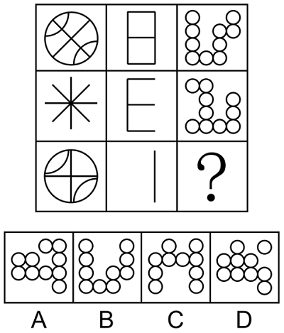

# 样式规律-加减同异（竖列求异-去同存异）

考点：[[20-考点/判断推理/图形推理/样式规律-加减同异（竖列求异-去同存异）|图形推理 / 样式规律-加减同异（竖列求异/去同存异）]]

**问法模型**：九宫格'填入问号使其呈现规律性'→ 横行无规律时转竖列观察，列内相同元素重复出现，优先做样式求异（去同存异）运算

## 推理链
1. 第1步：横行观察第一行'圆内交叉线与弧线、日字格、圆圈组合'与第二行'米字、E形、圆圈组合'，行内图形之间无一致的数量或位置规律，排除横行方向
2. 第2步：竖列观察发现每列元素同构重复：第一列均为线条图形、第二列均为横竖线构成的类字母图形、第三列均为相同小圆圈，锁定样式规律中的'加减同异'
3. 第3步：第一列验证求异：图1（圆+交叉线+弧线）与图2（米字射线）去同存异，重合的射线线条相消，剩下圆和弧线恰好是图3，规律初步成立
4. 第4步：第二列复核：图1'日'字与图2'E'形求异——左侧竖线与上、中、下三横为相同部分相消，仅剩右侧竖线，正对应图3的'丨'，求异规律确认
5. 第5步：第三列应用规律：对图1（U形圆圈组合）与图2（J形圆圈组合）逐位置比对，两图重合的圆圈相消，只出现一次的圆圈保留
6. 第6步：对照选项：A、B、C的圆圈分布与去同存异结果均不符，只有D项与第三列图1、图2相消后的剩余圆圈完全一致，故选D

**最快解法**：⚡ 竖列求异法（去同存异）+验证列前置：先用第二列'日'与'E'求异得'丨'一步确认规律，第三列直接把图1、图2中重合的小圆圈划掉，剩余圆圈比对选项秒选D

## 易错点
- ⚠ 思维定式只在横行找规律，漏掉竖列方向
- ⚠ 求同与求异混淆：应'去同存异'（保留不同部分），误取公共部分会完全做反
- ⚠ 第三列圆圈数量多且选项形近，重合位置看漏易误选B

## 母题抽象
> 🧩 当九宫格每列出现同类元素（相同线条或相同小图形）重复时，先横后竖定方向，用规律最明显的一列验证'求同/求异'运算，再套用到问号所在列

**同类特征**：九宫格3×3、竖列元素同构重复、类字母图形（日、E、丨、U、J）、求异/去同存异、横行无规律、问号在第三列第三行

## 相关题
- [[10-真题/判断推理/图形推理/17097246 位置规律-循环平移（双元素分别沿外框移动，步长等差递增）|17097246]]（山西 2024，相关度1）
- [[10-真题/判断推理/图形推理/2188604 位置规律-动态移动（最外圈顺-逆时针循环+灰块行内平移）|2188604]]（黑龙江 2018，相关度1）
- [[10-真题/判断推理/图形推理/2262564 数量规律-数直线（九宫格按列求和）|2262564]]（选调 2016，相关度1）
- [[10-真题/判断推理/图形推理/2262882 数量规律-面数量（九宫格逐行等差）|2262882]]（选调 2016，相关度1）
- [[10-真题/判断推理/图形推理/2295533 样式规律-元素遍历（图形分层拆解后按行遍历补缺）|2295533]]（上海 2019，相关度1）

---

### 题干

从所给四个选项中，选择最合适的一个填入问号处，使之呈现一定的规律性。

### 选项
- A. A
- B. B
- C. C
- D. D　✅

### 官方解析
九宫格横行观察无规律，但竖着看发现，相同线条重复出现，优先考虑样式规律中的加减同异。第一列图1和图2求异得到图3；经验证，第二列满足此规律；第三列应用此规律，故“？”处应选择图1和图2求异得到的图形，只有D项符合。
故正确答案为D。

### 给定材料
（无）
