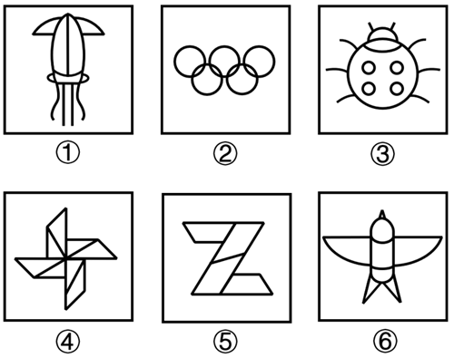

# 属性规律-曲直性（线条种类数：直曲混合 vs 纯直线-纯曲线）

考点：[[20-考点/判断推理/图形推理/属性规律-曲直性（线条种类数：直曲混合 vs 纯直线-纯曲线）|图形推理 / 属性规律-曲直性（线条种类数：直曲混合 vs 纯直线/纯曲线）]]

**问法模型**：六个图形分为两类、每类各有共同规律 → 分组分类题，元素组成不同时优先考虑属性规律（曲直性），再验证数量规律

## 推理链
1. 第1步：六图元素组成不同、且明显有曲有直，优先考虑属性规律中的曲直性
2. 第2步：逐一统计每个图形的线条种类（直线/曲线）：①鱿鱼图既有曲线（触须、轮廓）又有直线（身体中线）→2种
3. 第3步：②奥运五环全部由圆构成→纯曲线1种；③瓢虫躯体为圆（曲线）、腿为直线→2种；④风车全部由直线段构成→纯直线1种；⑤带条纹的Z字形全部由直线构成→纯直线1种；⑥飞机有机身弧线（曲线）也有直线部分→2种
4. 第4步：按线条种类数分组：①③⑥均为2种（有直有曲），②④⑤均为1种（纯曲线或纯直线）
5. 第5步：对照选项，①③⑥一组、②④⑤一组，对应C项

**最快解法**：⚡ 曲直性快速扫描法：逐图判断'是否同时含直线和曲线'——②五环纯曲线、④风车与⑤Z字纯直线（种类数1），①③⑥均直曲混合（种类数2），直接锁定C

## 易错点
- ⚠ 误以为②圆环相交处含直线，其实圆环纯为曲线，需认清②属'纯曲线（种类数1）'而非混合
- ⚠ 先试对称性分组会落空（⑤仅中心对称、④不对称，无对应选项），应及时切换到曲直性规律
- ⚠ 生活化图形（鱿鱼、瓢虫、飞机）诱导去数面数量或元素个数，偏离'线条种类数'这一分组主线

## 母题抽象
> 🧩 当分组分类题图形元素组成不同且图形呈现'有的纯直、有的纯曲、有的直曲混杂'时，统计每个图形的线条种类数（1种 vs 2种）进行分组，并回代选项验证

**同类特征**：元素组成不同、图形有曲有直、生活化图形（鱿鱼/瓢虫/飞机）、纯曲线图形（五环）、纯直线图形（风车/Z字）、六图分两类问法

## 相关题
- [[10-真题/判断推理/图形推理/1746832 数量规律-曲线数（字母字符图形化计数）|1746832]]（国考 2016，相关度2）
- [[10-真题/判断推理/图形推理/2263006 数量规律-曲线条数（线条计数分类）|2263006]]（四川 2016，相关度2）
- [[10-真题/判断推理/图形推理/5832461 对称性-中心对称与轴对称的分组分类|5832461]]（浙江 2021，相关度2）
- [[10-真题/判断推理/图形推理/10204454 数量规律-部分数（黑白球连通区域数做和）|10204454]]（甘肃 2024，相关度1）
- [[10-真题/判断推理/图形推理/10204457 面数量+最大面的对称性（中心对称与轴对称分组）|10204457]]（甘肃 2024，相关度1）

---

### 题干

把下面的六个图形分为两类，使每一类图形都有各自的共同特征或规律，分类正确的一项是：

### 选项
- A. ①②③，④⑤⑥
- B. ①②⑤，③④⑥
- C. ①③⑥，②④⑤　✅
- D. ①④⑥，②③⑤

### 官方解析
解析一：
元素组成不同，优先考虑属性规律。观察发现，题干图形有曲有直，可以考虑曲直性是否存在规律。图①③⑥中，图形的线条种类均为2（图形既有直线又有曲线）；图②④⑤中，图形的线条种类均为1（图形为纯曲线或纯直线），即图①③⑥为一组，图②④⑤为一组。
故正确答案为C。
解析二：
元素组成不同，优先考虑属性规律。观察发现，图①②③⑥均为轴对称图形，图⑤为中心对称图形，图④不是对称图形，没有答案。继续观察发现，题干出现生活化图形且封闭区域明显，考虑数量规律中的面数量。题干图形的面数量依次为7、9、7、8、4、8，图①②③的面数量均为奇数，图④⑤⑥的面数量均为偶数，即图①②③为一组，图④⑤⑥为一组。
故正确答案为A。
注：本题两种规律均不是非常严谨，分组分类按曲直线条种类数和数量奇偶分组考查都较少，大家了解基本解题思路即可，无需作为备考重点。

### 给定材料
（无）

> [!note] 复核版本状态
> 原题不可计分（genuine_multi_answer；来源记录的答案键/竞争项：C、A）；仅当前明确标注的编辑版按答案C计分。
> 详细原题疑点、修订题面、解析和证据见下方独立复核记录。

<!-- CODEX-ANSWER-REVIEW:BEGIN -->
### 本次独立复核

**复核结论：** `resolved`（答案与解析已核定）

**原题计分状态：** 不计分（`genuine_multi_answer`：多个答案均成立）。来源中记录的答案键/竞争项：C、A；这些记录不代表原题已核准答案。

**原题疑点与处理：**

青海 2024 〔20-考点/判断推理/图形推理/属性规律-曲直性（线条种类数：直曲混合 vs 纯直线-纯曲线）〕 — 官方解析二另给出按面数量奇偶分组（①②③为奇数7/9/7，④⑤⑥为偶数8/4/8）可得A项，与正确答案C的曲直规律并存；官方已注明两种规律均不够严谨，但既定正确…

**当前计分版本：** 明确标注的编辑版；未列出的题干、材料或选项沿用固定题源。答案不回填为原题答案。

**计分答案：** C（可计分）

**复核解析：**

固定图中混合直曲线的是①③⑥；仅含曲线或仅含直线的是②④⑤，对应选项C。原图还可按封闭面数奇偶分成另一组，题干没有指定规则，故修订明确以线条曲直性为分类依据。

**修订题干：**

【编辑修订】按线条曲直性分类：同时含直线和曲线的图形为一类，只含直线或只含曲线的图形归为另一类。选择分组正确的一项。

**相关信息：**

图形推理—曲直性分组；先确定每个图形是否同时包含曲线和直线。

**核对依据与来源边界：**

- 固定题源：[原题文件](https://github.com/Mentat-Uran/kaogongzhentizhengliu/blob/84ab93d4b64b61d897bece8a1c0a5bab06b4feb2/10-%E7%9C%9F%E9%A2%98/%E5%88%A4%E6%96%AD%E6%8E%A8%E7%90%86/%E5%9B%BE%E5%BD%A2%E6%8E%A8%E7%90%86/16593051%20%E5%B1%9E%E6%80%A7%E8%A7%84%E5%BE%8B-%E6%9B%B2%E7%9B%B4%E6%80%A7%EF%BC%88%E7%BA%BF%E6%9D%A1%E7%A7%8D%E7%B1%BB%E6%95%B0%EF%BC%9A%E7%9B%B4%E6%9B%B2%E6%B7%B7%E5%90%88%20vs%20%E7%BA%AF%E7%9B%B4%E7%BA%BF-%E7%BA%AF%E6%9B%B2%E7%BA%BF%EF%BC%89.md)；内容版本 `84ab93d4b64b61d897bece8a1c0a5bab06b4feb2`，源 Markdown blob `27388810c7165c0af688b8735a817ec9627cdb00`.
- **核心依据：** 固定题图逐一辨认直线与曲线；①③⑥混合，②④⑤纯线型。
- 固定题图/公式图：`90-图片/题目图/18e46a71a823460.png`.

<!-- CODEX-ANSWER-REVIEW:END -->
