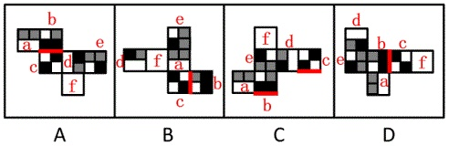

# 空间重构-展开图折叠（相邻面公共边特征）

考点：[[20-考点/判断推理/图形推理/空间重构-展开图折叠（相邻面公共边特征）|图形推理 / 空间重构-展开图折叠（相邻面公共边特征）]]

**问法模型**：问'哪一个展开图折叠成的纸盒和其他三个不一样'→ 对四个展开图中相同图案的面统一标号，用相邻面公共边法逐一比较折叠后相邻关系，找与众不同的选项

## 推理链
1. 第1步：四个展开图均由图案完全相同的面构成（各面都含黑块、灰块、白块），无法用相对面或不同图案排除，只能比较折叠后相邻面的位置细节
2. 第2步：对各选项展开图统一标号（a、b、c…，图案相同的面用相同字母），锁定一对相邻的面b与面c，观察其公共边与面上黑块的紧邻关系
3. 第3步：A项：面b、面c相邻，公共边紧邻面b与面c的黑块
4. 第4步：C项：面b、面c相邻，公共边同样紧邻面b与面c的黑块；D项：情况与A、C一致
5. 第5步：B项：面b、面c相邻，但公共边没有紧邻面b的黑块，折叠后相邻关系与A、C、D不同
6. 第6步：只有B项折叠成的纸盒与其他三个不一样，故正确答案为B

**最快解法**：⚡ 相邻面公共边法：在四个展开图中找图案相同的两个面（面b、面c），沿公共边检查黑块是否紧贴公共边——A/C/D项黑块均紧邻公共边，B项面b的黑块不紧邻公共边，一步锁定B

## 易错点
- ⚠ 四个展开图摆放方向不同，不给相同面重新标号易把旋转后的面误判为不同面，导致公共边找错
- ⚠ 误用相对面规律排除，而本题各面图案相同，真正考点是相邻面公共边与黑块的位置细节
- ⚠ 只检查公共边一侧（只看面b或只看面c），忽略需两侧黑块紧邻情况同时比对，易把C/D误判为不同项

## 母题抽象
> 🧩 当题干给出多个由相同图案面构成的展开图并问'哪个折成的盒子与其他不同'时，先给相同面统一标号，再用相邻面公共边法比较公共边与图案特征（如黑块）的紧邻关系，折叠后相邻关系与众不同者即答案

**同类特征**：纸盒外表面展开图、四个选项对比找不同、各面图案完全相同（含黑块/灰块）、相邻面公共边、折叠后空间关系、选异（选非）类问法

## 相关题
- [[10-真题/判断推理/图形推理/12536419 空间折叠（六面体）-相对面排除与相邻面位置关系（画边法-公共点法）|12536419]]（四川 2024，相关度1）
- [[10-真题/判断推理/图形推理/1791642 空间重构-四面体折叠（相邻面公共边法）|1791642]]（江苏 2016，相关度1）
- [[10-真题/判断推理/图形推理/1805286 空间重构-立体折叠（五棱柱展开图，相邻面黑白关系排除）|1805286]]（上海 2016，相关度1）
- [[10-真题/判断推理/图形推理/18643899 空间重构-纸盒折叠（相邻面公共边定位法）|18643899]]（四川 2026，相关度1）
- [[10-真题/判断推理/图形推理/18650003 空间重构-六面体折叠（相对面关系判定）|18650003]]（选调 2025，相关度1）

---

### 题干

下列纸盒的外表面展开图中，哪一个折叠成的纸盒和其他三个不一样？

### 选项
- A. A
- B. B　✅
- C. C
- D. D

### 官方解析

将选项展开图标上序号，如下图所示（各选项面都相同，故相同的面用相同字母表示），逐一进行分析。

A项：面b、面c相邻，公共边紧邻面b与面c的黑块（如上图所示）； 

B项：面b、面c相邻，公共边没有紧邻面b的黑块（如上图所示）；

C项：面b、面c相邻，公共边紧邻面b与面c的黑块（如上图所示）；

D项：面b、面c相邻，公共边紧邻面b与面c的黑块（如上图所示）。

综上，只有B项与其他三项不同。

本题为选非题，故正确答案为B。

### 给定材料
（无）
