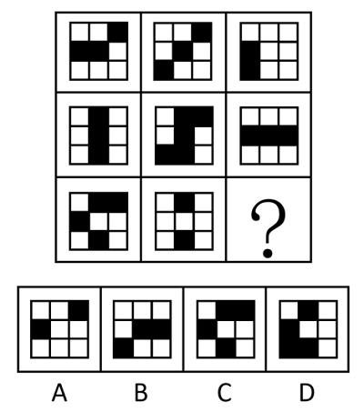

# 样式规律-黑白运算（同位叠加-定义叠加）

考点：[[20-考点/判断推理/图形推理/样式规律-黑白运算（同位叠加-定义叠加）|图形推理 / 样式规律-黑白运算（同位叠加/定义叠加）]]

**问法模型**：问'最符合所给图形规律'→ 九宫格先横看、横向无规律转纵看，发现轮廓分割相同仅黑白不同，用黑白运算逐位叠加求解

## 推理链
1. 第1步：九宫格每幅图外框与分割区域完全相同，仅小方格黑白填充不同→元素组成相似，优先考虑样式规律
2. 第2步：各图黑块数量不构成数量规律→锁定黑白运算（对应位置叠加）
3. 第3步：九宫格横向看无统一运算规律，转纵向看；观察第一列逐位叠加得出规则：黑+黑=白，黑+白=黑，白+黑=黑，白+白=白（同色得白、异色得黑）
4. 第4步：用第二列三图验证该规则，逐位吻合，规律成立
5. 第5步：将规则应用于第三列，第一、二幅图对应位置逐位叠加，推出问号处每个小格的黑白分布
6. 第6步：与四个选项逐位对照，仅B项与运算结果完全一致，A、C、D均有小格颜色不符

**最快解法**：⚡ 黑白运算口诀'同白异黑'（等价异或）：第一列竖向总结规则→第二列快速验证→第三列逐格叠加，直接锁定B

## 易错点
- ⚠ 九宫格惯性先横找规律，本题横向无规律，需及时切换为纵向观察，死磕行列方向会浪费时间
- ⚠ 黑白运算时未逐位对齐、凭整块轮廓目测，易把叠加方向或'黑+白=黑'记反
- ⚠ 忽略'轮廓和分割区域相同'这一黑白运算前提，误去数黑块个数走数量规律而卡壳

## 母题抽象
> 🧩 当九宫格各图外框与分割区域完全相同、仅黑白填充不同且数黑块无规律时，优先黑白运算；横看无规律立即转纵看，先总结'同色/异色'叠加规则并经验证，再套用到含问号的一列

**同类特征**：九宫格、轮廓与分割区域相同、黑白填充位置不同、黑块数量无数量规律、问号在第三列、元素组成相似

## 相关题
- [[10-真题/判断推理/图形推理/10204610 样式规律-加减同异（去同存异），九宫格列规律|10204610]]（辽宁 2024，相关度2）
- [[10-真题/判断推理/图形推理/10297349 样式规律-黑白运算|10297349]]（浙江 2025，相关度2）
- [[10-真题/判断推理/图形推理/10297407 样式规律-黑白运算（定义叠加）|10297407]]（四川 2025，相关度2）
- [[10-真题/判断推理/图形推理/12019768 样式规律-加减同异（求同）与位置旋转的复合规律|12019768]]（浙江 2026，相关度2）
- [[10-真题/判断推理/图形推理/12101004 样式规律-黑白运算（九宫格逐位置叠加）|12101004]]（江苏 2025，相关度2）

---

### 题干

下列选项中最符合所给图形规律的是（    ）。

### 选项
- A. A
- B. B　✅
- C. C
- D. D

### 官方解析
元素组成相似，优先考虑样式规律。题干图形轮廓和分割区域相同，黑块数量不同，优先考虑黑白运算。九宫格横向看无规律，考虑纵向看，观察第一列发现，运算规律为：黑+黑=白，黑+白=黑，白+黑=黑，白+白=白；经验证，第二列符合此规律；第三列应用此规律，只有B项符合。
故正确答案为B。

### 给定材料
（无）
