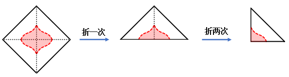

# 图形推理-折叠裁剪（剪纸对称还原）

考点：[[20-考点/判断推理/图形推理/图形推理-折叠裁剪（剪纸对称还原）|图形推理 / 图形推理-折叠裁剪（剪纸对称还原）]]

**问法模型**：折叠两次→沿虚线裁剪→展开后图形是什么 → 折痕即对称轴模型：展开图必关于每一条折痕镜像对称，先确定对称轴数量与夹角，再排除选项

## 推理链
1. 第1步：题干'正方形卡片沿对角线折叠两次'，两条折痕即正方形的两条对角线，交于中心且相互垂直，最终得到图中带直角的等腰直角三角形，虚线剪口位于直角顶点附近
2. 第2步：展开时每个剪口都沿两条折痕各镜像一次（展开一次关于第二条对角线对称，再展开一次关于第一条对角线对称），故展开图形必关于这两条相互垂直的对角线对称
3. 第3步：由两条相互垂直的对称轴可进一步推出：图形绕中心旋转180°后与自身重合，即展开图既是轴对称图形又是中心对称图形（官方解析'至少有两条相互垂直的对称轴'）
4. 第4步：逐项检验对称轴：A项能画出两条相互垂直的对称轴且中心对称；B、C、D项至多只有一条对称轴或仅有中心对称、不满足'两条相互垂直对称轴'的强条件
5. 第5步：只有A同时满足轴对称＋中心对称（两条垂直对称轴），故选A

**最快解法**：⚡ 对称轴排除法：抓住'沿对角线折两次'⇒两条折痕相互垂直⇒展开图必有两条相互垂直的对称轴且必为中心对称图形⇒对四个波浪四边形逐一画对称轴，仅A同时满足，直接锁定，无需比对曲线细节

## 易错点
- ⚠ 只检验'中心对称'就仓促选答案（B项看似180°旋转重合），漏掉'两条相互垂直的对称轴'这一更强条件而误选
- ⚠ 误以为展开图只需关于一条折痕对称，忽略两次折叠产生两条垂直折痕、剪口被镜像两次
- ⚠ 陷入逐段比对波浪曲线的具体凹凸形状，未先用整体对称性排除，既耗时又易受细节干扰

## 母题抽象
> 🧩 当题干出现'沿对称线折叠若干次—裁剪—展开'时，用'折痕即对称轴'模型：数清折痕条数及其夹角，展开图必含与之对应数量、位置的对称轴（两条垂直折痕⇒既轴对称又中心对称），据此直接筛选选项

**同类特征**：正方形沿对角线折叠两次、沿虚线裁剪、再展开求图形、两条折痕相互垂直、选项为波浪边轮廓图形的对称性辨析

## 相关题
（暂无）

---

### 题干

如图所示，正方形卡片沿对角线折叠两次后得到一个三角形，沿着虚线裁剪后，再展开卡片，则展开的图形最有可能是（    ）。

### 选项
- A. A　✅
- B. B
- C. C
- D. D

### 官方解析

由题干可知，正方形卡片沿对角线折叠两次后依照虚线进行裁剪，裁剪后再展开的图案至少有两条相互垂直的对称轴，即该图案应为既轴对称又中心对称图形，如下图所示，只有A项符合。

故正确答案为A。

### 给定材料
（无）
