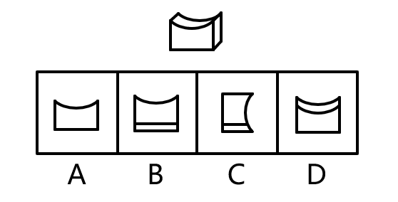
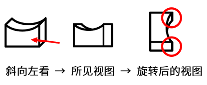

# 三视图-立体图形视图辨析（选非题）

考点：[[20-考点/判断推理/图形推理/三视图-立体图形视图辨析（选非题）|图形推理 / 三视图-立体图形视图辨析（选非题）]]

**问法模型**：给出单一立体图形，问'从任一角度看最不可能的视图' → 为每个选项寻找可行观察方向，逐项核对投影轮廓，选非题锁定不符项

## 推理链
1. 第1步：观察题干立体：一个顶部凹陷的柱体，前/后面轮廓为'矩形+上边缘凹弧'，上表面为凹弧曲面（类似马鞍凹槽）
2. 第2步：所用方法：三视图投影规则——视图是沿某方向的正投影，需为每个选项匹配观察方向并核对轮廓细节（包括棱线投影出的横线、曲线）
3. 第3步：逐项对照：A项为'矩形+上凹弧'，从前/后方向观察即可看到；B项在前者基础上底部多一条横线（前后底棱投影），可由相应方向看到；D项顶部有两条凹弧（前后两条上棱曲线同时投影），亦可由相应方向看到，故A、B、D均可能
4. 第4步：核查C项：按官方解析箭头方向（侧面方向）观察，真实视图应是'上半部分右侧存在曲线，下半部分为矩形（竖直直线）'
5. 第5步：C项却把整条右侧边都画成凹曲线，下半部分也呈曲线而非矩形直线，与真实侧面投影不符
6. 第6步：本题为选非题，C项最不可能是该立体图形的视图，当选

**最快解法**：⚡ 三视图排除法+轮廓细节核对：先给A、B、D快速匹配观察方向（正视/后视/斜俯视）排除，剩余C按侧面投影核对——凹陷曲面只使上半部分右侧出现曲线，下半部分应为竖直矩形边，C下半部也是曲线，直接锁定答案

## 易错点
- ⚠ 选非题惯性思维，误把'最不可能'看成'最可能'而选成A/B/D
- ⚠ 侧面投影时误以为凹弧曲面会让整条侧边都呈曲线，忽略下半部分应为矩形（直线）轮廓
- ⚠ 忽略B项底部横线、D项第二条凹弧是前后棱线的正投影，误将含多余线条的选项错判为'不可能'

## 母题抽象
> 🧩 当题干给出含凹凸曲面的立体并要求找'最不可能的视图'时，先为直观选项匹配观察方向做排除，再对剩余项核对曲面投影出现的区域（曲线只在上半部、下半部为直线矩形），局部细节不符者即为答案

**同类特征**：立体图形视图（三视图）、选非题：最不可能、顶部凹陷/凹弧曲面、矩形+上凹弧轮廓、侧面投影上半部曲线、下半部矩形、棱线投影形成横线或双曲线

## 相关题
（暂无）

---

### 题干

下图为给定的立体图形，从任一角度看，下列选项最不可能是该立体图形视图的是（    ）。

### 选项
- A. A
- B. B
- C. C　✅
- D. D

### 官方解析

本题考查三视图。如下图所示，A、B、D三项按图中箭头方向观察，均可看到。

C项可按下图中箭头方向观察，但视图应如下图所示，上半部分的右侧应存在曲线，下半部分应为矩形，而非曲线图形，C项图形错误，不是该立体图形视图，当选。

本题为选非题，故正确答案为C。

### 给定材料
（无）
