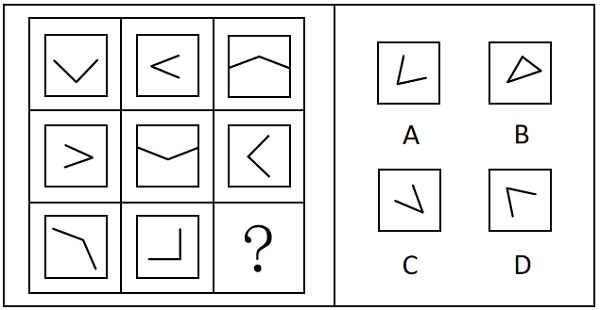

# 位置规律-旋转（九宫格V形开口顺时针旋转90°）

考点：[[20-考点/判断推理/图形推理/位置规律-旋转（九宫格V形开口顺时针旋转90°）|图形推理 / 位置规律-旋转（九宫格V形开口顺时针旋转90°）]]

**问法模型**：问'符合图形变化规律的选项'→ 九宫格元素组成相同，优先横行观察位置（旋转）规律并跨行连续应用

## 推理链
1. 第1步：九宫格每幅图均由正方形外框加两条直线组成的'V'构成，元素组成相同，优先考虑位置规律（旋转/翻转/平移）
2. 第2步：九宫格优先看横行，第一行'V'的开口方向依次为上（∨）、右（＜）、下（∧），规律为每次顺时针旋转90°
3. 第3步：验证第二行：开口方向依次为左（＞）、上（∨）、右（＜），同样每次顺时针旋转90°，且旋转跨行连续（第二行起点承接第一行末尾的'下'）
4. 第4步：第三行应用规律：图1开口向下，图2开口向左，故问号处'V'开口应向上
5. 第5步：逐项对照：B项为三条线构成的封闭三角形，线数不符排除；C、D项开口朝下（右下）方向不符排除
6. 第6步：A项开口向上，且两条线段长短、夹角与第三行图形顺时针旋转后的形态一致，故选A

**最快解法**：⚡ 位置规律口诀'元素相同看位置，九宫格先横行'：只盯'V'开口方向，第一行上→右→下锁定'顺时针旋转90°'，跨行连续推得第三行为下→左→？，开口向上的只有A，直接锁定

## 易错点
- ⚠ 误以为每行独立重新开始，把问号错定为开口向右，忽略旋转是跨行连续的（第三行起点为'下'而非'上'）
- ⚠ 第三行'V'两边不等长、夹角非直角，易误判为样式或数量规律，实际仍是同一图形的整体旋转
- ⚠ 开口方向看反：开口指两线夹角张开所朝方向而非顶点所指方向；另B项为三角形（三条线），与题干'两条直线'构成不符

## 母题抽象
> 🧩 当九宫格每幅图元素组成相同、仅方向改变时，优先横行观察局部特征（开口/箭头/指针）的方向变化；若呈固定步长顺（逆）时针旋转且跨行连续，则按规律推出问号处方向，再排除方向不符与线数/形状不符的选项

**同类特征**：九宫格、元素组成相同、正方形外框+两条直线V形、开口方向递变、顺时针旋转90°、第三行为不对称V仍遵循同一旋转规律

## 相关题
- [[10-真题/判断推理/图形推理/2616003 位置规律-旋转与翻转复合（九宫格横行规律）|2616003]]（海南 2020，相关度3）
- [[10-真题/判断推理/图形推理/12334416 图形推理-位置规律（旋转-翻转组合变换）|12334416]]（江苏 2024，相关度2）
- [[10-真题/判断推理/图形推理/12536397 样式规律-求异（去同存异）与位置规律（顺时针旋转90°）复合|12536397]]（四川 2024，相关度2）
- [[10-真题/判断推理/图形推理/13432345 图形推理-位置规律（旋转-分组类比）|13432345]]（深圳市考 2025，相关度2）
- [[10-真题/判断推理/图形推理/13504515 图形推理-位置规律（旋转-顺时针90°）|13504515]]（河北 2025，相关度2）

---

### 题干

下列选项中，符合所给图形变化规律的是（    ）。

### 选项
- A. A　✅
- B. B
- C. C
- D. D

### 官方解析

观察发现，题干每幅图形均是由两条直线组成的“V”和正方形外框构成，元素组成相同，优先考虑位置规律。九宫格优先看横行，第一行图形中“V”的开口方向分别为上、右、下，即每次顺时针旋转；经验证，第二行图形符合此规律；第三行图形应用此规律，只有A项符合。

故正确答案为A。

### 给定材料
（无）
