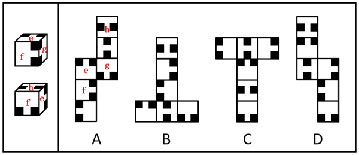
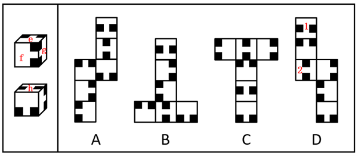

# 空间重构-六面体展开图还原（相对面与相邻面-黑块贴棱关系判定）

考点：[[20-考点/判断推理/图形推理/空间重构-六面体展开图还原（相对面与相邻面-黑块贴棱关系判定）|图形推理 / 空间重构-六面体展开图还原（相对面与相邻面/黑块贴棱关系判定）]]

**问法模型**：给出同一立方体的两个立体视图，问哪个展开图可由它展开 → 先由视图锁定'两两相邻面'确定相对面约束，再逐项验证展开图的相对/相邻关系与黑块位置，排除矛盾项

## 推理链
1. 第1步：题干左侧为同一六面体的两个立体视图，将可识别的面标注为e、f、g、h等，其中面e、面f、面g两两相邻（共享同一顶点）
2. 第2步：依据'两两相邻的三个面必不互为相对面'的规则，e、f、g的相对面只能出现在其余面中，即这三个面中必有一个面与面h为相对面；同时黑块是否贴棱决定相邻面的对应关系
3. 第3步：B项——题干立体图形中正面内的黑块与面h不相邻，但选项展开图中无论面1还是面2，与正面图案相同的面内黑块均与面1或面2相邻，即面1和面2都不是面h，与题干矛盾，排除
4. 第4步：C项——展开图中面1和面2为相对面，二者均不与面e、面f、面g中的任一个构成相对面，因此面1和面2都不是面h，展开图与题干不一致，排除
5. 第5步：D项——同理，面1和面2为相对面且均不与e、f、g任一面相对，故都不是面h，展开图与题干不一致，排除
6. 第6步：A项展开图折叠后各面的相对关系、相邻关系及黑块贴棱位置与题干两个立体视图完全一致，当选

**最快解法**：⚡ 相对面排除法：由两视图锁定'两两相邻的三面e、f、g'→与h相对者必在e/f/g之中；B项黑块相邻关系不符、C/D项中面1与面2互为相对面却不与e/f/g任一面相对（均非面h），三项皆矛盾直接排除，A吻合

## 易错点
- ⚠ 只看面内黑块图案的形状，忽略'黑块是否贴棱/与哪些面相邻'这一关键信息，导致B项误判
- ⚠ 展开图相对面判定失误：必须按'同行或同列隔一个面'或'Z字两端'找相对面，C、D的T形与阶梯形排布中极易看错面1与面2的位置关系
- ⚠ 未将两个立体视图按公共棱/公共面对齐拼合，忽略黑块在公共棱上的方向对应，造成相邻关系错判

## 母题抽象
> 🧩 当题干给出同一立方体的两个立体视图并要求匹配展开图时，先用'两两相邻的三面必互不相对'锁定相对面约束，再逐一检验各展开图中相对面组合与黑块贴棱的相邻关系，凡与视图矛盾者秒排

**同类特征**：同一六面体的两个立体视图、面内黑块角块/贴棱图案、四个展开图选项择一、相对面与相邻面关系验证、逐项排除定答案、问'可由左图展开的是'

## 相关题
- [[10-真题/判断推理/类比推理/2307732 语义关系-并列关系（反对并列）+二级辨析（地理位置相邻）|2307732]]（辽宁 2018，相关度1）
- [[10-真题/判断推理/定义判断/2452619 单定义-要件对应（多要件逐一比对）|2452619]]（江苏 2020，相关度1）
- [[10-真题/判断推理/图形推理/2367934 图形推理-实际意义（实体信息最大共同点）|2367934]]（江苏 2019，相关度1）
- [[10-真题/判断推理/图形推理/5510025 空间重构-展开图折叠（相邻面图案指向关系）|5510025]]（江西 2023，相关度1）

---

### 题干

下列选项中，可以由左图给定的同一个六面体展开而成的是（    ）。

### 选项
- A. A　✅
- B. B
- C. C
- D. D

### 官方解析

将题干立体图形能够识别的面标注序号（如下图所示），已知面e、面f和面g两两相邻，那么这三个面中必有一个面与面h为相对面，逐一分析选项。

A项：选项展开图与题干一致，当选；

B项：题干下面的立体图形中，正面内的黑块与面h不相邻，但选项展开图中无论面1还是面2，与正面相同的面内黑块均与面1或面2相邻，即面1和面2都不是面h，选项展开图与题干不一致，排除；

C项：选项展开图中，面1和面2为相对面，二者均不与面e、面f和面g中的任一个构成相对面，因此面1和面2都不是面h，选项展开图与题干不一致，排除；

D项：选项展开图中，面1和面2为相对面，二者均不与面e、面f和面g中的任一个构成相对面，因此面1和面2都不是面h，选项展开图与题干不一致，排除。

故正确答案为A。

### 给定材料
（无）
