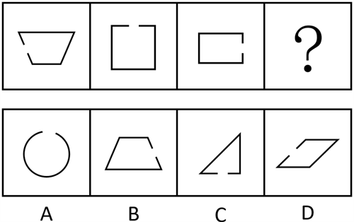

# 图形推理-位置规律（缺口方位旋转-移动）

考点：[[20-考点/判断推理/图形推理/图形推理-位置规律（缺口方位旋转-移动）|图形推理 / 图形推理-位置规律（缺口方位旋转/移动）]]

**问法模型**：『填入问号处使之呈现一定规律性』→ 提取题干图形中唯一变化的局部要素（缺口）的方位序列，按移动规律推出问号处方位

## 推理链
1. 第1步：题干三幅图均为带缺口的封闭多边形（梯形、正方形、长方形），且缺口位置各不相同，分别为左方、上方、右方
2. 第2步：图形外轮廓形状各异、缺口是唯一规律载体，优先考虑位置规律；缺口方位呈『左→上→右』的顺时针每次移动90°的循环序列
3. 第3步：按此序列延续，问号处图形的缺口应位于下方
4. 第4步：逐项核对缺口方位：A项圆的缺口在上方，B项梯形缺口在右方，D项平行四边形缺口在上方，C项三角形缺口在下方，只有C项满足
5. 第5步：故问号处应填入C项，使缺口方位呈现左、上、右、下的循环规律

**最快解法**：⚡ 位置规律口诀法：锁定『缺口方位』这一变量，读出左→上→右的顺时针旋转序列，直接断定问号处缺口在下，一眼锁定C（其余选项缺口均不在下方，排除法秒杀）

## 易错点
- ⚠ 被图形外框形状差异干扰（梯形/正方形/长方形形状不同），误以为考查形状规律而忽略缺口方位这一核心变量
- ⚠ 误选B：B项缺口在右方，与题干第三幅图重复而非延续序列，未看清序列应推进到『下方』
- ⚠ 忽略D项缺口位于上方（偏左），若只粗看缺口存在而不辨方位易错选D；A项为曲线圆形，与题干『多边形』属性不符，也可作次要排除依据

## 母题抽象
> 🧩 当一组图形同构、仅某一局部要素（缺口/开口/小标记）的方位在变时，用位置规律追踪该要素的方位移动顺序（常为顺/逆时针旋转90°），据此推出问号处方位并对照选项

**同类特征**：带缺口的多边形、缺口位置依次变化、左→上→右的方位序列、顺时针旋转90°、外框形状各异但缺口规律唯一、问号处延续位置规律

## 相关题
- [[10-真题/判断推理/图形推理/12536397 样式规律-求异（去同存异）与位置规律（顺时针旋转90°）复合|12536397]]（四川 2024，相关度1）
- [[10-真题/判断推理/图形推理/13432345 图形推理-位置规律（旋转-分组类比）|13432345]]（深圳市考 2025，相关度1）
- [[10-真题/判断推理/图形推理/13504515 图形推理-位置规律（旋转-顺时针90°）|13504515]]（河北 2025，相关度1）
- [[10-真题/判断推理/图形推理/17056528 位置规律-旋转（九宫格V形开口顺时针旋转90°）|17056528]]（上海 2026，相关度1）
- [[10-真题/判断推理/图形推理/2616003 位置规律-旋转与翻转复合（九宫格横行规律）|2616003]]（海南 2020，相关度1）

---

### 题干

从所给四个选项中，选择最合适的一个填入问号处，使之呈现一定规律性（    ）。

### 选项
- A. A
- B. B
- C. C　✅
- D. D

### 官方解析
题干每幅图均由带缺口的多边形构成，且缺口位置不同，优先考虑位置规律。观察发现，题干图形的缺口位置依次在左方、上方、右方，问号处应用此规律，缺口位置应该在下方，只有C项符合。
故正确答案为C。

### 给定材料
（无）
