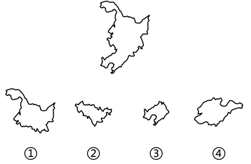

# 平面拼合（平行且等长相消）

考点：[[20-考点/判断推理/图形推理/平面拼合（平行且等长相消）|图形推理 / 平面拼合（平行且等长相消）]]

**问法模型**：从四个选项中选三个拼合成题干目标轮廓 → 用'平行且等长相消'法逐组尝试拼合并排除

## 推理链
1. 第1步：从图中提取目标轮廓（上方图形，整体上尖下阔、边缘多锯齿的不规则多边形，形似省域版图），需从①②③④中选三个拼出该轮廓
2. 第2步：所用方法为'平行且等长相消'——两个拼块相邻处的公共边必平行且等长，拼合时相互抵消，只剩外缘轮廓
3. 第3步：尝试①②③组合：①提供西部大块、②提供中部横向条块、③提供东南小块，三者相邻边平行且等长，消去内部接触边后，剩余外缘与题干轮廓逐段吻合
4. 第4步：验证含④的组合（②③④、①③④、①②④）：④自身是完整独立轮廓（形似另一省域），其边缘无法与①②③构成平行且等长的内部消去线，拼合后外缘与题干不符
5. 第5步：与选项对照：A(①②③)成立，排除B、C、D，得出结论

**最快解法**：⚡ 平行且等长相消法：先在四个拼块中找'平行且等长'的边（即拼合接触边），能两两相消、消去后剩余边缘恰好吻合目标轮廓的三个即入选；本题①②③接触边平行等长相消后与目标轮廓一致，直接锁定A，含④的组合作反例排除

## 易错点
- ⚠ 被④与目标轮廓的局部形状相似（锯齿边缘）迷惑，误选含④的干扰组合
- ⚠ 只凭形状'大致像'就拼凑组合，未严格验证接触边是否平行且等长
- ⚠ 忽略拼合后需逐段比对整体外缘轮廓，仅比较局部导致误判

## 母题抽象
> 🧩 当题干出现'选三个图形拼成目标轮廓'的平面拼合特征时，用平行且等长相消法：接触边平行等长则相消，剩余外缘须与目标轮廓逐段吻合，形似但接触边不匹配的是干扰项

**同类特征**：平面拼合、四选三拼轮廓、目标为不规则锯齿多边形（省域轮廓）、拼块边缘凹凸复杂、存在形状相似的干扰项、平行且等长相消

## 相关题
- [[10-真题/判断推理/图形推理/17900828 平面拼合（平行且等长相消）|17900828]]（江苏 2024，相关度4）
- [[10-真题/判断推理/图形推理/1791636 平面拼合（平行且等长相消）|1791636]]（江苏 2016，相关度4）
- [[10-真题/判断推理/图形推理/1791816 平面拼合（平行且等长相消）|1791816]]（江苏 2016，相关度4）
- [[10-真题/判断推理/图形推理/5755701 平面拼合（平行且等长相消）|5755701]]（江苏 2023，相关度4）
- [[10-真题/判断推理/图形推理/4651713 平面拼合（平行且等长相消）|4651713]]（江苏 2022，相关度3）

---

### 题干

从四个选项中选择三个使之能组成题干图形（    ）。

### 选项
- A. ①②③　✅
- B. ①③④
- C. ①②④
- D. ②③④

### 官方解析

本题考查平面拼合，可采用平行且等长相消的方式解题。图①、图②、图③消去平行且等长的线段后进行组合即可得到题干轮廓图。平行且等长相消的方式如下图所示：

故正确答案为A。

### 给定材料
（无）
