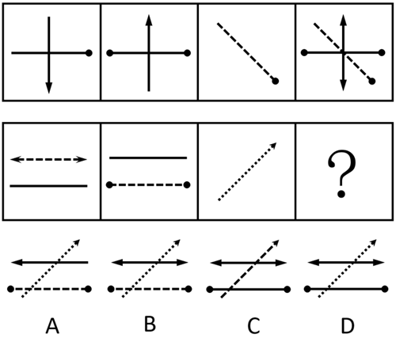

# 样式规律-加减同异（多图相加-叠加）

考点：[[20-考点/判断推理/图形推理/样式规律-加减同异（多图相加-叠加）|图形推理 / 样式规律-加减同异（多图相加/叠加）]]

**问法模型**：两行四列、问号填图使之呈现规律性 → 元素相似且相同线条重复出现时，先在第一行验证叠加规律（图1+图2+图3=图4），第二行套用同一规律并清单化核对元素

## 推理链
1. 第1步：第一行图1为竖线（下端箭头）+横线（右端小黑点），图2为竖线（上端箭头）+横线（两端小黑点），图3为虚斜线（右下端小黑点），元素相似且线条重复出现，指向样式叠加
2. 第2步：验证第一行规律：图4中同时出现双向箭头竖线（图1下箭头+图2上箭头）、两端带点横线、带点虚斜线，即图1+图2+图3全部元素直接相加得到图4
3. 第3步：第二行套用：图1为虚线双向箭头横线+实线横线，图2为实线横线+两端带点虚线横线，图3为右上带箭头的点状斜线
4. 第4步：问号处应为三图全部元素叠加：双向箭头虚线、实线横线、两端带点虚线、带箭头点状斜线，且各线条的虚实属性、箭头、端点小黑点须逐一保留
5. 第5步：逐项对照：A、B或箭头/端点元素缺失，或实线横线误画为虚线；C中两端带点横线由虚线误画为实线，虚实属性与原图不符
6. 第6步：只有D项四类元素齐全，虚实、箭头、端点均与'图1+图2+图3'的叠加结果完全一致，故选D

**最快解法**：⚡ 元素清单核对法：由第一行锁定'三图相加=图4'后，把第二行三图元素列成清单（双向箭头虚线／实横线／带点虚线／箭头点状斜线），逐项核对四个选项中每个元素的'有无+虚实+箭头端点'，唯一全对的即为D

## 易错点
- ⚠ 只核对线条'有无'而忽略虚实属性，误选把实线画成虚线（B类）或把带点虚线画成实线（C类）的选项
- ⚠ 忽略端点小黑点、箭头等小元素，漏数后误选A类缺项图形
- ⚠ 误以为规律是'两图叠加得第三图'（图1+图2=图3），实际第一行是三图相加得图4，套错叠加数量

## 母题抽象
> 🧩 当题干图形元素相似且相同线条（含箭头、端点等小元素）重复出现时，优先用样式叠加规律（相加或求同存异），将前一组的元素列成清单，在后一组选项中逐项核对'有无+虚实+小元素'，全对者即为答案

**同类特征**：元素组成相似、相同线条重复出现、分组/分行呈现规律、三图相加得第四图、线条虚实属性与箭头、端点小黑点、问号处填图

## 相关题
- [[10-真题/判断推理/图形推理/3523645 样式规律-求同存异（线条去同存异-叠加运算）|3523645]]（四川 2021，相关度3）
- [[10-真题/判断推理/图形推理/12019768 样式规律-加减同异（求同）与位置旋转的复合规律|12019768]]（浙江 2026，相关度2）
- [[10-真题/判断推理/图形推理/14403686 样式规律-黑白叠加（重叠为白、非重叠为黑）|14403686]]（山东 2025，相关度2）
- [[10-真题/判断推理/图形推理/16070178 样式规律-加减同异（翻转+去同存异）|16070178]]（重庆 2026，相关度2）
- [[10-真题/判断推理/图形推理/17056529 样式规律-求同求异（分元素：直线求同、小圆圈求异）|17056529]]（上海 2026，相关度2）

---

### 题干

从所给四个选项中，选择最合适的一个填入问号处，使之呈现一定规律性（    ）。

### 选项
- A. A
- B. B
- C. C
- D. D　✅

### 官方解析
元素组成相似，且相同线条重复出现，优先考虑样式规律中的加减同异。观察发现，第一行中的图1、图2和图3相加得到图4；第二行应用此规律，只有D项符合。 
故正确答案为D。

### 给定材料
（无）
