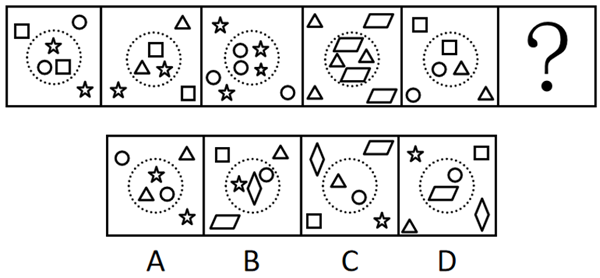

# 数量规律-小元素种类（虚线圆内外元素种类一致）

考点：[[20-考点/判断推理/图形推理/数量规律-小元素种类（虚线圆内外元素种类一致）|图形推理 / 数量规律-小元素种类（虚线圆内外元素种类一致）]]

**问法模型**：‘选择最合适的一个填入问号处使之呈现规律性’且每图均含一条虚线圆 → 按'虚线圆内外'分区归纳小元素种类规律并匹配选项

## 推理链
1. 第1步：提取图形特征——题干五幅图元素组成各不相同，且无明显对称、封闭、曲直等属性规律，每幅图都由若干小元素（星形、圆形、方块、三角形、平行四边形）组成，并被一条虚线圆分成内外两部分
2. 第2步：确定方法——属性规律不通则转向数量规律，且'虚线圆'提示分区观察：分别统计圆内、圆外小元素的种类（只看种类，不纠结个数）
3. 第3步：逐图验证——图1内外均为星形、圆形、方块；图2内外均为方块、三角形、星形；图3内为2圆+1星、外为2星+2圆，种类均为圆形和星形；图4内为平行四边形+三角形+平行四边形、外为2三角形+2平行四边形，种类均为三角形和平行四边形；图5内外均为方块、圆形、三角形
4. 第4步：归纳规律——五幅图共同规律为'虚线圆内外出现的小元素种类完全相同'（个数可不相等）
5. 第5步：对照选项——A项外为圆形、三角形、星形，内为星形、三角形、圆形，内外种类一致，符合；B项内为星/圆/菱形、外为方块/三角/平行四边形，不符；C项内为菱形/三角/圆、外为平行四边形/方块/星形，不符；D项内为圆/平行四边形、外为星/方块/三角/菱形，不符
6. 第6步：结论——只有A项满足'内外小元素种类相同'，故选A

**最快解法**：⚡ 分区对照法：以虚线圆为界，把每图小元素分成'圆内''圆外'两组，只记种类不数个数，口诀'内外同种'——题干五图逐一验证成立后，一眼扫选项：A内外均为圆/三角/星，B内含菱形外含方块直接排除，C内含菱形外含星排除，D内仅2种外4种排除，锁定A

## 易错点
- ⚠ 只顾数元素总个数找'个数守恒'，忽略'虚线圆内外'这一分区维度，导致看似无规律
- ⚠ 被图3、图4干扰：这两图内外元素个数不相等（如图4内3个、外4个），误把规律理解成'内外个数相同'而错排正确项；实际规律只看种类不看个数
- ⚠ 选项辨析不细：B中内圈是菱形而非星形、外圈是方块而非平行四边形，若形状辨析缺位易误判B也符合'内外种类一致'

## 母题抽象
> 🧩 当一组图形均含'封闭边界（虚线/实线圆或框）'并把零散小元素分成内外两部分时，优先验证'边界内外元素的种类（或个数）是否对应一致'，用分区对照法快速锁定答案

**同类特征**：每幅图被虚线圆分为内外两部分、小元素种类多且摆放零散、元素组成不同且无属性规律、内外元素种类相同（个数可不同）、问号处延续规律

## 相关题
- [[10-真题/判断推理/图形推理/11367773 数量规律-一笔画（奇点数）+面的形状（三角形面个数）双规律|11367773]]（江苏 2025，相关度2）
- [[10-真题/判断推理/图形推理/10204622 图形推理-数量规律-笔画数（一笔画判定）|10204622]]（辽宁 2024，相关度1）
- [[10-真题/判断推理/图形推理/12019817 数量规律-面的细化（面的形状：所有面均为四边形）|12019817]]（浙江 2026，相关度1）
- [[10-真题/判断推理/图形推理/13504266 数量规律-交点数（曲直交点数量+交点形态交替规律）|13504266]]（云南 2025，相关度1）
- [[10-真题/判断推理/图形推理/13504600 数量规律-多边形元素边数递减（等差数列）|13504600]]（辽宁 2025，相关度1）

---

### 题干

从所给的四个选项中，选择最合适的一个填入问号处，使之呈现一定的规律性：

### 选项
- A. A　✅
- B. B
- C. C
- D. D

### 官方解析
元素组成不同，且无明显属性规律，考虑数量规律。每幅图由若干小元素组成，且均被虚线圆分为内外两部分，观察发现，每幅图中虚线圆的内外小元素均相同，只有A项符合。
故正确答案为A。

### 给定材料
（无）
