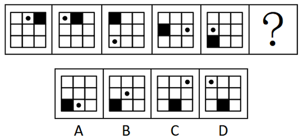

# 位置规律-循环平移（双元素分别沿外框移动，步长等差递增）

考点：[[20-考点/判断推理/图形推理/位置规律-循环平移（双元素分别沿外框移动，步长等差递增）|图形推理 / 位置规律-循环平移（双元素分别沿外框移动，步长等差递增）]]

**问法模型**：‘元素组成相同，选最合适的填入？’ → 优先考虑位置规律，把每个元素拆开沿外框路径分别追踪移动方向与步长

## 推理链
1. 第1步：五幅图均为3×3九宫格，每图仅含1个黑色方块和1个小黑点，元素组成相同，外框（去中心）共8格可作循环路径。
2. 第2步：采用位置规律，将黑块与小黑点拆成两条独立轨迹，沿外框8格顺次编号（左上0、左中1、左下2、下中3、右下4、右中5、右上6、上中7），逐图计数。
3. 第3步：黑块位置依次为右上(6)→上中(7)→左上(0)→左中(1)→左下(2)，即每次逆时针移动1格，故？处黑块应在下中(3)，排除A、B（黑块仍停在左下）。
4. 第4步：小黑点位置依次为上中(7)→左上(0)→左下(2)→右中(5)→左中(1)，逆时针移动格数依次为1、2、3、4格，步长呈等差递增。
5. 第5步：由图5到？处，小黑点应逆时针移动5格：左中(1)→左下(2)→下中(3)→右下(4)→右中(5)→右上(6)，落在右上角。
6. 第6步：C项黑块在下中、小黑点在右上，两条规律同时吻合；D项小黑点在左上（仅移1格）不符，故选C。

**最快解法**：⚡ 双元素分轨计数法：先看黑块——每步逆时针1格，图5在左下，？处必到下中，秒杀排除A、B；再看小黑点——步长1、2、3、4、5等差，图5在左中(编号1)，1+5=右上(编号6)，锁定C。

## 易错点
- ⚠ 误以为小黑点与黑块一样每次只移1格，由图5‘左中’直接推到‘左上’，误选D；实际步长是1、2、3、4、5递增。
- ⚠ 数格时把九宫格中心格算进路径，或按直线距离而非沿外框循环计数，导致步长错乱。
- ⚠ 只验证黑块规律就匆忙作答——A、B、C、D中A/B黑块在左下、C/D黑块都在下中，单靠黑块只能排除A、B，最终必须靠小黑点定答案。

## 母题抽象
> 🧩 当图形元素组成相同且各元素位置持续变化时，给外圈路径编号，分别追踪每个元素的移动方向和步长；若步长呈等差或循环规律，按规律续写下一位即可锁定答案。

**同类特征**：九宫格3×3、元素组成相同、黑块沿外框逆时针移动、小黑点沿外框逆时针移动、步长等差递增(1/2/3/4/5)、循环路径计数

## 相关题
- [[10-真题/判断推理/图形推理/2172768 位置规律（旋转-翻转）|2172768]]（海南 2021，相关度1）
- [[10-真题/判断推理/图形推理/10204458 位置规律-平移（特征交点沿内圈循环平移）|10204458]]（甘肃 2024，相关度1）
- [[10-真题/判断推理/图形推理/10204614 图形推理-位置规律（旋转+翻转交替循环）|10204614]]（黑龙江 2024，相关度1）
- [[10-真题/判断推理/图形推理/10297399 位置规律—平移（多黑块分组循环平移）|10297399]]（四川 2025，相关度1）
- [[10-真题/判断推理/图形推理/11226892 位置规律-九宫格小元素沿固定循环链移动|11226892]]（上海 2025，相关度1）

---

### 题干

从所给的四个选项中，选择最合适的一个填入问号处，使之呈现一定的规律性：

### 选项
- A. A
- B. B
- C. C　✅
- D. D

### 官方解析
元素组成相同，优先考虑位置规律。观察发现，黑色方块沿外框每次逆时针移动1格，排除A、B两项；小黑点沿外框每次逆时针移动1格、2格、3格、4格，故从图5到？处小黑点应沿外框逆时针移动5格，只有C项符合。
故正确答案为C。

### 给定材料
（无）
