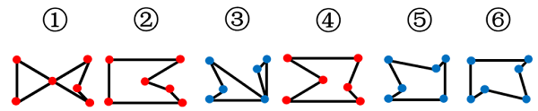

# 数量规律-交点数（交点数相同再比交点分布位置）

考点：[[20-考点/判断推理/图形推理/数量规律-交点数（交点数相同再比交点分布位置）|图形推理 / 数量规律-交点数（交点数相同再比交点分布位置）]]

**问法模型**：『六个图形分为两类，每类有各自共同特征』→ 分组分类模型：先属性规律（对称/封闭/曲直）后数量规律（交点/线/面），数量相同时再细化分布位置

## 推理链
1. 第1步：六个图形元素组成不同，均为不规则线条折线图，对称、封闭、曲直等属性规律均不明显
2. 第2步：观察发现每幅图『线条交叉明显』，按解题顺序转向数量规律，优先考虑交点数
3. 第3步：逐图数交点，发现每幅图的交点数均为6，数量一致无法直接分成两类
4. 第4步：对交点做二级细化——比较6个交点在图形中的分布位置，发现图①②④的6个交点分布位置相同
5. 第5步：图③⑤⑥的6个交点分布位置彼此也相同，与①②④组的分布不同
6. 第6步：故①②④一组、③⑤⑥一组，对照选项只有A符合

**最快解法**：⚡ 交点计数+位置比对法：先快速数出六图交点均为6，发现数量无法分组后不换规律，直接目测比对各图交点在图形中的相对位置排布，①②④位置一致、③⑤⑥位置一致，秒选A

## 易错点
- ⚠ 数出交点均为6后误以为数量规律走到头，轻易放弃而转向无规律的属性或面线数量
- ⚠ 忽略『同数量再看分布位置』这一二级细化维度，找不到①②④与③⑤⑥的差异所在
- ⚠ 被外轮廓相似性误导（如⑤⑥外形接近），按视觉相似而非交点位置规律错误分组

## 母题抽象
> 🧩 当分组分类题各图线条交叉明显且某一数量（如交点数）完全相同时，不要放弃该规律，继续比较该数量的『分布位置/构成类型』作为二级分类标准验证分组

**同类特征**：分组分类问法、元素组成不同、无明显属性规律、线条交叉明显、交点数均为6、交点分布位置分两组

## 相关题
- [[10-真题/判断推理/图形推理/10297262 数量规律-面的形状种类（封闭面种类数分组）|10297262]]（浙江 2025，相关度3）
- [[10-真题/判断推理/图形推理/12561847 数量规律-交点数（等差数列）|12561847]]（浙江 2024，相关度3）
- [[10-真题/判断推理/图形推理/16593132 数量规律-点数量（切点数）|16593132]]（甘肃 2024，相关度3）
- [[10-真题/判断推理/图形推理/17467550 数量规律-交点数（九宫格按行等差递增）|17467550]]（湖北 2026，相关度3）
- [[10-真题/判断推理/图形推理/1752676 数量规律-交点数（分组分类）|1752676]]（北京 2016，相关度3）

---

### 题干

把下面六个图形分为两类，使每一类图形都有各自的共同特征或规律，分类正确的一项是：

### 选项
- A. ①②④，③⑤⑥　✅
- B. ①②⑤，③④⑥
- C. ①③⑤，②④⑥
- D. ①③⑥，②④⑤

### 官方解析

本题为分组分类题目。元素组成不同，且无明显属性规律，考虑数量规律。观察发现，每幅图线条交叉明显，考虑交点数。每幅图的交点数均为6，无法分组，继续观察发现，图①②④中6个交点的分布位置相同，图③⑤⑥中6个交点的分布位置也相同，故图①②④为一组，图③⑤⑥为一组。

故正确答案为A。

### 给定材料
（无）
