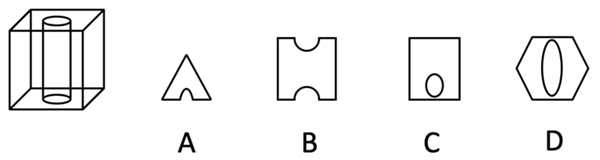
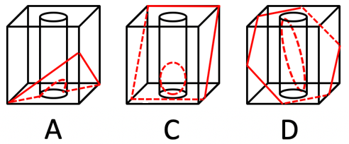

# 截面图-立方体贯穿挖孔（通孔）的截面判断

考点：[[20-考点/判断推理/图形推理/截面图-立方体贯穿挖孔（通孔）的截面判断|图形推理 / 截面图-立方体贯穿挖孔（通孔）的截面判断]]

**问法模型**：选非题：'从任意面剖开，哪一项不可能是截面' → 对每个选项构造或否定截平面，排除可截出的三项，锁定不可能的一项

## 推理链
1. 第1步：题干立体=正方体被一个从顶面贯穿到底面的竖直圆柱通孔挖空，截面必须同时体现'正方体截面轮廓+圆柱孔形成的缺口或内孔'两个要素
2. 第2步：所用规则——倾斜平面截圆柱侧壁得椭圆（弧）；截平面只有穿过顶面或底面的孔口，缺口才会与截面边缘相连；而平面截圆柱内部区域是凸集，一旦同时触及截面上两条相对的边缘，连通截面必被切成两块
3. 第3步：A项三角形底边中央带弧形缺口——让截平面斜切并穿过底面的孔口，椭圆下半部落到立方体外，截面上只留下与底边相连的半段椭圆弧缺口，可截出
4. 第4步：C项正方形内含一个完整封闭圆孔——用水平面（或近水平斜面）横截，正方形截面内留下完整圆（椭圆）孔洞，可截出
5. 第5步：D项六边形内含完整椭圆——让截平面斜切过立方体六个面得六边形，并从圆柱中部侧壁穿过，椭圆完整落在六边形内部不触边，可截出
6. 第6步：B项矩形上下两边中央同时出现缺口却仍是连通的一块——缺口在上边说明截平面穿过顶面孔口，缺口在下边说明又穿过底面孔口，贯穿的圆柱孔必然把截面截断成独立两块，与B项连通图形矛盾，故B不可能，选B

**最快解法**：⚡ 通孔截断原则+排除法：抓住'圆柱是贯穿上下的通孔'——同一连通截面上，缺口只能出现在截平面穿过的那一个孔口所连的边缘上；凡相对两边（上下）同时有缺口、图形却仍连通的选项必不可能。B上下双缺口且连通，直接锁定B；A（单侧缺口）、C/D（内部封闭孔）均可截出。

## 易错点
- ⚠ 忽略通孔的贯穿性：以为斜着切可以在上下两边各留一个缺口，实际截面会被孔切成两块而非连通图形
- ⚠ 想不到A的成因：截平面穿过底面孔口时只截出下半段椭圆弧，形成贴边缺口而非封闭椭圆，因而误选A
- ⚠ 把'挖去的圆柱'当实心圆柱处理，忘记孔洞处应表现为缺口或孔洞而非实线轮廓

## 母题抽象
> 🧩 当题干出现'立体中间打贯穿孔（通孔）求不可能截面'时，用'孔口截断'原则验证：缺口只能与截平面穿过的那个孔口边缘相连，凡连通截面在相对两条边上同时出现缺口的选项必不可能。

**同类特征**：正方体从中间挖去圆柱（通孔）、从任意面剖开、选非题：不可能是截面的一项、选项含贴边缺口/内部封闭孔图形、斜截圆柱得椭圆弧

## 相关题
- [[10-真题/判断推理/图形推理/2049950 截面图-组合立体（叠加+挖孔）的可行截面构造|2049950]]（湖南 2017，相关度1）
- [[10-真题/判断推理/图形推理/2615987 截面图（立体切割-空心立体截面）|2615987]]（海南 2020，相关度1）

---

### 题干

将一个正方体从中间挖去一个圆柱，得到如左图所示的新立体图形，从任意面剖开，右边哪一项不可能是该立体图形的截面？

### 选项
- A. A
- B. B　✅
- C. C
- D. D

### 官方解析

本题考查截面图，如下图所示，A、C、D三项均可截出，只有B项无法截出。

本题为选非题，故正确答案为B。

### 给定材料
（无）
