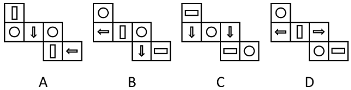
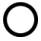

# 空间重构-相对面关系（展开图折纸盒）

考点：[[20-考点/判断推理/图形推理/空间重构-相对面关系（展开图折纸盒）|图形推理 / 空间重构-相对面关系（展开图折纸盒）]]

**问法模型**：四个展开图中哪个折成的正方体与其他三个不一样 → 空间重构相对面模型：给每个展开图标出三组相对面，比较相同图案是否互为相对面，唯一违反者即为答案（选非题）。

## 推理链
1. 第1步：四个展开图结构一致，均为1-3-2型（顶部1面+中间3面+底排2面），且每图都恰含2个○、2个箭头、2个条形，图案两两成对。
2. 第2步：按相对面规则配对：中间行首尾两面（M1与M3）同行隔一面相对；顶面T与底排第一面B1、中间面M2与底排第二面B2呈Z字两端分别相对。
3. 第3步：A图三组相对面为（○，○）（竖条，竖条）（↓，←）；C图为（↓，↓）（横条，横条）（○，○）；D图为（←，→）（○，○）（竖条，横条）——三图中同类图案均两两落在相对面上。
4. 第4步：B图三组相对面为（←，○）（○，↓）（竖条，横条）：两个○互为相邻面、两个箭头也互为相邻面，出现两组相对面图案不同。
5. 第5步：对照问法哪个与其他三个不一样：A/C/D均满足同类图案互为相对面，只有B不满足，故B折成的正方体与其他三个不同，选B。

**最快解法**：⚡ 相对面配对法（口诀：同行隔一面、Z字两端相对）：先用口诀给四图各配出三组相对面，再验证2个○、2个箭头、2个条形是否各自落在相对面上，A/C/D全部满足，B中○与箭头交叉相对（←与○、○与↓为相对面），秒选B。

## 易错点
- ⚠ 只核对一组相对面就下结论：B中竖条与横条那组是同类的，若只看这组会误认为B也正常；必须三组全查，才能发现B中（←，○）（○，↓）两组图案不同。
- ⚠ 把↓/←、←/→、竖条/横条因方向不同而误判A、D也存在相对面图案不同，从而错选A或D；本题以图案类别为准比较（面随正方体旋转，同类图案视为相同）。
- ⚠ 相对面配错位：1-3-2型中顶面与底排第一面（Z字两端）相对、中间面与底排第二面相对；若误把顶面与底排第二面配对，A图会配出（竖条，←）这类异组而错选A。

## 母题抽象
> 🧩 当展开图中六面图案两两成对时，用同行隔一面+Z字两端配出三组相对面，再验证相同图案是否互为相对面：全部互为相对面者折成同一类正方体，凡相同图案变成相邻面的那一个即为折法不同的异项。

**同类特征**：正方体外表面展开图、1-3-2型展开图、六面图案两两成对（2个○、2个箭头、2个条形）、问哪个折成后与其他三个不一样、相对面关系判定、空间重构选非题

## 相关题
- [[10-真题/判断推理/图形推理/10297111 空间重构-展开图拼合（碎片旋转组合）|10297111]]（天津 2025，相关度1）
- [[10-真题/判断推理/图形推理/12304871 空间重构-六面体折叠（相对面排除+共顶点相邻面）|12304871]]（江苏 2024，相关度1）
- [[10-真题/判断推理/图形推理/13504536 空间重构-展开图拆分拼合（黑白图案旋转复原）|13504536]]（河南 2025，相关度1）
- [[10-真题/判断推理/图形推理/15419026 六面体展开图-展开图等同性判定（画边法-时针方向法）|15419026]]（湖北 2025，相关度1）
- [[10-真题/判断推理/图形推理/18650003 空间重构-六面体折叠（相对面关系判定）|18650003]]（选调 2025，相关度1）

---

### 题干

以下为4个正方体的外表面展开图。其中哪个折成的正方体和其他3个不一样？

### 选项
- A. A
- B. B　✅
- C. C
- D. D

### 官方解析

本题为空间重构题。A、C、D三项中，构成相对面的两个面图案均相同，但B项中，“”面与“”面构成相对面，图案不同，只有B项与其他三项不同。

本题为选非题，故正确答案为B。

### 给定材料
（无）

> [!warning] 疑点（官方解析可能有误，待人工复核）
> 官方解析引号内具体图案缺失（某面与某面未随文字显示）；且A、C、D相对面图案均相同仅在图案类别层面成立，若严格按方向比较，A中相对面为↓与←、D中为←与→及竖条与横条，方向亦不同。此为表述精度问题，不影响结论：B中两个○、两个箭头均未构成相对面，B仍是唯一异项。

<!-- CODEX-ANSWER-REVIEW:BEGIN -->
### 本次独立复核

**复核状态：** `resolved`（答案与解析已核定）

**计分答案：** B（可计分）

**复核解析：**

按修订题干明确的图案类别判定相对面：A、C、D三项中，相对面的图案类别相同；B项中圆形面与箭头面构成相对面，类别不同，因此B与其他三项不同。答案B。这个结论与2024山西县级纪委监委回忆卷第51题及山西华图同卷估分答案一致；题源未找到考试机关发布的标准答案，故将图案类别口径明示在修订题干中。

**修订题干：**

以下为4个正方体的外表面展开图。比较相对面时，仅按圆形、箭头、条形三类图案判断，不把同一图案在面的朝向差异另算为不同类别。其中哪个折成的正方体和其他3个不一样？

**相关信息：**

空间重构—正方体展开图的相对面；符号的类别与面内方向须先定义，再比较相对面。

**题源依据：** [固定版本原题](https://github.com/Mentat-Uran/kaogongzhentizhengliu/blob/84ab93d4b64b61d897bece8a1c0a5bab06b4feb2/10-%E7%9C%9F%E9%A2%98/%E5%88%A4%E6%96%AD%E6%8E%A8%E7%90%86/%E5%9B%BE%E5%BD%A2%E6%8E%A8%E7%90%86/17097750%20%E7%A9%BA%E9%97%B4%E9%87%8D%E6%9E%84-%E7%9B%B8%E5%AF%B9%E9%9D%A2%E5%85%B3%E7%B3%BB%EF%BC%88%E5%B1%95%E5%BC%80%E5%9B%BE%E6%8A%98%E7%BA%B8%E7%9B%92%EF%BC%89.md)；固定内容 commit `84ab93d4b64b61d897bece8a1c0a5bab06b4feb2`，Markdown blob `804a05bca02bceb4054efe03e973707b290376de`。
<!-- CODEX-ANSWER-REVIEW:END -->
