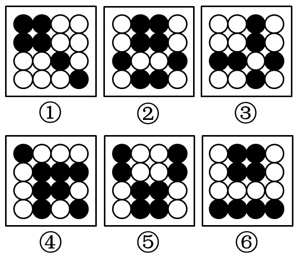

# 属性规律-对称性（对称轴方向：竖直轴与对角线轴）

考点：[[20-考点/判断推理/图形推理/属性规律-对称性（对称轴方向：竖直轴与对角线轴）|图形推理 / 属性规律-对称性（对称轴方向：竖直轴与对角线轴）]]

**问法模型**：“六个图形分为两类，使每类各有共同特征”→ 分组分类模型：逐一检验属性规律（对称轴方向），按方向差异三三分组

## 推理链
1. 第1步：六图均为16宫格内黑白圆点排布，外框与元素完全一致，数黑圆个数得①③为6个、②④⑤⑥为8个，无法三三均分，排除数量规律，转向属性规律。
2. 第2步：对②沿竖直中线对折检验：第3行左端黑圆(3,1)与右端黑圆(3,4)重合，(1,2)(1,3)、(4,2)(4,3)左右互为镜像；⑤的(1,1)(1,4)、⑥的(4,1)(4,4)同理，故②⑤⑥均为竖直对称轴的轴对称图形。
3. 第3步：对①先竖折不重合（左上(1,1)为黑、右上(1,4)为白），改沿左上—右下对角线折叠：(1,2)黑与(2,1)黑重合、(1,1)(3,3)(4,4)在对角线上，①关于该对角线对称。
4. 第4步：同法验证③：(1,3)↔(3,1)、(2,3)↔(3,2)、(3,4)↔(4,3)关于对角线两两重合；④：(2,3)↔(3,2)、(2,4)↔(4,2)关于对角线重合，故①③④均关于16宫格的对角线（左斜轴）对称。
5. 第5步：据此①③④为一组（对角线对称），②⑤⑥为一组（竖直轴对称），对照选项仅A为“①③④，②⑤⑥”，当选。

**最快解法**：⚡ 对称轴方向口诀“先竖后斜”：②⑤⑥左右对折即重合→竖轴一组；①③④竖折不重合、沿左上—右下对角线对折重合→对角线轴一组；直接锁定A。

## 易错点
- ⚠ 先数黑白圆个数：①③为6个、④为8个，凑不出3+3分组，易陷入数量类规律死胡同
- ⚠ 找到②⑤⑥竖对称就停止作答，未继续给①③④找对应属性，无法成组
- ⚠ 对角线方向看反：①③④沿“╲”（左上—右下）对角线对称，沿“╱”方向对折并不重合，需实际翻折验证而非凭印象

## 母题抽象
> 🧩 当题干出现“六个宫格/点阵图形分两类”且各图元素构成一致、仅位置不同时，先排除数量规律，再按“竖轴→横轴→对角线”顺序检验对称轴方向，按方向不同完成三三分组。

**同类特征**：16宫格黑白圆点、六个图形分两类（3+3）、外框一致仅圆点位置不同、黑白圆个数不成3:3比例、②⑤⑥左右镜像重合、①③④沿对角线翻折重合

## 相关题
（暂无）

---

### 题干

把下面的六个图形分为两类，使每一类图形都有各自的共同特征或规律，分类正确的一项是：

### 选项
- A. ①③④，②⑤⑥　✅
- B. ①④⑥，②③⑤
- C. ①②④，③⑤⑥
- D. ①③⑥，②④⑤

### 官方解析
本题为分组分类题目。在16宫格内，每个图形均由空白圆和黑色圆构成，且发现②⑤⑥图形均为对称图形，且对称轴方向均为竖向，再观察发现①③④图形均关于16宫格的左斜对称轴对称。即①③④一组，②⑤⑥一组。
故正确答案为A。

### 给定材料
（无）
