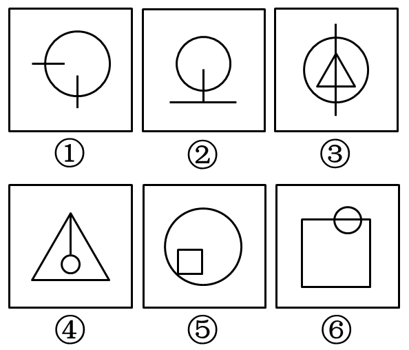

# 数量规律-交点数（主体元素与其他元素的交点）

考点：[[20-考点/判断推理/图形推理/数量规律-交点数（主体元素与其他元素的交点）|图形推理 / 数量规律-交点数（主体元素与其他元素的交点）]]

**问法模型**：六个图形分为两类 → 逐图提取共同构成要素，寻找可二分的数量/位置规律

## 推理链
1. 第1步：观察六个图形的构成，发现每幅图都由一个圆形（可视为主体元素）和其它元素（线段、三角形、正方形）构成
2. 第2步：确认主体元素与其它元素之间均存在接触，由此确定规律方向——数'圆与其它元素之间的交点个数'
3. 第3步：数交点——图①中圆与左侧横线、下方竖线各有1个交点，共2个；图③中竖线穿过圆，与圆周上下各交1点，共2个；图⑥中小圆与正方形顶边相交，共2个交点
4. 第4步：图②中圆与其它元素仅有1个交点；图④中小圆与三角形仅1个接触点；图⑤中小正方形与圆仅1个接触点
5. 第5步：①③⑥交点数均为2，②④⑤交点数均为1，据此二分
6. 第6步：对照选项，①③⑥一组、②④⑤一组对应D项，验证解法二'圆与直线交点分别为2、1、2、1、1、2'结论一致

**最快解法**：⚡ 数交点法：锁定'每图都有圆'这一共性，只数圆（主体元素）与其它元素的交点数——①③⑥为2个，②④⑤为1个，直接选D

## 易错点
- ⚠ 只数图形内部所有线段交点或总交点数，忽略'主体元素（圆）与其它元素'这一限定对象
- ⚠ 把圆与直线的相切/接触点漏数，或把一条线与圆的接触误判（应数线与圆周的交点个数，如③中竖线穿圆应数上下2点）
- ⚠ 图⑥中主体是小圆而非大正方形，主体认定错误会导致交点数数错

## 母题抽象
> 🧩 当一组图形都由'一个主体图形+其它元素'构成且元素间存在接触时，用数'主体图形与其它元素交点/接触点个数'的方法进行二分分类

**同类特征**：六图二分分类题、每图均含一个圆形主体元素、圆与线段或多边形存在交点或接触、交点数呈2与1两类分布、图形外形差异大但交点规律统一

## 相关题
（暂无）

---

### 题干

把下面的六个图形分为两类，使每一类图形都有各自的共同特征或规律，分类正确的一项是：

### 选项
- A. ①②④，③⑤⑥
- B. ①②⑤，③④⑥
- C. ①③④，②⑤⑥
- D. ①③⑥，②④⑤　✅

### 官方解析
解法一：本题考查数数中的主体元素与其它元素的交点数，逐一分析选项。
观察发现，题干中每幅图中都由一个圆形（可看成主体元素）以及其它元素构成，且主体元素与其它元素之间都存在交点，根据交点的个数可将图形分成两组。其中图①③⑥中交点数均为2，图②④⑤中交点数均为1。
故正确答案为D。
解法二：每幅图均由曲线和直线构成，曲线即圆与直线的交点分别是2、1、2、1、1、2。
故正确答案为D。

### 给定材料
（无）
