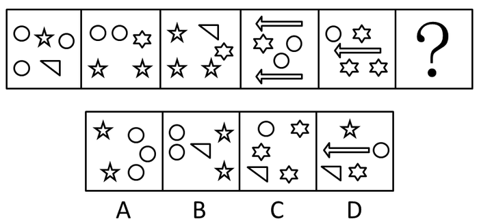

# 数量规律-元素种类与个数（个数交替循环）

考点：[[20-考点/判断推理/图形推理/数量规律-元素种类与个数（个数交替循环）|图形推理 / 数量规律-元素种类与个数（个数交替循环）]]

**问法模型**：'选择最合适的一个填入问号处使之呈现规律性'且元素组成凌乱 → 数每幅图的元素种类数与每种元素的个数，寻找交替循环规律

## 推理链
1. 第1步：题干5幅图均由分散排布的小元素组成，线条、封闭面等特征无统一规律，且每幅图恰好都由3种不同元素构成（圆、五角星、三角形、六角星、箭头等），元素种类数恒为3
2. 第2步：进一步数每幅图中每种元素的个数：图1为1、1、3，图2为1、2、2，图3为1、1、3，图4为1、2、2，图5为1、1、3（每图总数均为5个）
3. 第3步：个数规律呈'1、1、3'与'1、2、2'交替循环，第6幅图（问号处）三种元素的个数应为1、2、2
4. 第4步：逐项对照：A项仅2种元素（五角星、圆），种类数不符，排除；D项含4种元素，种类数不符，排除
5. 第5步：B、C均为3种元素，数个数：B项为1、2、2，符合规律；C项为1、1、3，是上一图已出现的规律，排除，故选B

**最快解法**：⚡ 数元素法（种类+个数两步走）：第一层先验证'每图3种元素'，秒杀排除A（2种）、D（4种）；第二层比较B（1、2、2）与C（1、1、3），按题干'1,1,3与1,2,2交替'的规律锁定B

## 易错点
- ⚠ 只数元素总个数（每图均为5个）而忽略分种类统计，无法区分选项
- ⚠ B、C都满足'3种元素'这一层规律，若漏数'每类个数'这层二级规律极易误选C
- ⚠ 五角星与六角星外形相近，数个数时看混形状会导致各类个数统计错误

## 母题抽象
> 🧩 当图形由多个分散小元素组成、位置和线条特征均无规律时，依次数'元素种类数→每种元素个数'，若个数呈交替/循环规律，则按规律推出问号处的个数组合并对照选项

**同类特征**：元素组成凌乱、每幅图由多种小元素分散排布、元素种类数恒定（均为3种）、每类元素个数呈交替规律、存在五角星/六角星等易混的相似元素、每图元素总数相同（均为5个）

## 相关题
- [[10-真题/判断推理/图形推理/1746870 数量规律-笔画数（奇点数定最少笔画）|1746870]]（国考 2016，相关度1）
- [[10-真题/判断推理/图形推理/1746874 图形推理-对称性（对称轴数量与方向）|1746874]]（国考 2016，相关度1）
- [[10-真题/判断推理/图形推理/1752670 图形推理-属性类对称性（轴对称与中心对称分组）|1752670]]（北京 2016，相关度1）
- [[10-真题/判断推理/图形推理/1772266 数量规律-面（封闭空间）数量成等差数列|1772266]]（深圳市考 2016，相关度1）
- [[10-真题/判断推理/图形推理/2024138 属性规律-对称性（轴对称与中心对称二分）|2024138]]（重庆 2016，相关度1）

---

### 题干

从所给四个选项中，选择最合适的一个填入问号处，使之呈现一定规律性：

### 选项
- A. A
- B. B　✅
- C. C
- D. D

### 官方解析
元素组成凌乱，观察图形发现每个图形均由多种元素组成，考虑元素的种类和个数。观察发现，题干中每幅图均由三种元素构成，B、C两项均满足；继续观察，可发现题干中每幅图中每种元素的个数分别为1、1、3，1、2、2，1、1、3，1、2、2，1、1、3，因此问号处三种元素的个数应分别为1、2、2。B项为1、2、2，C项为1、1、3。
故正确答案为B。

### 给定材料
（无）
