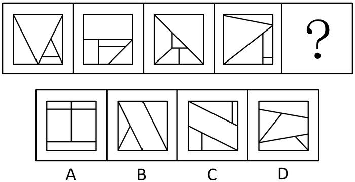

# 数量规律-面数量＋面的细化特征（最大面面积占正方形一半）

考点：[[20-考点/判断推理/图形推理/数量规律-面数量＋面的细化特征（最大面面积占正方形一半）|图形推理 / 数量规律-面数量＋面的细化特征（最大面面积占正方形一半）]]

**问法模型**：问号处填入使一组分割图形呈现规律的选项 → 元素组成不同先排除属性规律，优先数面（封闭区域），面数不唯一时再对面的形状/面积占比做二级辨析

## 推理链
1. 第1步：题干四幅图均为正方形被内部线条分割，元素组成不同，对称、曲直等属性规律无统一特征，窟窿（封闭区间）多，按解析优先考虑数量规律中的数面
2. 第2步：数面验证：题干每幅图均由5个面组成，构成常数规律
3. 第3步：数选项面数：A、C、D均为5个面，B只有4个面，依据'每幅图5个面'排除B
4. 第4步：面数剩A、C、D多个候选，规律不唯一，转入面的细化特征：题干每幅图中均有一个面的面积等于整个正方形的一半（如图1上方V形大面、图3/图4被对角线分出的大三角形面）
5. 第5步：逐项对照该特征：A项5个面但均为条状/块状小面，无一占正方形一半；C项两平行斜线所夹的斜带面恰为正方形面积一半；D项各面也无占半的大面
6. 第6步：只有C项同时满足'5个面＋存在面积为一半的面'，与题干规律完全吻合，故选C

**最快解法**：⚡ 数面法＋最大面特征二级辨析：先数面排除B（仅4个面），再用'每图存在面积为一半的大面'排除A、D，锁定C

## 易错点
- ⚠ 只数面数量：发现A、C、D都是5个面后无计可施，忽略'面的面积占比'这一二级辨析特征
- ⚠ 对C项中间斜带面面积误判，未意识到两平行斜线截正方形所夹带形区域可恰为面积一半
- ⚠ 线条交错处封闭区域漏数或多数，导致面数判断失误（如误判B的面数）

## 母题抽象
> 🧩 当题干是一组被内部线条分割的封闭图形、元素组成不同且数面得到多个相同候选时，继续对'最大面的面积占比/形状'做二级辨析（如存在占正方形一半的大面）即可定答案

**同类特征**：正方形内部线条分割、封闭区间（窟窿）数量多、每幅图均为5个面、存在面积为一半的最大面、元素组成不同，属性规律失效

## 相关题
（暂无）

---

### 题干

每道题包含一套图形和四个选项，请从四个选项中选出最恰当的一项填在问号处，使图形呈现一定的规律性。

### 选项
- A. A
- B. B
- C. C　✅
- D. D

### 官方解析
元素组成不同，且无法通过属性规律解题，考虑数量规律。题干图形窟窿（封闭区间）很多，优先数面。题干每幅图均由5个面组成，排除B选项。再观察，发现题干中每幅图形均有一个面的面积为整个正方形的一半，选项中ACD中只有C项符合此规律。
故正确答案为C。

### 给定材料
（无）
