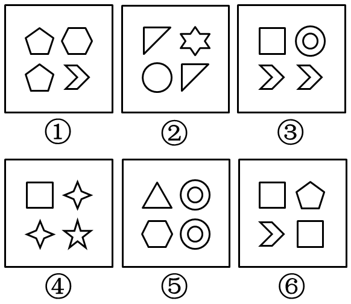

# 数量规律-相同元素的相对位置（同行-同列 vs 对角线）

考点：[[20-考点/判断推理/图形推理/数量规律-相同元素的相对位置（同行-同列 vs 对角线）|图形推理 / 数量规律-相同元素的相对位置（同行/同列 vs 对角线）]]

**问法模型**：六个小元素图形分为两类→先数元素个数，再锁定每图中'两个相同元素'并观察其排布位置分组

## 推理链
1. 第1步：元素组成不同，且每幅图均由4个独立小元素按2×2排布，优先考虑数量规律
2. 第2步：逐图找出重复元素：①两个五边形、②两个三角形、③两个双箭头（ chevron ）、④两个四角星、⑤两个双重圆、⑥两个正方形，每图都恰有两个元素一样
3. 第3步：观察相同元素的位置：①两五边形同在左列、③两双箭头同在下行、⑤两双重圆同在右列，均为同行或同列关系
4. 第4步：②两三角形（左上-右下）、④两四角星（右上-左下）、⑥两正方形（左上-右下）均处于对角线位置
5. 第5步：据此二分，①③⑤为同行/同列一组，②④⑥为对角线一组，与选项B吻合

**最快解法**：⚡ 位置规律口诀'找相同、看排布'：先圈出每幅图中重复的那个小元素，再看两个相同元素是同行/同列还是对角线，直接分为①③⑤、②④⑥，选B

## 易错点
- ⚠ 只发现每图都是4个元素、数量相同分不了组，就放弃数量规律，没想到细化为'相同元素的位置关系'
- ⚠ 找错重复元素：如④中把四角星与五角星误认相同、⑤中把双重圆与单圆混淆
- ⚠ 受对称性、封闭区域数等高频规律干扰，未优先锁定'两个相同元素'这一题眼

## 母题抽象
> 🧩 当六个图均由多个小元素组成且元素形状不同时，先找每图中'重复出现的相同元素'，再按其位置关系（同行/同列 vs 对角线）二分分类

**同类特征**：六个图形分类题、每图4个独立小元素、2×2排布、每图恰有两个相同元素、相同元素呈同行/同列或对角线、元素组成不同

## 相关题
- [[10-真题/判断推理/图形推理/10204454 数量规律-部分数（黑白球连通区域数做和）|10204454]]（甘肃 2024，相关度1）
- [[10-真题/判断推理/图形推理/10204604 数量规律-线数量（汉字横线数）|10204604]]（辽宁 2024，相关度1）
- [[10-真题/判断推理/图形推理/10297050 数量规律-特殊计数（线条穿过小白球的数量）|10297050]]（天津 2025，相关度1）
- [[10-真题/判断推理/图形推理/10297127 图形间关系-相交图形中不相交边数量（黑白图形相交）|10297127]]（天津 2025，相关度1）
- [[10-真题/判断推理/图形推理/10297148 数量规律-线的细化（端点连线穿过线条数；备选：平行线组数）|10297148]]（天津 2025，相关度1）

---

### 题干

把下面的六个图形分为两类，使每一类图形都有各自的共同特征或规律，分类正确的一项是：

### 选项
- A. ①②③,④⑤⑥
- B. ①③⑤,②④⑥　✅
- C. ①②⑤,③④⑥
- D. ①③⑥,②④⑤

### 官方解析
元素组成不同，且所有图形均为小元素组成，故优先考虑数量规律。全部都由四个独立的元素构成，且每幅图都有两个元素一样。观察发现，图①、③、⑤的两个相同的元素的位置关系是在同行或者同列，图②、④、⑥的两个相同的元素的位置关系为对角线关系。
故正确答案为B。

### 给定材料
（无）
