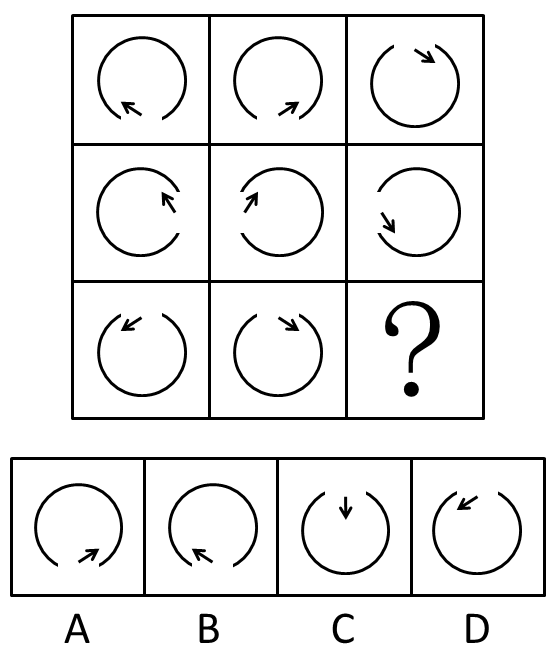

# 图形推理-位置规律（翻转：先左右翻转、再上下翻转）

考点：[[20-考点/判断推理/图形推理/图形推理-位置规律（翻转：先左右翻转、再上下翻转）|图形推理 / 图形推理-位置规律（翻转：先左右翻转、再上下翻转）]]

**问法模型**：九宫格'符合图形变化规律'问法→元素组成相同优先看位置规律，按行寻找复合翻转规律（先左右翻转、再上下翻转）

## 推理链
1. 第1步：九宫格每行图形均由'带缺口的圆弧+一个小箭头'构成，元素组成相同，优先考虑位置规律（旋转/翻转/平移）
2. 第2步：验证第一行：图1缺口在下方偏左、箭头朝左上，左右翻转后缺口到下方偏右、箭头变为朝右上，即为图2；图2再上下翻转，缺口转到上方、箭头变为朝右下，即为图3，确定规律为'每行先左右翻转、再上下翻转'
3. 第3步：第二行验证：图1（缺口右下、箭头朝左上）左右翻转得图2（箭头朝右上），图2上下翻转得图3，规律成立
4. 第4步：第三行应用前半段：图1（缺口右上、箭头朝左下）左右翻转得图2（缺口转到左上、箭头变为朝右下），与题面图2一致
5. 第5步：对第三行图2施加上下翻转：缺口由上方转到下方（落在左下），箭头位置由上移到右下、方向由朝右下变为朝右上
6. 第6步：对照选项：A项缺口在左下、箭头位于右下且朝右上，与推理结果完全一致；B项箭头朝左上、C项箭头竖直朝下、D项箭头朝左上且缺口在上方，均不符，故选A

**最快解法**：⚡ 位置规律口诀'一行两翻（先左右、后上下）'：直接对第三行图2作上下翻转——缺口转到左下、箭头翻成朝右上，秒选A

## 易错点
- ⚠ 把'上下翻转'误当'左右翻转'或'旋转180°'：上下翻转只改变箭头朝向的上下分量（朝右下↔朝右上），左右位置不变，误判易错选B/D
- ⚠ 只验证缺口位置而忽略箭头方向（或只看箭头忽略缺口），未做双重验证，易误选C
- ⚠ 元素组成相同时仍按列或整体找规律，舍近求远浪费时间；应优先按横行验证

## 母题抽象
> 🧩 当九宫格图形元素组成相同、仅缺口和箭头的位置/方向变化时，按行验证'翻转（先左右后上下）或旋转'规律，再将规律施加到问号前一格，直接比对选项形状与指向

**同类特征**：九宫格、元素组成相同、缺口圆弧+小箭头、位置规律、先左右翻转再上下翻转、求第三行问号处图形

## 相关题
- [[10-真题/判断推理/图形推理/2616003 位置规律-旋转与翻转复合（九宫格横行规律）|2616003]]（海南 2020，相关度3）
- [[10-真题/判断推理/图形推理/5408654 图形推理-位置规律（翻转：左右翻+上下翻接力）|5408654]]（四川 2022，相关度3）
- [[10-真题/判断推理/图形推理/2172768 位置规律（旋转-翻转）|2172768]]（海南 2021，相关度2）
- [[10-真题/判断推理/图形推理/12334416 图形推理-位置规律（旋转-翻转组合变换）|12334416]]（江苏 2024，相关度2）
- [[10-真题/判断推理/图形推理/17056528 位置规律-旋转（九宫格V形开口顺时针旋转90°）|17056528]]（上海 2026，相关度2）

---

### 题干

下列选项中，符合所给图形的变化规律的是：

### 选项
- A. A　✅
- B. B
- C. C
- D. D

### 官方解析
图形元素组成相同，优先考虑位置规律。九宫格每行第一个图形向右翻转得到第二个图形，再由第二个图形上下翻转得到第三个图形。
故正确答案为A。

### 给定材料
（无）
