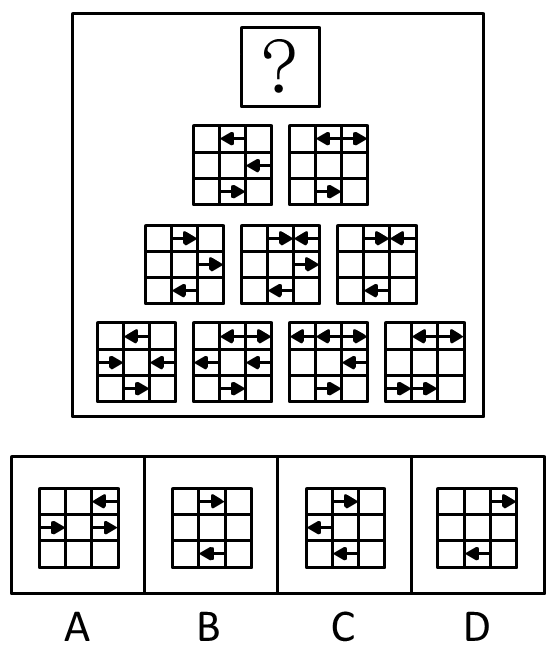
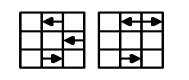
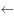

# 样式规律-图形叠加（自定义运算：相同保留且方向反转、不同消去为空白）

考点：[[20-考点/判断推理/图形推理/样式规律-图形叠加（自定义运算：相同保留且方向反转、不同消去为空白）|图形推理 / 样式规律-图形叠加（自定义运算：相同保留且方向反转、不同消去为空白）]]

**问法模型**：“符合所给图形的变化规律”＋金字塔逐层两两合成结构 → 识别叠加规则（同位置：元素相同则保留并反向，不同则置空），由下往上合成问号处图形

## 推理链
1. 第1步：题干为金字塔式排布——底层4个含方向箭头的3×3网格，向上逐层为3个、2个，塔顶为“？”，提示每层由其正下方相邻两图叠加生成上一层图形
2. 第2步：提取叠加规则：下面两图同一位置，元素相同→保留但方向变为相反；元素不同（含一有一空、方向不同）→消去变成空白
3. 第3步：对比“？”正下方左右两图：只有中间列最上面一格（均为向左箭头“←”）和最下面一格（均为向右箭头“→”）位置与方向完全相同，其余位置均不相同
4. 第4步：对相同位置执行“方向反转”：最上格“←”变为“→”，最下格“→”变为“←”，其余格子全部消去为空白
5. 第5步：逐项对照：B项恰好只有最上格向右箭头与最下格向左箭头，其余为空白，完全吻合
6. 第6步：A、C、D均多出其他格子的箭头或箭头位置、方向不符，排除，故选B

**最快解法**：⚡ 叠加口诀“相同保留、方向反转，不同清空”＋排除法：只对比问号正下方左右两图，锁定仅有的两处相同（中间列最上、最下格），方向反转后直接与选项比对，B项两箭头位置与方向完全对应。

## 易错点
- ⚠ 套用常规“求同存异”叠加而漏掉“方向反转”这一步，误以为保留原方向箭头
- ⚠ 把“元素不同”仅理解为方向不同的箭头，忽略“一空一有”同样属于不同、需消去为空白
- ⚠ 从底层四个图逐层验证浪费时间，或箭头左右方向看反导致选错选项

## 母题抽象
> 🧩 当题干出现金字塔（三角形）排布的多个同构小图形（如3×3箭头网格）且问号在塔顶时，用“相邻两图同位置对比：相同→保留并方向反转，不同→置空”的叠加规则，直接合成上层目标图形

**同类特征**：金字塔形逐层排布的多宫格、3×3网格内含方向箭头、由下往上两两合成、相同保留＋方向反转、不同消去为空白、问号位于塔顶

## 相关题
- [[10-真题/判断推理/图形推理/1805294 样式规律-品字运算（杨辉三角式相邻叠加，箭头方向运算）|1805294]]（上海 2016，相关度1）
- [[10-真题/判断推理/图形推理/5423865 样式规律-黑白运算（金字塔型多层叠加，逐区域运算）|5423865]]（上海 2023，相关度1）

---

### 题干

下列选项中，符合所给图形的变化规律的是（    ）。

### 选项
- A. A
- B. B　✅
- C. C
- D. D

### 官方解析

原图是由下往上，下面两幅图结合推出上面一幅图。其规律是：同一位置元素不同的就去掉变成空白，元素相同的就保留但方向变成相反的。

根据这个规律来观察：

相同的地方只有中间列的最上面和最下面，把方向反过来，最上面的箭头变成，最下面箭头变成，其他的都去掉变成空白，只有B项符合要求。

故正确答案为B。

### 给定材料
（无）
