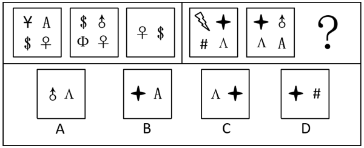
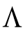

# 图形推理-元素种类与个数（求同规律-公共元素保留）

考点：[[20-考点/判断推理/图形推理/图形推理-元素种类与个数（求同规律-公共元素保留）|图形推理 / 图形推理-元素种类与个数（求同规律/公共元素保留）]]

**问法模型**：两组图对照求'图形变化规律'→ 数元素种类个数，验证'第三图=前两图公共元素（求同）'并应用到第二组

## 推理链
1. 第一组：图一含¥、A、$、♀四个小元素，图二含$、♂、Φ、♀四个小元素，元素组成不同且出现不同小元素，优先考虑元素种类和个数
2. 图三仅含♀、$两个元素，恰好都是图一和图二共同出现的元素，归纳规律为'图三=图一∩图二（保留公共元素）'
3. 第二组：图一含⚡、✦、#、Λ，图二含✦、♂、Λ、A，逐个比对得相同小元素为'✦'和'Λ'
4. 故问号处图形应且仅含✦和Λ这两个小元素
5. 逐项对照：A为♂+Λ，♂非公共元素，排除；B为✦+A，A非公共元素，排除；C为Λ+✦，两元素均为公共元素，符合；D为✦+#，#非公共元素，排除
6. 结论：只有C项同时含第二组图一、图二的全部公共元素，故选C

**最快解法**：⚡ 求同法+排除法：直接圈出第二组图一与图二中重复出现的小元素'✦'和'Λ'，快速排除只含其一或混入非公共元素的A、B、D，锁定C

## 易错点
- ⚠ 误把规律当元素个数递减或位置旋转/移动，忽略'公共元素保留'的求同本质
- ⚠ 只验证选项含✦就仓促作答，未检查另一元素是否也为公共元素（如误选含A的B或含#的D）
- ⚠ 找公共元素时漏比某个小元素（如忽略⚡或#），导致公共元素集合找错

## 母题抽象
> 🧩 当两组图每格由多个不同小元素组成且第三图元素明显减少时，用'求同法'验证第三图=前两图公共元素之交集，问号处同理

**同类特征**：两组图对照类比、每格含4个不同小元素、第三图仅含2个元素、元素组成不同、公共元素/求同规律、问号处补图

## 相关题
- [[10-真题/判断推理/图形推理/10204454 数量规律-部分数（黑白球连通区域数做和）|10204454]]（甘肃 2024，相关度1）
- [[10-真题/判断推理/图形推理/10204604 数量规律-线数量（汉字横线数）|10204604]]（辽宁 2024，相关度1）
- [[10-真题/判断推理/图形推理/10297050 数量规律-特殊计数（线条穿过小白球的数量）|10297050]]（天津 2025，相关度1）
- [[10-真题/判断推理/图形推理/10297127 图形间关系-相交图形中不相交边数量（黑白图形相交）|10297127]]（天津 2025，相关度1）
- [[10-真题/判断推理/图形推理/10297148 数量规律-线的细化（端点连线穿过线条数；备选：平行线组数）|10297148]]（天津 2025，相关度1）

---

### 题干

下列选项中，符合所给图形的变化规律的是<u>        </u>。

### 选项
- A. A
- B. B
- C. C　✅
- D. D

### 官方解析

元素组成不同，且出现了不同的小元素，优先考虑元素的种类和个数。第一组图中图一和图二均有4个不同的小元素，而图三只有2个不同的小元素，且这2个小元素均出现在了图一和图二中。第二组图应用此规律，图一和图二中的相同小元素为“”和“”，故？处的图形应含有这2个小元素，对应C项。

故正确答案为C。

### 给定材料
（无）
