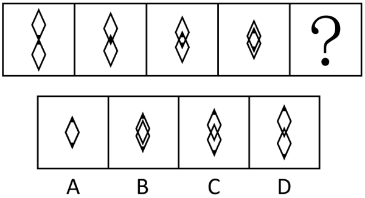

# 位置规律-平移（双元素相向平移至重合）

考点：[[20-考点/判断推理/图形推理/位置规律-平移（双元素相向平移至重合）|图形推理 / 位置规律-平移（双元素相向平移至重合）]]

**问法模型**：图形序列问'符合所给图形的变化规律的是'→ 元素组成相同优先看位置规律：量化每次平移的步长（占边长/高度的比例），据此外推问号处两图形的相对位置状态

## 推理链
1. 第1步：图1中两个大小相同的菱形上下排列、仅顶点相触，两菱形中心的相对距离等于一个菱形的高（竖直对角线）
2. 第2步：题干与解析给出平移规则——上方菱形向下平移、下方菱形向上平移（相向而行），每次各移一段边长、两个合计的位移量约相当于整个菱形高度的四分之一（题面文字中分数缺字，按解析'第4次平移恰好重合'可反推此步长）
3. 第3步：图1→图2、图2→图3、图3→图4中两菱形重叠程度逐次加深、外轮廓逐渐收拢，验证'每平移一次相对靠近固定步长'的规律成立
4. 第4步：图4到'？'为第4次平移，累计相对位移=4次×每步步长≈一个完整菱形的高，两菱形中心重合，图形应呈现为完全重合的单个菱形轮廓
5. 第5步：对照选项，A项为两菱形完全重合（只见单个菱形），B项上下仍有错位的双轮廓（未完全重合），C、D项重叠/相交程度不足，均不符合第4次平移后的状态

**最快解法**：⚡ 步长计算法+排除法：从'顶点相触'到'完全重合'需相对位移一个菱形的高，解析指明'？'处为第4次平移且'应平移到正好重合的位置'，故直接锁定呈现单个菱形（完全重合）的A项，排除仍见双轮廓或仅部分重叠的B、C、D

## 易错点
- ⚠ 把'每次移动'误解为两个菱形合计移动一份边长，漏算'各移一次、合计为两份'导致步长算错
- ⚠ 只凭'越来越重叠'的模糊趋势做题，不数平移次数，误选B（接近重合但仍有双轮廓）
- ⚠ 忽略'？'是第4次平移的终点（共5幅图、4次移动），误把图4的临界状态当成最终答案

## 母题抽象
> 🧩 当两个相同图形沿同一直线相向平移、每次步长固定时，先算'起始相对距离÷每步相对位移'得到重合所需次数，问号处即第N次平移后的完全重合（或对应重叠比例）图形

**同类特征**：两个相同菱形、上下相向平移、每次平移固定比例的边长、重叠程度逐图加深、第4次平移后恰好重合、元素组成相同优先位置规律

## 相关题
（暂无）

---

### 题干

两个菱形上下平移，每次移动边长的，下列选项中，符合所给图形的变化规律的是<u>        </u>。

### 选项
- A. A　✅
- B. B
- C. C
- D. D

### 官方解析

元素组成相同，优先考虑位置规律。根据题干得知，两个菱形上下平移，每次平移边长的。观察发现，图一中位于上方的菱形向下平移其边长的，同时位于下方的菱形向上平移其边长的，即两个菱形一共平移菱形边长的，相当于整个菱形高度的，其他图形也符合该规律，图四到？处为第4次平移，故？处图形中两个菱形应平移到正好重合的位置，只有A项符合。

故正确答案为A。

### 给定材料
（无）
