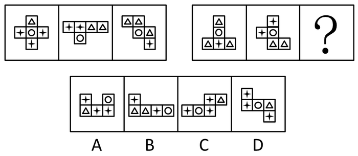

# 数量类-元素个数（'+'星形数量递减）＋空间重构-六面体展开图折叠（开口盒、底面定位）

考点：[[20-考点/判断推理/图形推理/数量类-元素个数（'+'星形数量递减）＋空间重构-六面体展开图折叠（开口盒、底面定位）|图形推理 / 数量类-元素个数（'+'星形数量递减）＋空间重构-六面体展开图折叠（开口盒、底面定位）]]

**问法模型**：两行式图形推理求'？'处规律 → 先数特征小元素的个数找行规律，再用展开图折叠规则（能否成盒、特定面方位）逐项二次排除

## 推理链
1. 第1步：题干每幅图均由5个小方格拼成，格内含'△''○''+'三种小元素，外形与正六面体展开图相似，故同时考虑素数量与空间重构两条线索
2. 第2步：数'+'（官方称'星'）的个数：第一行三图依次为3、2、1，呈递减规律
3. 第3步：第二行前两图'+'个数为1、2，按每行出现1、2、3的规律，？处图形应含3个'+'，B项只有2个'+'，排除B
4. 第4步：验证空间属性一——题干所有图形均能折成一面开口的正六面体，A项（2×2方块旁挂一格）无法折成开口六面体，排除A
5. 第5步：验证空间属性二——题干图形折叠后'○'面均处于底面，C项折叠后'○'面为侧面而非底面，排除C
6. 第6步：D项含3个'+'、可折成一面开口的六面体且'○'为底面，三项规律全部满足，故选D

**最快解法**：⚡ 数量规律＋折叠排除法：第一步数'+'个数，第二行应为1、2、3，锁定含3个'+'的A/C/D（排除B）；第二步用'能否折成开口六面体'排除A；第三步用'折叠后○恒为底面'排除C，秒选D

## 易错点
- ⚠ 图形中△○+三种元素混杂，只顾整体数元素总数而未锁定单一'+'符号的数量规律
- ⚠ 数完数量后直接比较平面形状，忽略'所有图均为可折叠展开图'这一空间属性，误选A
- ⚠ 折叠时未追踪'○'面的方位，漏掉'圆面恒为底面'的隐蔽规律而误选C

## 母题抽象
> 🧩 当图形由若干方格拼成且格内含多种小符号时，先挑某一特征符号数个数找行递变规律，再用展开图折叠规则（能否成盒、特定面位置）二次排除

**同类特征**：两行式问号缺位、每个图形由5个方格组成、方格内含△○+多种小元素、形似正六面体展开图、'+'个数3-2-1递减、需折叠成开口六面体且○为底面

## 相关题
（暂无）

---

### 题干

从所给四个选项中，选择最合适的一个填入问号处，使之呈现一定的规律性：

### 选项
- A. A
- B. B
- C. C
- D. D　✅

### 官方解析
图形均存在一些独立的小个体，并且和正六面体的展开图相似，考虑素数量和空间重构。
观察发现，第一行图形“星”的数量分别是3、2、1，第二行前两个图形“星”的数量为1、2、？，则？处应为“星”数量是3的图形，排除B项；并且题干所有图形均能折成一面开口的正六面体，排除A项；继续观察发现，题干所有图形折成的开口六面体中，圆面均为底面，排除C项。
故正确答案为D。

### 给定材料
（无）
