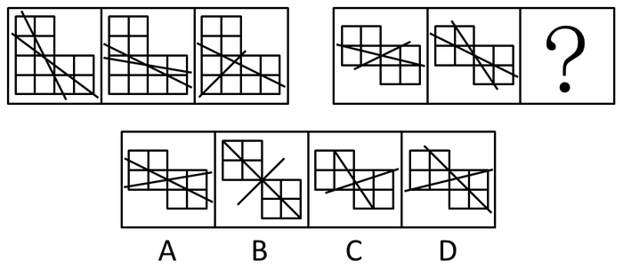

# 位置规律-直线切割（切割区域面积两两相等+直线均切入主体）

考点：[[20-考点/判断推理/图形推理/位置规律-直线切割（切割区域面积两两相等+直线均切入主体）|图形推理 / 位置规律-直线切割（切割区域面积两两相等+直线均切入主体）]]

**问法模型**：两组图'元素组成相同'→ 不套旋转平移，先找直线对主体的切割规律（面积分组），再查直线穿行位置，双重筛选排除

## 推理链
1. 第1步：两组图均为'小方格拼接的主体图形+两条直线'，元素组成相同，优先考虑直线与主体图形之间的位置/切割规律
2. 第2步：细看第一组：两条直线将主体图形分割成若干块，恰好构成'两对两两之间面积相同'的部分
3. 第3步：将此规律代入第二组已给出的两图验证：其两条直线同样把主体分成两对等面积部分，规律成立
4. 第4步：用该规律对照选项：C、D中直线切出的区域面积无法两两配对相等，排除C、D
5. 第5步：追加第二重规律——各组图中任一直线均在主体图形内部进行切割（切实切到小方格）；B项中有一条直线没有切割任何一个小方格，排除B
6. 第6步：A项两条直线均切入主体内部，且将主体分割成两对面积相同的部分，同时满足两重规律，与官方答案一致

**最快解法**：⚡ 双重排除法：先验'两直线切割出两对等面积部分'排除C、D，再验'每条直线均切实切到小方格'排除B，锁定A

## 易错点
- ⚠ 见'元素组成相同'就机械往旋转/翻转等位置变化上想，忽略本题规律藏在'直线相对主体的切割关系'中
- ⚠ 只数直线数、交点数等数量特征，漏掉'面积两两相等'这一隐蔽的切割面积规律
- ⚠ 忽视直线是否真正切到小方格，误选B（其中一条直线悬空、未切割任何方格）

## 母题抽象
> 🧩 当两组图元素组成相同且每图均为'主体图形+两条直线'时，用切割验证法：先验证直线切出的区域能否两两等面积配对，再验证每条直线是否切实切入主体内部，双重排除锁定答案

**同类特征**：两组图对照求同、元素组成相同、小方格拼接主体+两条直线、切割区域面积两两相等、直线均穿过主体内部、逐条排除定答案

## 相关题
- [[10-真题/判断推理/图形推理/2172768 位置规律（旋转-翻转）|2172768]]（海南 2021，相关度1）
- [[10-真题/判断推理/图形推理/10204458 位置规律-平移（特征交点沿内圈循环平移）|10204458]]（甘肃 2024，相关度1）
- [[10-真题/判断推理/图形推理/10204614 图形推理-位置规律（旋转+翻转交替循环）|10204614]]（黑龙江 2024，相关度1）
- [[10-真题/判断推理/图形推理/10297399 位置规律—平移（多黑块分组循环平移）|10297399]]（四川 2025，相关度1）
- [[10-真题/判断推理/图形推理/11226892 位置规律-九宫格小元素沿固定循环链移动|11226892]]（上海 2025，相关度1）

---

### 题干

从所给四个选项中，选择最合适的一个填入问号处，使之呈现一定的规律性：

### 选项
- A. A　✅
- B. B
- C. C
- D. D

### 官方解析
元素组成相同，考虑位置规律。
观察发现，第一组图形中，两条直线将图形分割成两对两两之间面积相同的部分，将此规律代入第二组，排除C、D两项，进一步观察，各图中任一直线均在主体图形内部进行切割，而B项中的一条直线没有切割任何一个小方格，排除。
故正确答案为A。

### 给定材料
（无）

> [!warning] 疑点（官方解析可能有误，待人工复核）
> 官方解析首句定位为'元素组成相同，考虑位置规律'，但实际验证的规律是'两直线切割形成两对等面积部分+直线均切入主体内部小方格'，属切割/面积关系而非严格的旋转平移位置变化，表述与实际规律略有出入，不影响答案A的正确性

<!-- CODEX-ANSWER-REVIEW:BEGIN -->
### 本次独立复核

**复核状态：** `confirmed`（独立复算确认答案）

**计分答案：** A（可计分）

**复核解析：**

按恢复的图形核对两条割线形成的分割关系：前两幅图对应的两组区域分别保持等面积，问号图应延续两组对等面积的交错关系。B的其中一条线没有切入图形，无法形成所需分割；C、D的分割面积配对也与前两组不符。只有A同时满足两组面积关系，故选A。

**相关信息：**

判断推理—图形数量与面积关系；先确认线段实际切割到哪些区域，再比较区域面积是否相等，不能仅凭线条方向判断。

**题源依据：** [固定版本原题](https://github.com/Mentat-Uran/kaogongzhentizhengliu/blob/84ab93d4b64b61d897bece8a1c0a5bab06b4feb2/10-%E7%9C%9F%E9%A2%98/%E5%88%A4%E6%96%AD%E6%8E%A8%E7%90%86/%E5%9B%BE%E5%BD%A2%E6%8E%A8%E7%90%86/1772276%20%E4%BD%8D%E7%BD%AE%E8%A7%84%E5%BE%8B-%E7%9B%B4%E7%BA%BF%E5%88%87%E5%89%B2%EF%BC%88%E5%88%87%E5%89%B2%E5%8C%BA%E5%9F%9F%E9%9D%A2%E7%A7%AF%E4%B8%A4%E4%B8%A4%E7%9B%B8%E7%AD%89%2B%E7%9B%B4%E7%BA%BF%E5%9D%87%E5%88%87%E5%85%A5%E4%B8%BB%E4%BD%93%EF%BC%89.md)；固定内容 commit `84ab93d4b64b61d897bece8a1c0a5bab06b4feb2`，Markdown blob `177907d4cb55160abf369f1ce72d666c03f93267`。
<!-- CODEX-ANSWER-REVIEW:END -->
