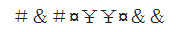
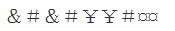
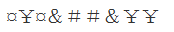
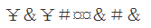
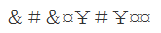

# 样式规律-相同符号的位置分布对应

考点：[[20-考点/判断推理/图形推理/样式规律-相同符号的位置分布对应|图形推理 / 样式规律-相同符号的位置分布对应]]

**问法模型**：题干给出一段符号序列，问哪一选项与题干规律一致 → 不看符号含义，提取'每种相同符号出现的位置编号'作为指纹，与选项逐一比对

## 推理链
1. 第1步：题干为9位符号序列：# & # ¤ ¥ ¥ ¤ & &（第4位符号记为¤），共出现#、&、¤、¥四种符号
2. 第2步：按官方解析归纳位置组——位置1、3符号相同（#）；位置2、8、9符号相同（&）；位置4、7符号相同（¤）；位置5、6符号相同（¥）
3. 第3步：将'位置2与位置8、9为同一符号'作为最具区分度的检验点，逐项扫描A、B、C、D四个选项
4. 第4步：A、C、D三项中位置2与位置8、9的符号不同，违反该位置组，排除
5. 第5步：B项各相同符号出现的位置分布与题干完全一致，当选B

**最快解法**：⚡ 排除法＋位置标记法：只抓题干中'&'占位最多（位置2、8、9）这一最显眼特征，先扫四个选项的位置2与位置8、9是否同号，一步排除A、C、D，无需逐一比对全部9位

## 易错点
- ⚠ 逐位硬比对9个符号费时易错，未优先抓'重复次数最多的符号（&占3位）'这一区分度最高的检验点
- ⚠ 只看符号形状相似而忽略'相同符号位置组'的整体结构，误选形状接近但位置规律不符的选项
- ⚠ 数错符号位置，把9位序列的位置编号标错（如把位置2、8、9看漏一位）

## 母题抽象
> 🧩 当题干给出一串符号/字符/图形组成的序列并要求选出'规律一致'的选项时，先标注每种相同元素出现的位置编号，用'相同元素位置组'作指纹去匹配选项，优先用重复次数最多的元素做排除

**同类特征**：一维符号序列排布、问'与题干规律一致'的一项、相同符号位置对应、9位序列含4种符号、只看位置关系不看符号含义

## 相关题
（暂无）

---

### 题干

### 选项
- A. 

- B. 

　✅
- C. 

- D. 

### 官方解析
分析题干符号间关系。
从相同符号的位置入手：位置1、3符号相同；位置2、8、9符号相同；位置4、7符号相同；位置5、6符号相同。
A、C、D三项中位置2与位置8、9符号不同，排除；只有B选项相同符号的位置和题干保持一致。
故正确答案为B。

### 给定材料
（无）
