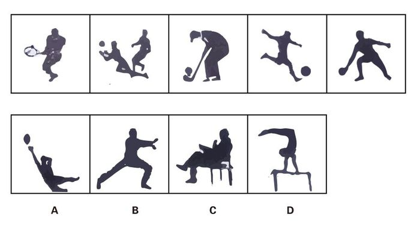

# 图形推理-实际意义（最大共同点：球类运动+黑色小球元素）

考点：[[20-考点/判断推理/图形推理/图形推理-实际意义（最大共同点：球类运动+黑色小球元素）|图形推理 / 图形推理-实际意义（最大共同点：球类运动+黑色小球元素）]]

**问法模型**：题干五个图呈现规律性，从四个图中选第六个图保持规律 → 对图形的实际意义归纳'最大共同点'，再按共同元素逐项排除

## 推理链
1. 第1步：观察题干五图的实际意义：打网球、打排球、打高尔夫、踢足球、打乒乓球，均为'人进行球类运动'的人物剪影
2. 第2步：寻找最大共同点：每幅图中人伴有一个黑色实心小球（网球、排球、高尔夫球、足球、乒乓球），这是贯穿五图的显性共同元素
3. 第3步：逐项对照：A项为人在接/掷黑色小球的球类运动场景，含黑色小球；B项为武术动作，无球；C项为坐姿场景，无球；D项为鞍马体操，无球
4. 第4步：只有A项同时满足'人物+球类运动+黑色小球'的题干规律，故选A

**最快解法**：⚡ 实际意义+共同元素法：先认定五图都是球类运动场景，再抓住'黑色小球'这一最显眼细节，一眼排除无小球的B、C、D，锁定A

## 易错点
- ⚠ 只看'人物剪影'这一粗略主体，忽略'黑色小球'这一关键细节，导致B、C、D无法区分
- ⚠ 习惯性套用数量、封闭区域、对称等常规图形规律，忽略本题考查图形的实际意义
- ⚠ A项动作似'鱼跃接球/掷球'，可能误判为非球类运动而排除正确答案

## 母题抽象
> 🧩 当题干图形为人物剪影且呈现具体活动场景时，走'实际意义+最大共同元素'路线：找出每幅图都包含的显性小元素（如黑色小球），用该元素对选项做排除验证

**同类特征**：人物剪影图形、球类运动场景、黑色小球元素、考查图形实际意义、最大共同点法、排除法定值

## 相关题
- [[10-真题/判断推理/图形推理/1791630 图形规律-内容属性归纳（人物剪影的生活语义归类：运动场景）|1791630]]（江苏 2016，相关度1）

---

### 题干

在题干中给出一套图形，其中有五个图，这五个图呈现一定的规律性。在给出的另一套图形中，有四个图，从中选出唯一的一项作为保持上边五个图规律性的第六个图。

### 选项
- A. A　✅
- B. B
- C. C
- D. D

### 官方解析
本题考查图形的实际意义，寻找最大共同点。题干一组图都是人在做不同的球类运动，都存在黑色小球。选项中只有A项具有黑色小球。
故正确答案为A。

### 给定材料
（无）
