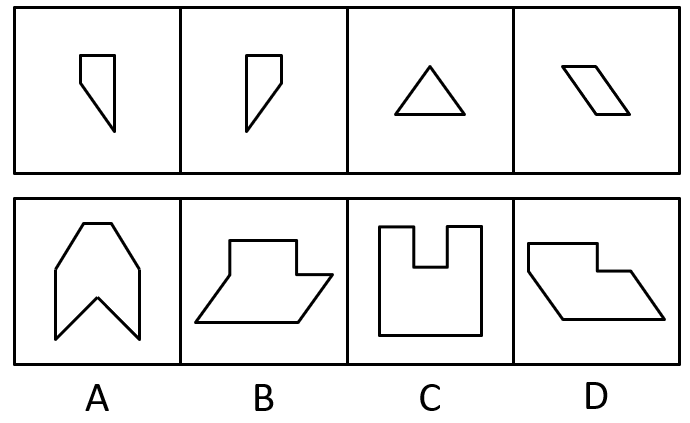
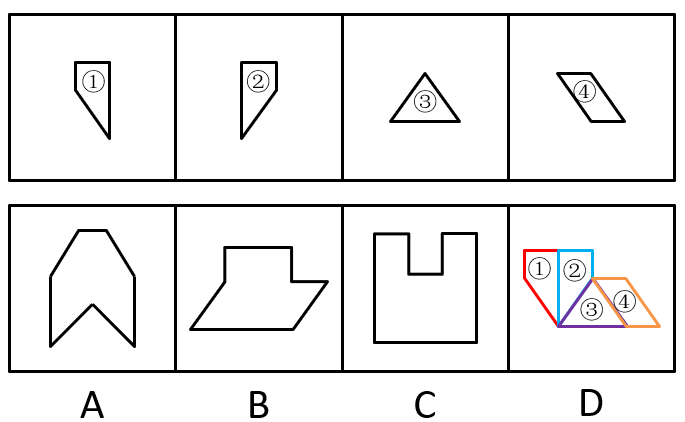

# 图形推理-平面拼合（平行等长相消）

考点：[[20-考点/判断推理/图形推理/图形推理-平面拼合（平行等长相消）|图形推理 / 图形推理-平面拼合（平行等长相消）]]

**问法模型**：四个子图形只能平移拼合为一个 → 用平行等长相消法拼合子图形，剩余外围轮廓与选项逐一比对

## 推理链
1. 第1步：提取四个子图形特征——图1、图2为互为镜像的靴形四边形（各含水平顶边、竖直边、斜边），图3为平底三角形（两条斜腰），图4为平行四边形（上、下水平边，左、右斜边）
2. 第2步：采用平行等长相消法——以面积较大的平行四边形为基准图形，寻找平行且等长的边两两对齐拼合，拼合后内部公共线段抵消
3. 第3步：将图1与图2的斜边分别与三角形的两条斜腰拼合，两条竖直边相对抵消，在中部形成向下凹陷的台阶，两靴形的水平顶边保留为顶部两级水平轮廓
4. 第4步：将平行四边形补在右下方，其斜边与底边未被抵消，保留为整体外围的斜向轮廓和底部水平边
5. 第5步：内部边全部抵消后，外围轮廓为：顶部两级水平边+中部下沉台阶、左右斜边、底部水平边
6. 第6步：逐项对照——A为左右对称的燕尾凹形，与子图形斜边方向及台阶结构不符；B与D形似但台阶位置/斜边倾斜方向不同，只有D的斜边方向与只能平移（不可旋转）条件下保留的外围斜边一致；C全由横竖边组成，无法消去子图形中的斜边；故选D

**最快解法**：⚡ 平行等长相消法+斜边方向守恒排除：先以大块平行四边形为基准拼合斜边，竖直边相对抵消形成台阶；再用'只能平移→斜边方向不变'快速排除无斜边的C和斜向/台阶不符的A、B，锁定D

## 易错点
- ⚠ 忽略'只能上、下、左、右平移、不能旋转'，把镜像的靴形当作可旋转拼合，导致斜边方向判断错误而误选B
- ⚠ B与D轮廓高度相似，只看大致形状不核对台阶位置与左右斜边倾斜方向，二级辨析缺位
- ⚠ 不熟悉平行等长相消，试图用面积估算或随意拼凑，把子图形斜边全部抵消后误选全横竖轮廓的C

## 母题抽象
> 🧩 当题干出现'多个图形只能平移拼合为一个'的特征时，用平行等长相消法：以面积较大图形为基准，找平行且等长的边两两拼合抵消，剩余外围轮廓再与选项逐一比对（牢记斜边方向守恒）

**同类特征**：四个子图形拼合为一个、只能上、下、左、右平移、子图形含斜边（靴形四边形、三角形、平行四边形）、选项轮廓含台阶/凹口、平面拼合类图形推理、平行等长相消

## 相关题
- [[10-真题/判断推理/图形推理/1789606 图形推理-平面拼合（平行等长相消）|1789606]]（江苏 2016，相关度3）
- [[10-真题/判断推理/图形推理/2042112 图形推理-平面拼合（平行等长相消）|2042112]]（江苏 2017，相关度3）
- [[10-真题/判断推理/图形推理/2042712 图形推理-平面拼合（平行等长相消）|2042712]]（江苏 2017，相关度2）
- [[10-真题/判断推理/图形推理/10975247 图形推理-平面拼合（平行且等长相消法）|10975247]]（江苏 2024，相关度1）
- [[10-真题/判断推理/图形推理/16095258 图形推理-平面拼合（平行且等长相消）|16095258]]（江苏 2024，相关度1）

---

### 题干

选项的四个图形中，只有一个是由题干中的四个图形拼合（只能上、下、左、右平移）而成的，请把它找出来。

### 选项
- A. A
- B. B
- C. C
- D. D　✅

### 官方解析

本题考查的是平面拼合，可以采用平行等长相消的方法（找到相对面积较大的图形为基准图形，找到平行且等长的边进行拼合，拼合之后等长线条抵消）。如下图所示：

故正确答案为D。

### 给定材料
（无）
