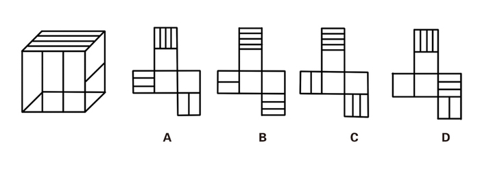
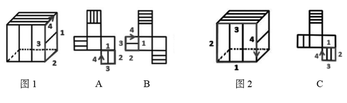

# 空间重构-六面体折叠（画边法-顺时针画边定位相邻面）

考点：[[20-考点/判断推理/图形推理/空间重构-六面体折叠（画边法-顺时针画边定位相邻面）|图形推理 / 空间重构-六面体折叠（画边法/顺时针画边定位相邻面）]]

**问法模型**：'四个展开图中只有一个是左侧立体图的展开图'→画边法：以带线面上线段端点所邻空白面的棱为边1顺时针给四条棱编号，比对'第4条边所邻的面'与立体图是否一致

## 推理链
1. 第1步：读左侧立体图，可见三个带线面——顶面四条平行线（四线面）、正面两条竖线（二线面）、右面一条线（一线面），隐藏面中含一个三线面和两个空白面
2. 第2步：定方法——画边法：一线面中的线段与两条边有交点，取与空白面相交的棱记为边1，从边1起顺时针给该面四条棱编号1~4
3. 第3步：一线面检验：立体图中边4对应三线面；A、B项按同一规则在展开图上画边，边4均对应空白面，与题干不一致，排除
4. 第4步：二线面检验：二线面中的两条线段与两条边有交点，取与空白面相交的棱记为边1顺时针画边，立体图中边4对应一线面
5. 第5步：C项按同法画边，边4对应空白面而非一线面，与题干不一致，排除
6. 第6步：D项经一线面、二线面两次画边检验均与立体图一致，当选

**最快解法**：⚡ 画边法（顺时针画边）：先取特征最清晰的一线面，以线段端点所邻空白面的棱为边1顺时针编号，比较边4所邻面——排A、B；再用二线面同法画边，边4应邻一线面——排C，锁定D

## 易错点
- ⚠ 只辨'相邻/相对面'不够精细，四个选项外轮廓与面排布相似，必须精确到'第4条边邻哪个面'这一级
- ⚠ 画边起点选错：必须以'线段端点所在且与空白面相交'的那条棱为边1，起点一换编号整体错位
- ⚠ 在展开图上画边时须把该面视为正对自己再顺时针编号，视角翻转易把顺/逆时针弄反
- ⚠ 忽略立体图中不可见的三线面，误以为边4应邻空白面而错选

## 母题抽象
> 🧩 当六面体各面靠'平行线条数'区分且存在空白面时，用画边法：以线段端点所邻空白面的棱为边1顺时针编号，用'边4所邻面'在立体图与展开图中是否一致逐一排除选项

**同类特征**：六面体折叠唯一展开图问法、面特征为平行线条数（一/二/三/四线面）、存在空白面可作画边锚点、线段端点与棱相交的位置是唯一辨别信息、四个选项外轮廓一致、相邻面需精确到棱的方位

## 相关题
（暂无）

---

### 题干

右边四个图形中，只有一个是左侧图形的展开图，请把它找出来。

### 选项
- A. A
- B. B
- C. C
- D. D　✅

### 官方解析

一线面中的线段与两条边有交点，如图1所示，与空白面交于边1。在立体图形与展开图中，以边1为唯一边顺时针画边。 

A项：边4对应空白面，题干中边4对应三线面，与题干不一致，排除。 

B项：边4对应空白面，题干中边4对应三线面，与题干不一致，排除。 

二线面中的线段与两条边有交点，如图2所示，与空白面交于边1。在立体图形与展开图中，以边1为唯一边顺时针画边。 

C项：边4对应空白面，题干中边4对应一线面，与题干不一致，排除。 

D项：与题干一致，当选。

故正确答案为D。

### 给定材料
（无）
