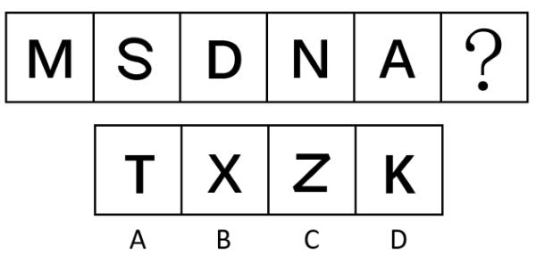

# 属性规律-对称性（只轴对称与只中心对称奇偶项交替）

考点：[[20-考点/判断推理/图形推理/属性规律-对称性（只轴对称与只中心对称奇偶项交替）|图形推理 / 属性规律-对称性（只轴对称与只中心对称奇偶项交替）]]

**问法模型**：问号处填入最合适图形使之呈现规律性 → 元素组成不同时优先看属性规律，按奇偶项分类对称性并排除双对称干扰项

## 推理链
1. 第1步：题干图形依次为字母M、S、D、N、A，元素组成不同，优先考虑属性规律，且均为规整大写字母，锁定对称性考点
2. 第2步：逐字判断对称类型——M（竖直对称轴）、D（水平对称轴）、A（竖直对称轴）均只有对称轴无对称中心，属'只轴对称'；S、N旋转180°后与自身重合但无对称轴，属'只中心对称'
3. 第3步：归纳位置规律——奇数位第1、3、5幅（M、D、A）为只轴对称，偶数位第2、4幅（S、N）为只中心对称，呈奇偶交替
4. 第4步：问号处为第6幅（偶数位），应选择'只中心对称'的图形
5. 第5步：逐项对照——A项T只轴对称（竖轴）、B项X既轴对称又中心对称（双对称）、C项Z旋转180°重合且无对称轴（只中心对称）、D项K只轴对称（横轴），仅C项符合

**最快解法**：⚡ 对称分类法+奇偶交替口诀：先标出M、D、A为'轴'，S、N为'中'，发现轴、中交替→问号找'只中心对称'；直接排T、K（只轴对称）和X（轴+中双对称），秒选Z

## 易错点
- ⚠ 误选B项X：X是'轴对称+中心对称'双对称图形，不满足'只中心对称'的限定，属于典型双对称陷阱项
- ⚠ 字母对称性误判：Z容易被误认为有对称轴（实际Z无对称轴，仅中心对称），S易被误认为轴对称（实际S无对称轴，仅中心对称）
- ⚠ 忽略奇偶交替：若只找'全组统一对称规律'会因M与S对称类型不同而卡壳，需意识到分组交替规律

## 母题抽象
> 🧩 当题干出现'规整字母/规整图形且元素组成不同'时，先按对称性把图形分成'只轴对称/只中心对称/双对称'三类，再检验奇偶项是否交替，问号处按其所在位置对应类别选择，并警惕双对称干扰项

**同类特征**：规整大写字母序列、元素组成不同、六格顺推问号在末位、奇偶项对称类型交替、轴对称与中心对称混合、含双对称干扰项X

## 相关题
- [[10-真题/判断推理/图形推理/10204454 数量规律-部分数（黑白球连通区域数做和）|10204454]]（甘肃 2024，相关度1）
- [[10-真题/判断推理/图形推理/10204604 数量规律-线数量（汉字横线数）|10204604]]（辽宁 2024，相关度1）
- [[10-真题/判断推理/图形推理/10297050 数量规律-特殊计数（线条穿过小白球的数量）|10297050]]（天津 2025，相关度1）
- [[10-真题/判断推理/图形推理/10297127 图形间关系-相交图形中不相交边数量（黑白图形相交）|10297127]]（天津 2025，相关度1）
- [[10-真题/判断推理/图形推理/10297148 数量规律-线的细化（端点连线穿过线条数；备选：平行线组数）|10297148]]（天津 2025，相关度1）

---

### 题干

从所给的四个选项中，选择最合适的一个填入问号处，使之呈现一定的规律性。

### 选项
- A. A
- B. B
- C. C　✅
- D. D

### 官方解析
元素组成不同，优先考虑属性规律。观察发现，题干已知图形均为规整的字母，考虑对称性。题干第一、三、五幅图均为只轴对称的图形，第二、四幅图均为只中心对称的图形，因此问号处应选择一个只中心对称的图形，只有C项符合。
故正确答案为C。

### 给定材料
（无）
