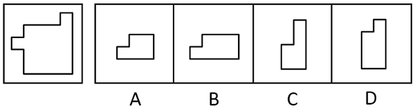
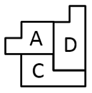

# 平面拼合（平行且等长相消）

考点：[[20-考点/判断推理/图形推理/平面拼合（平行且等长相消）|图形推理 / 平面拼合（平行且等长相消）]]

**问法模型**：'大图恰好可分割为某三个小图（可平移旋转不可翻转），找出不属于的'→选非型平面拼合题，用平行且等长相消法验证哪三个能拼出原轮廓，拼不出的即为答案

## 推理链
1. 第1步：题干为选非题，要求找出'不属于分割所得'的图形；题干轮廓特征为主体矩形、左侧面中部带一小凸台、右上角带一窄高凸起，允许平移旋转但不允许翻转
2. 第2步：依据平面拼合的'平行且等长相消'规则——两块图形拼接处若边线平行且长度相等，则该边作为内部公共边互相抵消，消完后剩余外轮廓应与题干大图一致
3. 第3步：取A项（左低右高台阶形）、D项（底部左侧带台阶的竖长形），并将C项旋转，使三者相邻边两两平行且等长后贴边拼合
4. 第4步：消去A、D与旋转后C之间所有平行且等长的内部线段，剩余外轮廓逐边吻合题干'左侧凸台＋右上窄高凸起'的形状，证明A、C、D三块恰为分割所得
5. 第5步：B项与A项外形相似但长宽比例不同，其边长无法与C、D满足'平行且等长'的相消条件，拼不出题干轮廓，故B不属于分割所得

**最快解法**：⚡ 平行且等长相消法：将A、D与旋转后的C两两贴边拼合，消去平行且等长的内部公共边，剩余轮廓=题干图形，验证成功；无法参与相消拼合的B即为'不属于'的一项

## 易错点
- ⚠ A与B、C与D为'同形不同比例'的高仿干扰项，凭肉眼直觉易误判，必须逐边核对长度做平行等长相消
- ⚠ 忽视'可旋转不可翻转'条件：C需旋转后才能拼入，若只按原始方向比对会误认为C拼不进
- ⚠ 选非题思维定势：按惯性选'能拼出'的一项而误选A/C/D，漏看'不属于'三个字

## 母题抽象
> 🧩 当题干出现'大图可分割为几个小图（可平移旋转不可翻转），选不属于/可拼入的一项'时，用平行且等长相消法：小图两两贴边拼合，消去平行且等长的公共边，剩余轮廓与题干一致者可拼入；对同形不同比例的干扰项必须核对边长而非只看形状

**同类特征**：平面拼合、选非题（找出不属于）、可平移旋转不可翻转、外形相似仅比例不同的成对干扰项、平行且等长相消、轮廓逐边吻合

## 相关题
- [[10-真题/判断推理/图形推理/17058547 平面拼合（平行且等长相消）|17058547]]（选调 2023，相关度4）
- [[10-真题/判断推理/图形推理/1791636 平面拼合（平行且等长相消）|1791636]]（江苏 2016，相关度4）
- [[10-真题/判断推理/图形推理/1791816 平面拼合（平行且等长相消）|1791816]]（江苏 2016，相关度4）
- [[10-真题/判断推理/图形推理/5755701 平面拼合（平行且等长相消）|5755701]]（江苏 2023，相关度4）
- [[10-真题/判断推理/图形推理/4651713 平面拼合（平行且等长相消）|4651713]]（江苏 2022，相关度3）

---

### 题干

左边图形恰好可以分割为右边的某三个图形（可以平移、旋转，但不能翻转），请找出不属于分割所得的图形。

### 选项
- A. A
- B. B　✅
- C. C
- D. D

### 官方解析

本题考查平面拼合，可采用平行且等长相消的方式解题。A项、D项与旋转后的C项消去平行且等长的线段后进行组合，可得到题干轮廓图，平行且等长相消的方式如下图所示。

本题为选非题，故正确答案为B。

### 给定材料
（无）
