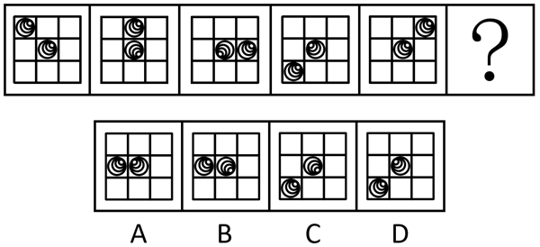

# 位置规律（内外圈分开看：外圈平移步数递增+内圈旋转）

考点：[[20-考点/判断推理/图形推理/位置规律（内外圈分开看：外圈平移步数递增+内圈旋转）|图形推理 / 位置规律（内外圈分开看：外圈平移步数递增+内圈旋转）]]

**问法模型**：问号处填入最合适图形使之呈现规律性 → 元素组成相同，套用位置规律模型：九宫格内外圈分开追踪移动与旋转

## 推理链
1. 第1步：五幅已知图均由相同的螺旋小元素构成，仅位置/朝向变化 → 元素组成相同，优先考虑位置规律
2. 第2步：将每幅图的九宫格拆成外圈（周围8格）和内圈（中心格），分别追踪各自的变化规律
3. 第3步：外圈螺旋从图1左上角出发，图2在上中、图3在右中、图4在左下角、图5在右上角，沿外圈8格环依次顺时针移动1、2、3、4格
4. 第4步：依此外推，问号处外圈螺旋应从图5右上角顺时针移动5格，落到左中格，据此排除C、D
5. 第5步：内圈中心螺旋每次顺时针旋转90°，图5中心螺旋再旋转90°后的开口朝向需与剩余选项逐一比对
6. 第6步：A项外圈位置虽在左中，但中心螺旋旋转后的朝向不符；B项外圈位置与中心螺旋旋转方向均吻合，故选B

**最快解法**：⚡ 内外圈分开追踪法：外圈沿8格环顺时针数步（步数依次为1、2、3、4、5，等差递增）先排C、D，再用中心螺旋顺时针旋转90°定A、B

## 易错点
- ⚠ 忽略内外圈要分开看，把外圈平移和内圈旋转混在一起找规律，导致规律'看似无序'
- ⚠ 外圈移动步数是1~5格等差递增，误以为每次固定移动相同格数而数错落点
- ⚠ 只验证外圈落点就选A，漏验中心螺旋的旋转方向（手性/开口朝向）

## 母题抽象
> 🧩 当题干出现'相同元素在九宫格或环状结构中变位'的特征时，用内外圈分开追踪法：外圈沿8格环数移动步数（注意步数可能等差递增），内圈用旋转/翻转方向做二级验证

**同类特征**：元素组成相同、九宫格布局、内外圈分开变化、移动步数递增、中心图形旋转

## 相关题
- [[10-真题/判断推理/图形推理/2172768 位置规律（旋转-翻转）|2172768]]（海南 2021，相关度1）
- [[10-真题/判断推理/图形推理/10204458 位置规律-平移（特征交点沿内圈循环平移）|10204458]]（甘肃 2024，相关度1）
- [[10-真题/判断推理/图形推理/10204614 图形推理-位置规律（旋转+翻转交替循环）|10204614]]（黑龙江 2024，相关度1）
- [[10-真题/判断推理/图形推理/10297399 位置规律—平移（多黑块分组循环平移）|10297399]]（四川 2025，相关度1）
- [[10-真题/判断推理/图形推理/11226892 位置规律-九宫格小元素沿固定循环链移动|11226892]]（上海 2025，相关度1）

---

### 题干

从所给的四个选项中，选择最合适的一个填入问号处，使之呈现一定的规律性。

### 选项
- A. A
- B. B　✅
- C. C
- D. D

### 官方解析

元素组成相同，优先考虑位置规律。观察发现，题干已知图形均可看作九宫格，考虑内、外圈分开看。从第一幅图到第五幅图，外圈的依次顺时针移动1、2、3、4格，故从第五幅图到问号处图形，外圈的应顺时针移动5格，排除C、D两项；内部的依次顺时针旋转90°，只有B项符合。

故正确答案为B。

### 给定材料
（无）
